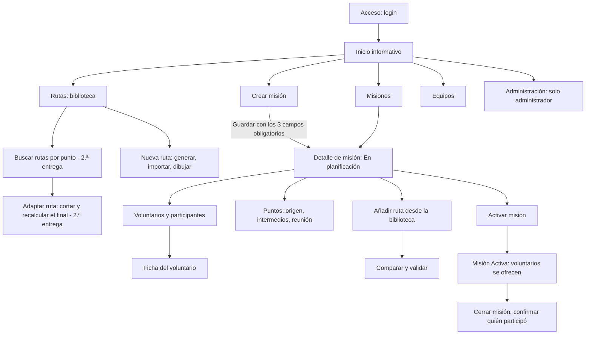
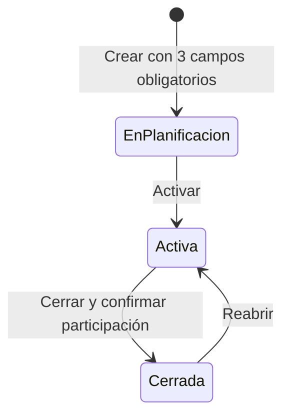
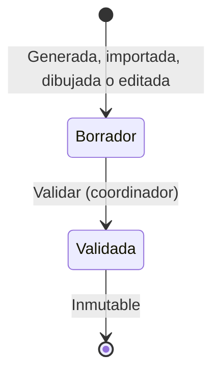
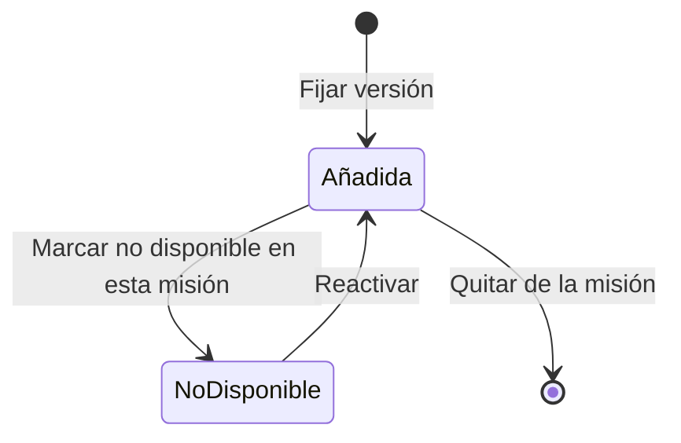
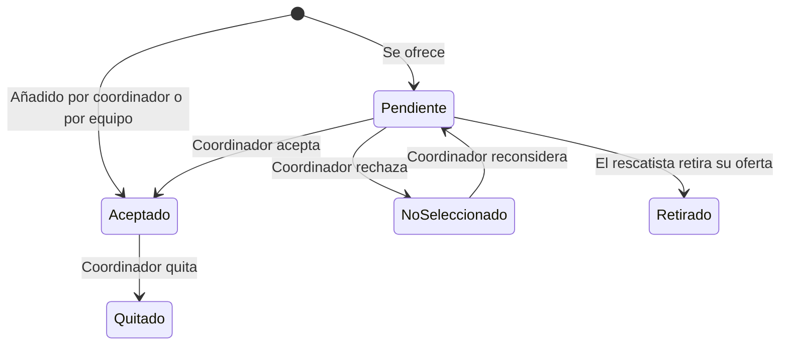
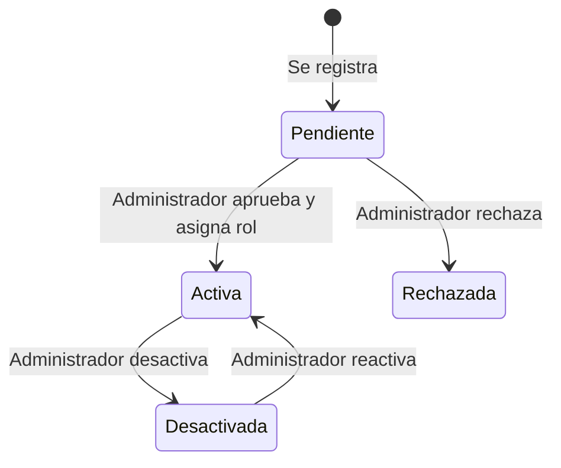
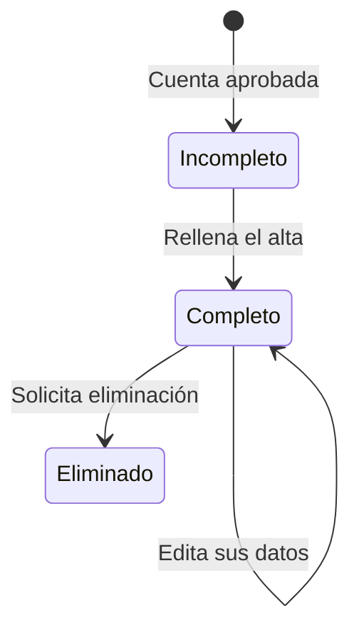

# OnWay — Documento 02: Flujo del coordinador y estructura de vistas

Versión: 0.8 (borrador) · Fecha: 2026-11-01 · Depende de: documento 01 (v1.2)

Este documento define cómo recorre la app un coordinador, qué vistas existen, qué contiene cada una y qué puede hacer cada rol en ellas. Los IDs RF, RN, D y Q remiten al documento 01. Los elementos marcados *(propuesto)* no los has definido tú y están pendientes de confirmar. Lo marcado **segunda entrega** va en la segunda fase de v1 (D-21).

Los **15 bocetos de baja fidelidad** acompañan a este documento (lienzo aparte). La sección 13 indica qué boceto corresponde a cada vista.

---

## 1. Flujo principal del coordinador

Principios de diseño:
- **La misión se crea en segundos** con lo mínimo y se completa desde su propio detalle (D-10). Nada de lo opcional bloquea el guardado ni el avance.
- **Las rutas no pertenecen a la misión.** Se crean y se guardan en la biblioteca, y la misión las añade (D-14). Lo que se trabaja una vez se reutiliza.
- **Lo que ve el rescatista nunca cambia solo.** La misión fija una versión de cada ruta (D-19).
- **Los datos personales se enseñan lo justo.** Las listas muestran lo mínimo; los datos de contacto están en la ficha; los datos sensibles no salen de la ficha propia ni de la administración (D-22, D-24, D-28).
- **El historial es lo que el coordinador confirma al cerrar**, no lo que se acepta al abrir (D-27).

## 2. Navegación

Barra de navegación principal, visible en todas las vistas tras el login.

| Enlace | Administrador | Coordinador | Rescatista |
|---|---|---|---|
| Inicio | Sí | Sí | Sí (versión reducida) |
| Misiones | Sí | Sí | Sí (solo activas y cerradas) |
| Crear misión | No (Q-14) | Sí | No |
| Rutas (biblioteca) | Sí *(propuesto)* | Sí | No (Q-17) |
| Equipos | Sí *(propuesto)* | Sí *(propuesto)* | No |
| Administración | Sí | No | No |
| Mi perfil | No aplica | No aplica | Sí |
| Cuenta (idioma, cerrar sesión) | Sí | Sí | Sí |

El administrador no tiene «Crear misión» porque no escribe misiones (Q-14 resuelta: no, 2026-10-31); ve Misiones y el detalle en solo lectura. Rutas aparece como enlace porque la biblioteca es independiente de las misiones. Equipos, porque la lista de equipos "ya formados" tiene que gestionarse en algún sitio (Q-12). Mi perfil, porque el rescatista mantiene sus datos, habilidades e historial. Administración, porque alguien tiene que aprobar cuentas y custodiar los datos sensibles (D-25).

En el boceto del rescatista (14) la barra tiene solo Misiones y Mi perfil.

## 3. Vistas

### 3.1 Acceso: login, registro y espera

Boceto 1. Una sola pantalla de entrada con tres estados.

**Login**
- **Campos:** correo, contraseña.
- **Acciones:** entrar, recuperar contraseña, ir a registrarse.
- **Errores:** credenciales incorrectas (mensaje genérico, sin revelar si el correo existe), cuenta desactivada, bloqueo temporal por intentos.
- **Resultado:** lleva a Inicio (RF-101). Si es un rescatista con el perfil incompleto, lleva antes al formulario de alta (3.9). Si la cuenta está pendiente, lleva a la pantalla de espera.
- Al iniciar sesión, el navegador pide permiso para leer la ubicación del dispositivo, que usa el Inicio (RF-708). Si se deniega, el acceso sigue con normalidad.

**Registro** (RF-104)
- **Campos:** correo, contraseña, repetir contraseña y **código de invitación de la organización** *(propuesto)*, que asocia la solicitud a su organización.
- El registro nunca concede el rol de coordinador (RN-25).
- Un correo ya registrado no revela de quién es.

**Espera de aprobación** (RF-106)
- Mensaje: "Tu solicitud está pendiente. Un administrador de tu organización debe aprobarla".
- La persona no ve nada más: ni misiones, ni datos de la organización.
- Solo puede cerrar sesión. Al aprobarse, el siguiente acceso lleva al formulario de alta.

### 3.2 Inicio

Boceto 3. Vista informativa. No se edita nada desde aquí (RF-701). El criterio es mostrar lo que un alpinista consultaría antes de salir, en una sola pantalla.

**Ubicación para el tiempo (RF-704, RF-708, D-30).** La meteorología, la luz y la luna se calculan por defecto para la **ubicación del dispositivo**, leída al iniciar sesión. El título de las tarjetas indica "📍 Mi ubicación". Si el coordinador pincha una de las **misiones activas** de la lista, las tarjetas cambian al **objetivo de esa misión** y el título lo indica. Un enlace "Volver a mi ubicación" restablece la posición del dispositivo.

| Bloque | Qué muestra | Prioridad |
|---|---|---|
| Misiones activas | Tarjetas **pinchables** con nombre, coordinador responsable, voluntarios por decidir, participantes aceptados y pendientes (rutas sin validar, sin origen). La tarjeta elegida queda resaltada | Should (RF-703) |
| Meteorología | Para la ubicación mostrada, calculada a la **altitud del punto**: temperatura, viento y rachas, precipitación y nieve, nubosidad, isoterma de 0 °C si hay dato. Resumen de los próximos días y detalle desplegable por hora | Should (RF-704) |
| Luz y luna | Amanecer, atardecer, crepúsculos, fase lunar con porcentaje de iluminación, salida y puesta de la luna, de la misma ubicación | Should (RF-705) |
| Boletines oficiales | Enlaces a la predicción de montaña de AEMET y Météo-France y, en temporada, a los boletines de aludes, según la zona mostrada | Could (RF-706) |
| Mapa | Posición del dispositivo y objetivos de las misiones activas, con la misión elegida resaltada | Could (RF-707) |
| Acceso rápido a Crear misión | Botón destacado (solo coordinador) | Must |

- **Por qué a la altitud del punto:** los modelos meteorológicos suavizan el relieve. Una previsión a nivel de valle puede errar varios grados en una cima (R-06). Es lo que distingue una previsión de montaña de una de ciudad.
- **Proveedores:** Open-Meteo como principal y Meteoblue como alternativa, ambos con planes gratuitos no comerciales (D-18). Los datos se guardan en caché por punto y altitud redondeados, por los cupos gratuitos (R-09).
- **La posición del dispositivo no se guarda** (RN-26). Solo se usa para esa consulta, redondeada (~1 km).
- **Sin permiso de ubicación o sin señal:** la tarjeta muestra "Activa la ubicación o elige una misión". Está pendiente decidir si se usa el punto base de la organización como alternativa (Q-32).
- **Sin misiones activas:** mensaje claro y botón para crear una misión. El tiempo sigue mostrándose para la ubicación del dispositivo.
- **Fallo del proveedor meteorológico:** la tarjeta muestra "no disponible" o el último dato con su hora, y el resto del inicio sigue funcionando.
- **Rescatista:** versión reducida con las misiones activas, aquellas en las que se ha ofrecido (con su estado) y la misma meteorología, luz y luna, con la misma regla de ubicación (boceto 14).

### 3.3 Misiones

Boceto 4. Lista de misiones de la organización (RF-204), con **pestañas por estado**.

| Pestaña | Contenido | Quién la ve |
|---|---|---|
| En planificación | Misiones en preparación | Coordinadores y administrador *(propuesto, Q-16)* |
| Activas | Misiones en curso | Todos |
| Cerradas | Histórico | Todos |

- **Cada elemento:** nombre, coordinador responsable, objetivo (coordenadas o lugar), orígenes, rutas (validadas / añadidas), participantes y voluntarios pendientes, fecha de creación.
- **Acciones:** abrir la misión, buscar por nombre, crear misión (atajo).
- **Estado vacío:** "No hay misiones" en la pestaña, con botón para crear.
- **Rescatista:** solo ve *Activas* y *Cerradas*, sin atajo de crear, con un indicador del estado de su oferta ("Pendiente", "Aceptado", "No seleccionado").

### 3.4 Crear misión

Boceto 5. Formulario en una sola página, con el mapa visible al lado para elegir puntos (RF-201). Una **barra inferior fija** con **Cancelar** y un botón grande **Crear misión**, siempre visible.

**Sección 1 · Datos obligatorios**

| Campo | Notas |
|---|---|
| Nombre de la misión | Texto de 3 a 120 caracteres. Debe ser único entre las misiones no cerradas de la organización *(propuesto)* |
| Coordinador responsable | Selector con los coordinadores de la organización. Por defecto, el usuario actual |
| Punto objetivo | Tres formas de entrada (RF-401): coordenadas, clic en el mapa o dirección. La altitud se obtiene automáticamente |

El botón **Crear misión** se activa cuando las tres cosas son válidas.

**Sección 2 · Opcional (se puede añadir después)**

| Campo | Notas |
|---|---|
| Descripción o notas *(propuesto)* | Texto libre |
| Equipos | Selección múltiple de equipos activos. Se muestra su localidad |
| Rescatistas individuales | Selección múltiple de rescatistas de la organización con el perfil completo. Entran como aceptados (RF-804) |
| Puntos de origen | Cero o varios. Cada uno con nombre, nota y ubicación (tres formas de entrada) |
| Rutas | Se eligen de la biblioteca. Con la búsqueda por punto, una vez fijado el objetivo se mostrarán primero las **rutas existentes cercanas** (**segunda entrega**, RF-514) |

- **Validaciones del objetivo:** coordenadas dentro de rango (latitud entre -90 y 90, longitud entre -180 y 180). Si la dirección es ambigua se muestran candidatos. Si la dirección resuelve a otro país, se muestra el país para evitar confusiones en zona fronteriza.
- **Búsqueda de dirección:** se lanza al pulsar el botón de buscar, no mientras se escribe (documento 04, límites del servicio de geocodificación).
- **Al guardar:** la misión se crea *En planificación* y el usuario llega al detalle de la misión.
- **Crear rutas nuevas no está en el formulario.** Se hace desde la biblioteca o desde el detalle de la misión. Es un proceso con progreso y con resultados que hay que revisar y validar.

### 3.5 Detalle de misión (centro de trabajo)

Boceto 6. Vista central (RF-205). Todo lo que se añade después de crear la misión se hace desde aquí.

**Cabecera:** nombre, estado, coordinador responsable, coordenadas y lugar del objetivo. Acciones: editar datos, duplicar, **Activar misión** (si está en planificación), **Cerrar misión** (si está activa), **Reabrir** (si está cerrada).

**Lista de preparación** (no bloquea nada):
- Objetivo definido: se marca solo.
- Puntos de origen añadidos.
- Equipos o voluntarios aceptados.
- Al menos una ruta validada añadida.

Cada elemento pendiente enlaza a la acción que lo resuelve.

**Secciones** (pestañas o bloques):

| Sección | Contenido | Acciones del coordinador |
|---|---|---|
| Mapa | Objetivo, orígenes, puntos intermedios, puntos de reunión, rutas añadidas | Cambiar capa (satélite, topográfica, carreteras), mostrar u ocultar rutas |
| Voluntarios y participantes | Lista de rescatistas ofrecidos y aceptados (ver 3.7) | Aceptar, rechazar, quitar, añadir, asignar equipos |
| Puntos | Orígenes, intermedios obligatorios, puntos de reunión | Añadir, editar, borrar, importar desde GPX o KML |
| Rutas de la misión | Tabla comparativa y rutas en el mapa: versión fijada, estado de validación, origen, equipo asignado, métricas, disponibilidad | **Añadir ruta**, cambiar versión, marcar no disponible, quitar de la misión, exportar |
| Historial | Registro de cambios (RN-05) | Solo lectura |

**Rescatista:** ve las secciones Mapa, Puntos y Rutas de la misión en solo lectura, y solo las versiones validadas (RN-03). No ve Voluntarios y participantes (RF-602). Tiene el botón **Me ofrezco como voluntario** o **Retirar mi oferta** (RF-605) mientras la misión esté activa. Si su perfil está incompleto, el botón lo lleva a completarlo (RN-20). Boceto 14.

### 3.6 Rutas (biblioteca)

Boceto 9. Vista nueva (RF-512). Es el fondo permanente de rutas de la organización. Sigue el modelo de **Wikiloc**: pantalla partida con la **lista a la izquierda y un mapa grande a la derecha**.

**Lista (izquierda)**
- Tarjetas con casilla de selección, nombre, estado de la última versión (Borrador, Validada, Archivada), distancia, desnivel, altitud máxima, antigüedad de la validación y número de misiones donde se usa.
- La lista muestra las rutas del **área visible del mapa** y se actualiza al moverlo. Una opción permite buscar solo al pulsar "Buscar en esta zona".
- Pasar el ratón por una tarjeta resalta su trazado en el mapa, y al revés.
- Filtros: estado, distancia, desnivel, antigüedad de la validación y búsqueda por nombre o lugar. Etiquetas si se acepta Q-21. Orden y paginación.
- Acciones sobre la selección: **exportar** y archivar. Botones **Generar rutas**, **Dibujar ruta** e **Importar ruta**. La composición por tipo de vía (barra y texto) es real en lo generado o dibujado pegado a los caminos; en lo importado o dibujado en línea recta dice «sin clasificar».

**Mapa (derecha)**
- Capas satélite, topográfica y carreteras, conmutables.
- Botón de "mi posición".
- Trazados de las rutas de la lista, con el seleccionado resaltado.
- **Segunda entrega:** dibujar una zona y hacer clic en un punto para buscar las rutas que pasan cerca (RF-514).

**Nueva ruta** (tres vías)

*A) Generar* (RF-501, RF-507; vista `/routes/generate`)
1. El coordinador elige punto de inicio y punto final con las tres formas de entrada.
2. Opcionalmente, puntos intermedios obligatorios y **zonas a evitar**: una lista con casillas de las zonas de la organización (y de la misión, si viene de una), **Dibujar una zona** (toques en el mapa; al menos tres vértices; la tabla de coordenadas es la alternativa de teclado), motivo opcional y borrar. Las rutas no cruzan las zonas marcadas.
3. Elige el número de alternativas (1 a 4) y, si quiere, el nombre: se añade el número de la alternativa.
4. La app pide el cálculo (un trabajo en segundo plano) y muestra el progreso, sondeando cada 1,5 s. La interfaz no se bloquea.
5. Cada alternativa queda como una ruta nueva en *Borrador*, versión 1, con las métricas del servidor y su composición real. El resultado es una tabla comparable (distancia, subida, bajada, tipo de vía) con el enlace a cada ruta, el resaltado en el mapa y **Generar otras rutas**. El motor puede devolver menos alternativas de las pedidas si la red no ofrece más; nunca repite una.
6. Si no hay ruta posible, un mensaje lo indica y propone mover los puntos o quitar alguna zona. Mensajes propios para «fuera de la zona que cubre el motor» y «el motor no responde» (el resto de la aplicación sigue).

*B) Importar* (RF-510)
1. Seleccionar un archivo GPX o KML.
2. Vista previa sobre el mapa.
3. La app recalcula las métricas con su modelo de elevación (RN-10).
4. El coordinador pone nombre y guarda. Entra como *Borrador*.
5. Errores: archivo inválido, vacío o demasiado grande. No se guarda nada.

*C) Dibujar a mano* *(propuesto, Should)*
1. El coordinador marca puntos sobre el mapa (2 a 50 si quiere que se unan) y, con la casilla **«Unir los puntos siguiendo los caminos»** (activada de serie), pulsa **Calcular la ruta por los caminos**: el servidor los une en orden por la red y devuelve la línea, las métricas y la composición como vista previa (nada se guarda; si se mueve un punto, la vista previa se retira).
2. Se guarda como *Borrador*, marcada como modificada manualmente. Con la casilla desmarcada se guarda en línea recta y queda «sin clasificar». La edición posterior de vértices sigue siendo en línea recta.

**Buscar rutas por punto** (RF-514, **segunda entrega**)
1. El coordinador indica un punto (por defecto, el objetivo de la misión en la que está trabajando) o hace clic en el mapa.
2. Ajusta el radio. Por defecto se muestran primero las rutas que pasan dentro del radio y, debajo, las más cercanas.
3. Cada resultado muestra la **distancia de la ruta al punto** y marca en el mapa el lugar de la ruta más próximo.
4. Puede comparar varios resultados en el mapa y en la tabla de métricas, y añadirlos a la misión.
5. Sin resultados: "No hay rutas a menos de X km", con opción de ampliar el radio o crear una ruta nueva.

**Adaptar ruta** (RF-515, **segunda entrega**)
1. Desde un resultado o desde el detalle de una ruta: **Adaptar**.
2. El coordinador elige el punto de corte sobre la ruta (por defecto, el más cercano al nuevo objetivo) y el nuevo punto final.
3. La app conserva el tramo hasta el corte sin cambios y calcula solo el tramo restante.
4. El coordinador revisa y elige **Guardar como nueva versión** o **Guardar como nueva ruta** (con otro nombre). Esta segunda opción crea una ruta derivada (RF-517).

En la primera entrega, **Guardar como nueva ruta** también existe al editar una ruta a mano: es la derivación sin el cálculo automático del tramo final.

**Detalle de ruta** (boceto 10)
- Mapa, perfil de elevación y métricas de la versión seleccionada.
- Historial de versiones: fecha, autor, estado, notas. Se puede abrir cualquier versión anterior.
- "Deriva de": enlace a la ruta de origen, si existe.
- "Derivadas": rutas creadas a partir de esta.
- "Usada en": misiones (activas, en planificación, cerradas) y qué versión fija cada una.
- Acciones: editar (crea versión nueva), derivar, validar, archivar, exportar.
- Una ruta usada en alguna misión no se puede eliminar, solo archivar (RN-14).

### 3.7 Voluntarios y participantes (dentro de la misión)

Boceto 7. Vista pensada para decidir rápido y en bloque, **al estilo de una bandeja de correo** (RF-803).

**Disposición**
- Barra superior: casilla "seleccionar todos", contador ("12 seleccionados"), acciones en bloque, buscador y filtros.
- Cada fila: **casilla a la izquierda** y, a la derecha, **nombre, equipo y localidad del equipo**, más el estado y la fecha de la oferta (D-22).
- Un rescatista sin equipo aparece con "Sin equipo" y sin localidad. Si pertenece a varios, se muestran todos con su localidad.
- La lista no muestra ningún otro dato personal (RN-21).
- A la derecha de la lista, la **ficha** del rescatista seleccionado.

**Selección**
- Casilla de cabecera: selecciona todos los de la página. Al hacerlo aparece el aviso "Se han seleccionado los 25 de esta página. Seleccionar los 134 resultados", como en el correo.
- Quitar la selección con la misma casilla, o con "Ninguno".
- Seleccionar un rango con Mayús + clic *(propuesto)*.

**Acciones en bloque** (aparecen al seleccionar algo)

| Acción | Efecto | Confirmación |
|---|---|---|
| Aceptar | Pasa a Aceptado | No |
| Rechazar | Pasa a No seleccionado | No |
| Quitar | Elimina de la misión (aceptados o rechazados) | Sí, con número de afectados, y opción de deshacer *(propuesto)* |

**Filtros:** estado (Pendientes, Aceptados, No seleccionados), equipo, localidad del equipo, y búsqueda por nombre. Por defecto, la vista abre en *Pendientes*. Filtrar por habilidad llega en la segunda entrega (RF-811).

**Ficha del voluntario**

Al pulsar sobre un nombre, se abre la ficha en el panel lateral con:
- Nombre, equipo o equipos y su localidad.
- **Cursos y habilidades** (RF-808), cada curso con un enlace **"📎 abrir certificado"** si lo adjuntó (D-29). Cada apertura queda registrada *(propuesto, RN-24)*.
- **Teléfono y correo** (D-28). El coordinador los ve de quienes se ofrecieron o fueron añadidos a sus misiones *(propuesto, RN-23)*.
- Estado y fecha de la oferta en esta misión.
- **No muestra documento de identidad ni dirección, ni el historial de misiones** (RN-18, D-24). El pie de la ficha lo recuerda: "Aquí no aparecen documento ni dirección".

Desde la ficha se puede aceptar o rechazar a ese voluntario.

**Otras acciones**
- **Añadir equipo:** sus miembros entran como Aceptados *(propuesto)*.
- **Añadir rescatista:** el coordinador elige un rescatista de la organización y entra como Aceptado (RF-804).

**Estados vacíos**
- Sin voluntarios: "Nadie se ha ofrecido todavía". Si la misión está en planificación: "Los rescatistas podrán ofrecerse cuando actives la misión".
- Sin resultados con los filtros: "Ningún rescatista coincide", con enlace para limpiar filtros.

**Casos límite**
- El rescatista retira su oferta mientras el coordinador tiene la lista abierta: la fila desaparece al actualizar, y el coordinador ve un aviso si intentaba actuar sobre ella.
- Una acción en bloque sobre una selección de varias páginas se aplica sobre los resultados filtrados, no sobre toda la misión.
- La lista cargada en pantalla no puede quedar obsoleta sin avisar: se actualiza periódicamente o con un botón de refrescar.

### 3.8 Equipos

Boceto 12. Vista de gestión de equipos de la organización (RF-801).
- Lista de equipos: nombre, **localidad**, número de miembros, estado.
- Detalle: miembros (nombre), añadir y quitar, desactivar el equipo.
- Crear o editar un equipo pide nombre y localidad. La localidad es lo que se enseña en la lista de voluntarios.
- "Agrupación" y "equipo" son lo mismo (D-26): no hay un nivel más.
- Quién puede gestionarlos está pendiente (Q-12).

### 3.9 Alta y perfil del rescatista

Boceto 2 (alta) y boceto 15 (Mi perfil). Vista nueva (RF-806, RF-807, RF-808, RF-809). Es a la vez el **formulario de alta** y la pantalla **Mi perfil**.

**Alta (primer acceso)**

Cuando un rescatista accede por primera vez con la cuenta ya aprobada (D-25), debe completar este formulario antes de usar la app. Hasta entonces, el perfil está incompleto y no puede ofrecerse a misiones (RN-20). Un aviso lo recuerda.

| Bloque | Campos | Obligatorio | Notas |
|---|---|---|---|
| Datos personales | Nombre completo | Sí | |
| | Tipo de documento (DNI, NIE, pasaporte, otro) | Sí | *(propuesto)* para admitir rescatistas franceses |
| | Número de documento | Sí | Para DNI y NIE se valida el formato y la letra de control. Para el resto, formato libre |
| Contacto | Teléfono | Sí | Lo ven administrador y coordinadores (D-28) |
| | Correo electrónico | Sí | **Es el correo del inicio de sesión.** Viene relleno y no editable. No se pide dos veces |
| Dirección | Calle, número, piso | Calle y número sí | |
| | Código postal, localidad, provincia, país | Sí | |
| Cursos y habilidades | Lista de entradas (ver abajo) | No | Se puede completar después |

El formulario indica qué datos ve cada uno: "Teléfono y correo los ven el administrador y los coordinadores. Documento y dirección se guardan cifrados: los ves tú y el administrador".

**Cursos y habilidades** (RF-808)

Cada entrada tiene: nombre, tipo (curso o habilidad), entidad que lo expidió (opcional), fecha y caducidad (opcionales) *(propuesto)* y **certificado adjunto opcional**, en PDF o imagen (D-29). Ejemplos: primeros auxilios en montaña, técnico de rescate, conducción 4x4, manejo de dron. El rescatista añade, edita y elimina las suyas. Un curso sin certificado es declarativo y se muestra sin la marca "adjunto".

**Mi perfil (después del alta)** · boceto 15

Dos bloques de datos separados a propósito:
- **Datos de contacto** (obligatorios): nombre completo, teléfono y correo (el de acceso, no editable aquí; cambiarlo es cambiar la cuenta). Los ven administrador y coordinadores.
- **Datos sensibles**: documento de identidad y dirección. Solo el rescatista y el administrador. Se muestran enmascarados.

Secciones:
- **Cursos y habilidades**, con columna de certificado ("📎 adjunto" o "Adjuntar").
- **Mis equipos:** los que le ha asignado el coordinador, con su localidad. Solo lectura.
- **Historial de misiones:** solo lectura, generado a partir de las misiones en que el coordinador **confirmó su participación al cerrarlas** (RF-809, RN-19, D-27). Haber sido aceptado y luego desmarcado no cuenta.
- **Mis datos y privacidad:** descargar mis datos, solicitar la eliminación (el historial se conserva anonimizado, RN-22, RF-812) y consultar quién ha accedido a mis datos sensibles *(propuesto)*.

**Quién ve qué**

| Dato | El propio rescatista | Coordinador | Administrador |
|---|---|---|---|
| Nombre, equipo, localidad del equipo | Sí | Sí | Sí |
| Cursos y habilidades | Sí | Sí | Sí |
| Certificado de un curso | Sí | Sí, con registro de la apertura *(propuesto)* | Sí, con registro de la apertura *(propuesto)* |
| Teléfono y correo | Sí | Sí, de quienes se ofrecieron o fueron añadidos a sus misiones *(propuesto)* | Sí |
| Historial de misiones | Sí | **No** | Sí *(propuesto)* |
| Documento de identidad | Sí | **No** | Sí, con registro de cada consulta |
| Dirección completa | Sí | **No** | Sí, con registro de cada consulta |

**Errores y casos límite**
- Documento con formato o letra de control inválidos: mensaje claro, sin guardar.
- Documento ya registrado en la organización: el sistema lo detecta y lo rechaza sin revelar de quién es.
- El rescatista abandona el formulario a medias: queda como perfil incompleto y se le pide al volver.
- Certificado de tipo o tamaño no admitido: error claro, el curso no se guarda con el archivo.
- Cualquier dato sensible se muestra enmascarado por defecto (por ejemplo, el número de documento con los primeros dígitos ocultos) hasta que el propio usuario lo pide *(propuesto)*.

### 3.10 Administración

Boceto 13. Vista solo para el administrador de organización (RF-106, RF-813).

**Solicitudes de alta** (parte superior)
- Lista tipo bandeja con casilla, nombre, correo y fecha de la solicitud. No muestra equipo ni «datos completos»: el perfil se crea al aprobar y lo rellena la persona en su primer acceso (Q-34).
- Acciones en bloque: **aprobar** (eligiendo el rol: rescatista o coordinador) y **rechazar**.
- Hasta que se aprueba, la persona solo ve la pantalla de espera (3.1).

**Usuarios de la organización**
- Lista con nombre, rol, estado (activo, desactivado) y último acceso.
- Acciones: cambiar rol, desactivar y reactivar. Un administrador no puede quitarse a sí mismo el rol si es el último.
- Si se desactiva a un coordinador responsable de misiones, la app obliga a reasignarlas (RN-11).

**Datos sensibles y accesos**
- Desde un usuario, el administrador puede abrir sus datos sensibles (documento y dirección). Cada consulta queda registrada con quién, qué y cuándo (RF-810).
- Registro de accesos a datos sensibles y a certificados, con filtros por usuario y fecha *(propuesto)*.

**Código de invitación** *(propuesto)*: el administrador consulta y regenera el código que usan los rescatistas al registrarse.

El administrador no escribe misiones (Q-14 resuelta: no); las lee, sin acciones de escritura.

## 4. Subflujos desde el detalle de misión

### 4.1 Voluntariado

1. La misión se activa (4.5). Desde ese momento es visible para los rescatistas.
2. El rescatista, con el perfil completo, abre la misión y pulsa **Me ofrezco como voluntario**. Queda *Pendiente*.
3. El coordinador abre *Voluntarios y participantes*, filtra, selecciona y **acepta** o **rechaza** (3.7). Puede abrir la ficha de un voluntario para decidir.
4. El rescatista ve el cambio de estado dentro de la app. En v1 no hay notificaciones activas.
5. El rescatista puede retirar su oferta mientras la misión esté activa.
6. Al cerrar la misión, el coordinador confirma quién participó (4.5). Solo esos quedan en su historial.

### 4.2 Añadir punto de origen

1. En *Puntos*, **Añadir origen**.
2. Nombre, nota y ubicación con las tres formas de entrada.
3. Se guarda y aparece en el mapa. No genera rutas por sí solo.

### 4.3 Añadir una ruta a la misión

Boceto 11. Desde *Rutas de la misión*, **Añadir ruta** abre un diálogo con tres caminos:

**A) Elegir de la biblioteca**
1. Se abre el selector de la biblioteca. Con la búsqueda por punto (**segunda entrega**), las **sugerencias** de rutas que pasan cerca del objetivo aparecen arriba (RF-514).
2. El coordinador elige una o varias. Si una ruta tiene varias versiones, se propone la última validada.
3. Opcionalmente asigna cada una a un origen de la misión y a un equipo (RF-805).
4. La misión **fija la versión** elegida (D-19).

**B) Crear una ruta nueva para esta misión**
1. Generar, importar o dibujar (3.6), con los puntos rellenados con el objetivo y un origen de la misión. En el detalle de la misión, la sección **Generar rutas** abre la vista de generar con `?mission=` (objetivo fijo, selector de origen, aviso de que las rutas se añadirán).
2. Si la misión no tiene origen, el botón de generar está desactivado con una explicación y enlace a *Añadir origen* (RN-08). Una misión cerrada tampoco genera.
3. Al terminar, la ruta queda en la biblioteca y se añade a la misión con su versión 1 fijada. Si la misión se cierra mientras se calcula, las rutas quedan solo en la biblioteca.

**C) Adaptar una ruta cercana** (**segunda entrega**)
1. Desde las sugerencias, **Adaptar** (3.6).
2. Al guardar como nueva ruta o nueva versión, se añade a la misión.

Una versión en *Borrador* puede añadirse a la misión, pero el rescatista no la ve hasta que se valide.

### 4.4 Comparar y validar rutas

1. Tabla de rutas de la misión con distancia, desnivel positivo y negativo, altitud mínima y máxima, pendiente máxima, composición por tipo de vía, fecha de validación. Sin tiempo (D-03).
2. Selección de varias rutas para verlas superpuestas en el mapa, con el perfil de elevación.
3. **Validar** pide confirmación y muestra el aviso de que la ruta es una propuesta y no sustituye el criterio del equipo (RF-506).
4. Una versión validada pasa a ser visible para los rescatistas de esa misión, si está activa.
5. Si una ruta se vuelve inviable en esta misión, el coordinador la marca como *No disponible en esta misión* (RF-508). Los rescatistas la ven señalada, no desaparecida.
6. Si aparece una versión validada más reciente de una ruta ya añadida, la misión lo indica y el coordinador decide si actualiza (RF-518). **Nunca se actualiza sola.**
7. Si la validación tiene más de N días, la ruta aparece marcada como posiblemente desactualizada (RF-519).

### 4.5 Activar y cerrar misión

**Activar**
1. El coordinador pulsa **Activar misión**.
2. Si no hay ninguna ruta validada, la app avisa pero permite continuar *(propuesto)*.
3. La misión pasa a *Activa*, es visible para los rescatistas y se abre el voluntariado.

**Cerrar, confirmando la participación** (boceto 8, RF-208, D-27)
1. El coordinador pulsa **Cerrar misión**.
2. Se abre un diálogo: "¿Quién participó?". Lista los **rescatistas aceptados**, cada uno con una casilla y su equipo.
3. **Todos vienen marcados por defecto** *(propuesto)*, para que solo desmarque a quien no fue. Hay acciones "Marcar todos" y "Desmarcar todos", y un resumen en vivo ("3 de 4 han participado").
4. Un aviso explica el efecto: "Solo los marcados quedarán en su historial de misiones".
5. Al confirmar, la misión pasa a *Cerrada* y es de solo lectura para todos (RN-09).
6. Desaparece de *Activas* y se consulta en *Cerradas*.
7. El coordinador puede reabrirla como *Activa*. Al volver a cerrarla se confirma de nuevo la lista *(propuesto)*.
8. Cancelar el diálogo deja la misión *Activa*.

Si no hay ningún aceptado, el diálogo se salta y solo pide confirmar el cierre.

## 5. Ciclos de vida

**Misión**

**Versión de ruta**

Una versión validada no se edita. Para cambiarla se crea una versión nueva en *Borrador*, que a su vez se valida. La ruta puede archivarse cuando ya no se quiere usar.

**Ruta dentro de una misión**

**Participación de un rescatista en una misión**

Dentro de *Aceptado*, al cerrar la misión se guarda además si **participó** (casilla confirmada) o no. Es un dato aparte del estado y es el que alimenta el historial.

**Cuenta de usuario**

**Perfil de rescatista**

Un rescatista con perfil *Incompleto* no puede ofrecerse a misiones (RN-20). En *Eliminado* se borran sus datos personales y su historial queda anonimizado (RN-22).

## 6. Permisos por acción

| Acción | Administrador | Coordinador | Rescatista |
|---|---|---|---|
| Ver Inicio | Sí | Sí | Sí (reducido) |
| Ver misiones activas | Sí | Sí | Sí |
| Ver misiones en planificación | Sí | Sí | No *(propuesto, Q-16)* |
| Crear misión | No | Sí | No |
| Editar datos de misión | No | Sí (Q-10) | No |
| Activar, cerrar o reabrir misión | No | Sí | No |
| Confirmar la participación al cerrar | No | Sí | No |
| Añadir equipos y rescatistas | No | Sí | No |
| Ofrecerse o retirar su oferta | No aplica | No aplica | Sí, solo a sí mismo, solo en misiones activas, con el perfil completo |
| Aceptar, rechazar o quitar voluntarios | No | Sí | No |
| Ver lista de voluntarios y participantes | Sí | Sí | No |
| Ver ficha del voluntario (habilidades, teléfono, correo) | Sí | Sí, de quienes se ofrecieron o añadió a sus misiones *(propuesto)* | No |
| Abrir un certificado | Sí, con registro | Sí, con registro *(propuesto)* | Solo los propios |
| Ver el historial de misiones de un rescatista | Sí *(propuesto)* | **No** | Solo el propio |
| Ver documento de identidad y dirección de un rescatista | Sí, con registro | **No** | Solo los propios |
| Editar el propio perfil, habilidades y datos | No aplica | No aplica | Sí |
| Solicitar la eliminación de los propios datos | No aplica | No aplica | Sí |
| Añadir puntos | No | Sí | No |
| Ver la biblioteca de rutas | Sí | Sí | No (Q-17) |
| Generar, importar, dibujar, adaptar y editar rutas | No | Sí | No |
| Validar versiones de ruta | No | Sí | No |
| Añadir, quitar o cambiar la versión de una ruta en una misión | No | Sí | No |
| Marcar una ruta no disponible en una misión | No | Sí | No |
| Ver rutas o versiones en borrador | Sí | Sí | No |
| Ver rutas validadas de una misión activa | Sí | Sí | Sí |
| Exportar rutas | Sí | Sí | Sí, solo validadas de misiones activas |
| Ver misiones cerradas | Sí | Sí | Sí |
| Gestionar equipos | Sí *(propuesto, Q-12)* | Sí *(propuesto, Q-12)* | No |
| Aprobar o rechazar solicitudes de alta | Sí | No | No |
| Gestionar usuarios (rol, desactivar) | Sí | No | No |
| Ver el registro de accesos a datos sensibles | Sí | No | Solo los accesos a los propios *(propuesto)* |

Todas estas comprobaciones se aplican en el servidor (RF-103), no solo ocultando botones. Esto incluye los datos sensibles: la API de listados no los devuelve nunca (RN-21). Q-14 está resuelta (no): el administrador lee misiones y rutas, y solo gestiona usuarios y datos; no las escribe.

## 7. Flujo del rescatista (resumen)

Boceto 14. Se detallará en un documento posterior, pero el recorrido base es:

1. Registro con código de invitación → pantalla de espera → el administrador aprueba (3.1).
2. Primer acceso → **formulario de alta** (3.9).
3. Login → Inicio reducido, con meteorología, luz y luna de su ubicación o de la misión que elija.
4. Misiones activas → Detalle en solo lectura.
5. En la misión: ver mapa, puntos y rutas validadas con métricas.
6. **Me ofrezco como voluntario**, y consultar el estado de la oferta. Puede retirarla.
7. Exportar una ruta o todas las validadas.
8. En **Mi perfil**: mantener datos y habilidades (con certificados), consultar su historial de misiones.

## 8. Estados vacíos, errores y casos límite

| Situación | Comportamiento esperado |
|---|---|
| Misión sin origen | Generar rutas desde la misión desactivado, con mensaje que enlaza a Añadir origen. Se puede seguir añadiendo rutas de la biblioteca |
| Misión sin ninguna ruta validada | El rescatista ve el objetivo y los puntos, y "Sin rutas validadas todavía" |
| Biblioteca vacía | "Aún no hay rutas", con botones para crear o importar |
| Búsqueda por punto sin resultados (segunda entrega) | "No hay rutas a menos de X km". Opciones: ampliar radio, crear una ruta nueva |
| Aparece versión validada nueva de una ruta de la misión | Aviso en la misión. El coordinador decide si actualiza. Nada cambia solo |
| Ruta fijada en una misión se archiva | No se puede archivar mientras esté en una misión no cerrada. Se explica en qué misiones se usa |
| Se intenta eliminar una ruta usada | Solo se permite archivar (RN-14) |
| Validación antigua | Marca "posiblemente desactualizada". Sigue usable, pero visible |
| Objetivo en zona sin datos de caminos | El trabajo falla con «fuera de la zona que cubre el motor» (`OUTSIDE_COVERAGE`) y propone elegir puntos cerca de caminos de los Pirineos. Se puede importar o dibujar |
| Sin ruta posible entre dos puntos, o con las zonas a evitar | «No hay ninguna ruta posible» (`NO_ROUTE_POSSIBLE`); propone mover los puntos o quitar alguna zona |
| Motor de rutas caído | `ROUTING_UNAVAILABLE`: al pedir el cálculo no se crea ningún trabajo y se explica que el resto de la aplicación sigue; importar, dibujar en línea recta y la biblioteca funcionan |
| Dirección que resuelve en otro país | Se muestra el país y se pide confirmación |
| Coordinador responsable desactivado | La misión queda marcada como sin responsable y se obliga a reasignarla (RN-11) |
| Importación con archivo inválido o enorme | Error claro, no se guarda nada |
| Importación sin altitudes | Se recalculan con el modelo de elevación propio |
| Proveedor meteorológico caído o cupo agotado | Tarjeta "no disponible" o con el último dato guardado y su hora. El inicio sigue operativo |
| Ubicación del dispositivo denegada o sin señal | La tarjeta pide activarla o pinchar una misión. Pendiente decidir el punto base como alternativa (Q-32) |
| Sesión caducada | Redirección al login conservando la vista a la que se iba |
| Pérdida de conexión en v1 | Mensaje claro de que la app necesita conexión. El modo offline llega en v2 (D-05) |
| Misión cerrada | Todos los controles de edición, incluido ofrecerse, quedan desactivados |
| Dos coordinadores editan a la vez | Pendiente (Q-10). Las rutas versionadas reducen el riesgo: nadie pisa la versión de otro. Como mínimo, aviso de que la misión cambió |
| Rescatista retira su oferta con la lista del coordinador abierta | La fila desaparece al actualizar. Aviso si el coordinador intentaba actuar sobre ella |
| Rescatista con perfil incompleto intenta ofrecerse | Se le lleva a completar el alta y vuelve a la misión |
| Rescatista sin equipo en la lista de voluntarios | "Sin equipo", sin localidad |
| Equipo sin localidad | No se puede crear. La localidad es obligatoria |
| Cuenta pendiente intenta entrar a una vista | Solo ve la pantalla de espera |
| Registro con un código de invitación inválido | Error genérico, no se crea la solicitud |
| Cerrar una misión sin aceptados | El diálogo de participación se salta. Solo se confirma el cierre |
| Cancelar el diálogo de cierre | La misión sigue Activa y no cambia ninguna participación |
| Reabrir y volver a cerrar | Se pide de nuevo confirmar quién participó |
| Rescatista elimina sus datos teniendo misiones en su historial | Los datos personales se borran. En las misiones queda "Participante anónimo" |
| Un coordinador intenta abrir el documento, la dirección o el historial de un rescatista | No se muestra. No existen esos campos en su ficha, y la API los rechaza |
| Certificado con formato o tamaño no admitido | Error claro. El curso no se guarda con ese archivo |

## 9. Entidades implicadas

El detalle de las entidades, sus relaciones y sus reglas está en el documento 03 (modelo de dominio). Este documento solo comprueba que el flujo no pide nada que el modelo no pueda representar.

## 10. Trazabilidad con el documento 01

| Vista o flujo | Requisitos |
|---|---|
| Acceso, registro y espera | RF-101, RF-102, RF-103, RF-104, RF-106, RN-25 |
| Inicio | RF-701, RF-703, RF-704, RF-705, RF-706, RF-707, RF-708, RN-26 |
| Navegación | RF-702 |
| Misiones | RF-204, RF-601 |
| Crear misión | RF-201, RF-401, RF-402, RF-513, RF-514 (segunda entrega) |
| Detalle de misión | RF-205, RF-207, RF-602 |
| Voluntarios y participantes | RF-605, RF-802, RF-803, RF-804, RF-811 (segunda entrega), RN-21, RN-23 |
| Ficha del voluntario | RF-803, RF-808, RN-18, RN-23, RN-24 |
| Equipos | RF-801 |
| Alta y perfil del rescatista | RF-806, RF-807, RF-808, RF-809, RF-810, RF-812, RN-18 a RN-24 |
| Administración | RF-106, RF-810, RF-813, RN-11, RN-25 |
| Puntos | RF-402, RF-403, RF-404, RF-405 |
| Biblioteca de rutas | RF-501, RF-510, RF-511, RF-512, RF-516, RF-517; RF-514 y RF-515 en la segunda entrega |
| Rutas de la misión | RF-502, RF-503, RF-504, RF-506, RF-508, RF-513, RF-518, RF-519, RF-805 |
| Activar y cerrar misión | RF-202, RF-207, RF-208, RN-09, RN-19 |

## 11. Preguntas abiertas que afectan a este documento

Las preguntas están centralizadas en el documento 01, sección 9. Las que condicionan las vistas son:

- **Q-10** Si todos los coordinadores pueden editar una misión o solo el responsable.
- **Q-12** Quién gestiona los equipos.
- **Q-13** Prioridad del inicio y proveedor meteorológico.
- ~~**Q-14** Si el administrador también trabaja con misiones y rutas, o solo gestiona usuarios y datos.~~ **Resuelta (2026-10-31): no.** El administrador no escribe misiones.
- **Q-16** Visibilidad de las misiones en planificación para los rescatistas.
- **Q-17** Si los rescatistas pueden consultar la biblioteca.
- **Q-21** Etiquetas de rutas.
- **Q-31** Qué misiones ve el rescatista y qué avisos recibe.
- **Q-32** Alternativa si se deniega la ubicación del dispositivo.

Resueltas desde la v0.3: Q-22 (equipo y agrupación son lo mismo), Q-23 (registro con aprobación), Q-24 (visibilidad de datos) y Q-25 (participación confirmada al cerrar).

## 12. Registro de cambios

**0.8 (2026-11-01)**
- H3 (§3.6, §4.3, §8): «Generar rutas» (zonas a evitar, progreso, comparación con la composición real, generar desde la misión), dibujar a mano con la casilla de unir a los caminos, y los casos de misión sin origen, sin ruta posible, fuera de cobertura y motor caído.

**0.7 (2026-10-31)**
- H2 (§3.6): dibujar y editar a mano son líneas rectas, sin ajuste a caminos hasta H3; «Generar» no se muestra en H2; la composición por tipo de vía dice «sin clasificar»; la selección se conserva entre páginas y se exporta (GPX/KML) o se archiva; en pantalla estrecha, pestañas Lista y Mapa.

**0.6 (2026-10-31)**
- Q-14 resuelta (no): el administrador no escribe misiones. §2: sin «Crear misión» en su barra. §6: sus celdas «Q-14» pasan a «No». §3.2, §3.10 y §11 al día (H1-T6).

**0.5 (2026-10-29)**
- Solicitudes de alta (3.10): se retiran las columnas «Equipo indicado» y «Datos completos» del boceto 13 (Q-34).

**0.4 (2026-10-29)**
- El producto pasa a llamarse **OnWay**.
- Alineado con los 15 bocetos (nueva sección 13).
- Acceso con registro y pantalla de espera (3.1). Nueva vista de Administración (3.10) y columna Administrador en navegación y permisos.
- Inicio: meteorología, luz y luna de la ubicación del dispositivo o del objetivo de la misión elegida (3.2).
- Biblioteca de rutas con lista y mapa, como Wikiloc (3.6).
- Ficha del voluntario con teléfono, correo y acceso al certificado; sin historial (3.7).
- Alta y perfil: correo de contacto igual al de acceso, bloque de contacto separado de los sensibles, certificado opcional (3.9).
- Cierre de misión con confirmación de quién participó (4.5). Nuevo ciclo de vida de la cuenta.
- Crear misión con barra inferior fija. Búsqueda de dirección al pulsar.

**0.3 (2026-10-29)**
- Nueva vista de alta y perfil del rescatista, con datos personales, cursos y habilidades, historial y gestión de los propios datos.
- Nueva ficha del voluntario dentro de la lista, sin documento ni dirección.
- La lista de voluntarios muestra nombre, equipo y localidad del equipo. Los equipos llevan localidad.
- Búsqueda por punto, sugerencias y adaptación marcadas como segunda entrega.
- Nuevo ciclo de vida del perfil de rescatista. Permisos ampliados con datos sensibles.
- Mi perfil en la navegación del rescatista.

**0.2 (2026-10-29)**
- Misión con tres estados. Nueva vista Rutas (biblioteca). Rutas añadidas a la misión con versión fijada. Nueva vista de voluntarios con acciones en bloque. Inicio con meteorología, luz solar y fase lunar. Entidades movidas al documento 03.

**0.1 (2026-10-29)** Primera versión.

## 13. Correspondencia con los bocetos

| Boceto | Vista | Sección |
|---|---|---|
| 1 | Acceso, registro y espera | 3.1 |
| 2 | Alta de rescatista | 3.9 |
| 3 | Inicio | 3.2 |
| 4 | Misiones | 3.3 |
| 5 | Crear misión | 3.4 |
| 6 | Detalle de misión | 3.5 |
| 7 | Voluntarios y participantes | 3.7 |
| 8 | Cierre de misión | 4.5 |
| 9 | Rutas (biblioteca) | 3.6 |
| 10 | Detalle de ruta | 3.6 |
| 11 | Añadir ruta a la misión | 4.3 |
| 12 | Equipos | 3.8 |
| 13 | Administración | 3.10 |
| 14 | Vista del rescatista | 3.5, 3.2, 7 |
| 15 | Mi perfil | 3.9 |
