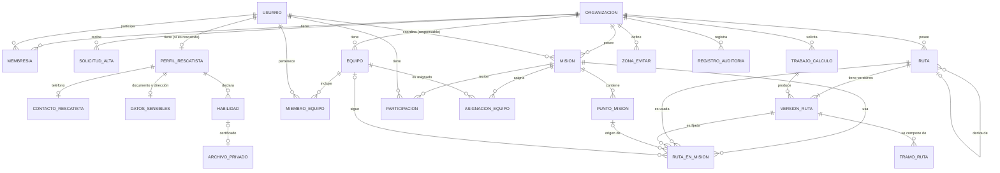
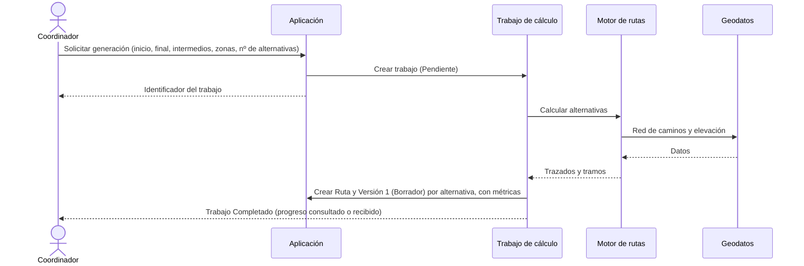

# OnWay — Documento 03: Modelo de dominio y flujos clave

Versión: 0.6 (borrador) · Fecha: 2026-10-31 · Depende de: documentos 01 (v0.7) y 02 (v0.5)

Este documento traduce los requisitos y las vistas en un modelo conceptual: qué cosas existen en el sistema, cómo se relacionan, qué reglas deben cumplirse siempre y cómo fluyen los datos en los procesos clave. No fija tecnologías ni tablas: la arquitectura está en el documento 04 y el modelo de datos será el documento 05. Los IDs RF, RN, D y Q remiten al documento 01.

---

## 1. Principios de modelado

1. **La organización es la raíz del aislamiento.** Todo dato de negocio pertenece a una organización y nada se comparte entre organizaciones (D-08, RN-17).
2. **Las rutas son un activo permanente; las misiones las usan.** Una ruta no depende de ninguna misión. La misión referencia una versión concreta de cada ruta (D-14, D-19).
3. **Lo validado es inmutable.** Una versión de ruta, una vez guardada, no se modifica. Cambiar es crear otra (RN-12). Así, lo que un equipo ve en el campo no cambia sin que alguien lo decida.
4. **La geometría es un dato de primera clase.** Posiciones, rutas y zonas se guardan como geometría con altitud, no como texto. Esto permite buscar rutas cercanas a un punto (D-15) con índices geográficos.
5. **Los cálculos pesados son asíncronos.** Generar o adaptar una ruta es un trabajo con estado y progreso, no una petición que bloquea la pantalla.
6. **Lo que el rescatista decide se registra como estado, no como borrado.** Ofrecerse, retirar, aceptar y rechazar dejan rastro (RN-05).
7. **Lo externo va detrás de una interfaz.** Mapas, elevación, geocodificación, meteorología y motor de rutas se pueden cambiar sin tocar el dominio (sección 9).
8. **El modelo no debe impedir lo que viene.** Offline (v2), campo a través (v2), seguimiento en vivo y notificaciones (v3) tienen su hueco previsto (sección 13).
9. **Los datos personales se separan y se minimizan.** Los datos de contacto, los sensibles y los profesionales se tratan por separado, y los sensibles viven en su propia entidad, con acceso restringido, y no viajan en listados ni en respuestas que no los necesiten (sección 11).
10. **Quién entra lo decide una persona.** Una cuenta nueva no accede a nada hasta que un administrador la aprueba y le da rol (D-25).
11. **Haber participado es una afirmación del coordinador, no un efecto automático.** Se confirma al cerrar la misión y solo eso alimenta el historial (D-27).

## 2. Módulos del dominio

Agrupación lógica de responsabilidades. Cómo se despliegan (un monolito modular, con API y worker como dos puntos de entrada del mismo código) está en el documento 04.

| Módulo | Responsabilidad | Depende de |
|---|---|---|
| **Identidad y organizaciones** | Organizaciones, código de invitación, usuarios, registro y aprobación de cuentas, membresías y roles, autenticación | — |
| **Perfiles de rescatista** | Alta, datos de contacto y sensibles, cursos y habilidades con certificado, historial de misiones, derechos sobre los datos | Identidad |
| **Equipos y participación** | Equipos con localidad, miembros, voluntariado, aceptación, confirmación de asistencia | Identidad, Perfiles |
| **Misiones** | Misión, puntos, estados, rutas añadidas a la misión, cierre | Identidad, Biblioteca de rutas, Equipos |
| **Biblioteca de rutas** | Rutas, versiones, derivación, validación, búsqueda espacial, importación y exportación | Identidad, Geodatos |
| **Planificación de rutas** | Trabajos de cálculo: generar y adaptar rutas | Biblioteca, Geodatos |
| **Geodatos** | Mapas, elevación, geocodificación, red de caminos | — (proveedores externos) |
| **Información ambiental** | Meteorología de montaña, sol y luna de un punto (ubicación del dispositivo u objetivo de misión) | Misiones (el objetivo) |
| **Archivos privados** | Certificados de cursos: almacenamiento, acceso con enlaces de corta duración | Perfiles |
| **Auditoría** | Registro de cambios y de accesos a datos sensibles y certificados | Todos |

Regla de dependencia: **Misiones conoce a Biblioteca de rutas, pero no al revés.** La biblioteca puede *consultar* en qué misiones se usa una ruta ("Usada en"), pero no depende de ellas para funcionar. Del mismo modo, **el historial de un rescatista se calcula a partir de la participación**: Perfiles consulta a Participación, no la modifica.

## 3. Modelo conceptual

Las relaciones centrales son:
- **Misión ↔ Ruta**, muchos a muchos, a través de `RUTA_EN_MISION`, que además fija la versión.
- **Ruta → Versión**, uno a muchos, con versiones inmutables.
- **Usuario → Perfil de rescatista**, uno a uno. Del perfil cuelgan, también uno a uno, el **contacto** (teléfono) y los **datos sensibles** (documento y dirección), cada uno en su propia entidad con su propia regla de acceso (INV-32).
- **Usuario ↔ Misión**, muchos a muchos, a través de `PARTICIPACION`. De ahí sale el historial, filtrando por asistencia confirmada.
- **Habilidad → Archivo privado**, opcional, para el certificado de un curso.

## 4. Entidades

Los atributos son conceptuales. Nombres, tipos y restricciones concretas se fijan en el documento 05.

### 4.1 Identidad y perfiles

| Entidad | Atributos clave | Notas |
|---|---|---|
| **Organización** | nombre, país, estado, **código de invitación** *(propuesto)* | Raíz del aislamiento. El código asocia un registro a su organización (D-25) |
| **Usuario** | correo (único, es el de acceso y el de contacto), nombre de visualización, idioma, **estado de cuenta (Pendiente, Activa, Rechazada, Desactivada)** | Datos de acceso. No contiene datos sensibles. El correo de contacto del rescatista es este mismo campo (D-28) |
| **Membresía** | usuario, organización, rol (coordinador, rescatista, administrador), estado | El rol vive aquí, no en el usuario. Se crea al aprobar la cuenta, con el rol que elige el administrador (RF-106). En v1 un usuario pertenece a una sola organización (RF-102), pero modelarlo así evita rehacer el modelo si cambia |
| **Solicitud de alta** | usuario, organización, fecha, estado (Pendiente, Aprobada, Rechazada), decidida por, fecha de decisión, rol concedido | Representa el registro a la espera de aprobación (RF-104, RF-106). Una cuenta *Pendiente* no tiene membresía activa |
| **Perfil de rescatista** | usuario, nombre completo, estado del perfil (Incompleto, Completo, Eliminado), fechas de alta y última modificación | Identidad profesional del rescatista dentro de la organización. Se crea *Incompleto* al aprobar la cuenta (RF-807). Es lo único del rescatista que ve cualquier miembro de la organización: nombre y equipo |
| **Contacto del rescatista** | perfil, **teléfono** | Entidad aparte, uno a uno con el perfil. El correo no está aquí: es el del usuario (INV-31). La leen el propio rescatista, el administrador y, con una participación pendiente o aceptada, el coordinador (INV-28) |
| **Datos sensibles del rescatista** | perfil, tipo de documento, número de documento, dirección completa (calle, número, piso, código postal, localidad, provincia, país), huella del documento | Entidad aparte, uno a uno con el perfil, **cifrada**. Para detectar duplicados sin exponer el documento se guarda una huella irreversible *(propuesto)*. Solo la leen el propio rescatista y, con registro de cada consulta, el administrador (INV-18, INV-19) |
| **Habilidad** | perfil, nombre, tipo (curso o habilidad), entidad que lo expidió, fecha, caducidad, **certificado (archivo privado, opcional)** | Cero o varias por perfil (RF-808). Entrada libre; no hay un catálogo cerrado *(propuesto)*. Un curso sin certificado es declarativo (D-29) |
| **Archivo privado** | propietario (el rescatista, que equivale a su perfil: es uno por usuario), tipo de contenido, tamaño, clave de almacenamiento, huella del contenido, fecha | Certificado de curso en PDF o imagen. No es público: se abre con un enlace firmado de corta duración (documento 04) |

### 4.2 Equipos

| Entidad | Atributos clave | Notas |
|---|---|---|
| **Equipo** | organización, nombre, **localidad**, estado | Grupo permanente de rescatistas. "Agrupación" y "equipo" son lo mismo (D-26). La localidad es obligatoria y es lo que se muestra en la lista de voluntarios (D-22) |
| **Miembro de equipo** | equipo, usuario | Un rescatista puede estar en varios equipos o en ninguno (RF-806) |

### 4.3 Misiones

| Entidad | Atributos clave | Notas |
|---|---|---|
| **Misión** | organización, nombre, descripción, coordinador responsable, estado (En planificación, Activa, Cerrada), objetivo (ubicación, altitud, procedencia del dato), fechas de creación, activación y cierre | El objetivo es obligatorio y único, por eso es atributo de la misión y no un punto más (RN-07) |
| **Punto de misión** | misión, tipo (origen, intermedio, reunión), nombre, nota, ubicación, altitud, orden | Cero o muchos por misión |
| **Asignación de equipo** | misión, equipo | Asignar un equipo crea participaciones aceptadas para sus miembros (RF-802) |
| **Participación** | misión, usuario, estado (Pendiente, Aceptado, No seleccionado, Retirado, Quitado), procedencia (voluntario, equipo, coordinador), fecha de oferta, decidido por, fecha de decisión, **participó (sin confirmar, sí, no), confirmado por, fecha de confirmación** | Única por misión y usuario. Representa a los voluntarios y participantes (RF-803). **El campo "participó" se fija al cerrar la misión y es la fuente del historial** (RF-208, RF-809, D-27) |
| **Zona a evitar** | organización, misión opcional, polígono, motivo | Dónde se guarda y quién la ve: Q-05 |

### 4.4 Rutas

| Entidad | Atributos clave | Notas |
|---|---|---|
| **Ruta** | organización, nombre, estado (Activa, Archivada), derivada de (ruta y versión), versión más reciente, versión validada más reciente, etiquetas (Q-21) | Es la identidad estable: "esta ruta" a lo largo del tiempo |
| **Versión de ruta** | ruta, número, estado (Borrador, Validada), geometría con altitud, métricas, procedencia, marca de modificada manualmente, parámetros de generación, trabajo de cálculo que la produjo, quién la creó y cuándo, quién la validó y cuándo, nota | **Inmutable una vez guardada** (RN-12). Métricas: distancia, desnivel positivo y negativo, altitud mínima y máxima, pendiente máxima |
| **Tramo de ruta** | versión, orden, geometría, tipo de vía (carretera, pista, sendero, sin camino o **sin clasificar**), distancia, desnivel | Hace posible la composición de la ruta (RF-503) y el campo a través en v2 |
| **Ruta en misión** | misión, ruta, **versión fijada**, origen de la misión opcional, equipo opcional, estado (Añadida, No disponible), nota, quién la añadió y cuándo | Única por misión y ruta (RF-513, RF-805, RF-508) |
| **Trabajo de cálculo** | organización, solicitado por, tipo (generar, adaptar), parámetros, estado (Pendiente, Calculando, Completado, Fallido), motivo del fallo, versiones producidas, fechas | Soporta el cálculo asíncrono (sección 8.2) |

**Tipo «sin clasificar» (H2):** una ruta importada, dibujada o editada a mano no pasa por el motor, así que no se sabe qué tipo de vía recorre: toda versión de H2 tiene un único tramo de tipo *sin clasificar*. La clasificación llega con el motor en H3.

**Procedencia de una versión:** generada, importada, dibujada, editada o adaptada. Para las importadas se conserva una referencia al archivo original, por trazabilidad (RF-510).

### 4.5 Transversales

| Entidad | Atributos clave | Notas |
|---|---|---|
| **Registro de auditoría** | organización, tipo de entidad, id, acción, usuario, fecha, detalle | Cubre RN-05. Incluye el acceso a datos sensibles (INV-19) y la apertura de certificados ajenos (INV-26) |
| **Pronóstico en caché** | proveedor, ubicación y altitud (redondeadas), datos, fecha de obtención, caduca en | No es dato de negocio: es una caché para limitar llamadas y respetar los cupos gratuitos (RF-704, R-09). La clave es un punto redondeado, no un usuario: **no relaciona la caché con quien consultó** (INV-30) |

Las fases de la luna y las horas de sol **no se guardan**: se calculan al momento a partir de la ubicación y la fecha (sección 9). La **ubicación del dispositivo tampoco se guarda**: el cliente la envía para la consulta y se descarta (RN-26).

**El historial de misiones no es una entidad.** Es una consulta sobre la participación (sección 8.9). Así no puede desincronizarse ni editarse a mano (RN-19, INV-21).

## 5. Versionado y derivación de rutas

Tu necesidad (D-16) mezcla dos cosas distintas y el modelo las representa por separado.

| | **Nueva versión** | **Ruta derivada** |
|---|---|---|
| Qué es | Otra edición de *la misma* ruta | Una ruta *nueva*, con vida propia |
| Nombre | El mismo | Uno nuevo |
| Cuándo | Corregir o mejorar la ruta tal como está | Aprovechar el principio de una ruta y cambiar el final para otro objetivo |
| Qué recuerda | La versión anterior | "Deriva de la ruta X, versión N" |
| Efecto en misiones que usan la original | Ninguno hasta que el coordinador actualice (D-19) | Ninguno: son rutas distintas |
| Qué se copia | Se parte de la geometría de la versión anterior | Se copia la parte conservada; el resto se calcula |

**Reglas**
- Una versión guardada nunca se modifica, ni siquiera por quien la creó (RN-12).
- Mientras se edita en pantalla, el trabajo vive en una copia de trabajo del cliente. Solo se guarda una versión al pulsar guardar. Así no se llena la historia de versiones intermedias.
- Una versión en *Borrador* que nunca se validó ni se usó en ninguna misión puede descartarse por quien la creó *(propuesto)*.
- Una versión validada no se borra. Si ya no se quiere usar, se archiva la ruta (RN-14).
- La versión validada más reciente de una ruta se guarda aparte de la versión más reciente, porque pueden ser distintas: puede haber un borrador más nuevo que la última versión validada.
- En la primera entrega, derivar significa copiar y editar (RF-517). El cálculo automático del tramo final llega con la adaptación en la segunda entrega (RF-515).

## 6. Ciclos de vida

Los diagramas de estados de misión, versión de ruta, ruta en misión, participación, cuenta y perfil están en el documento 02, sección 5. Aquí se fijan las reglas que los gobiernan.

**Cuenta de usuario**
- Nace *Pendiente* al registrarse con un código de invitación válido (RF-104). No tiene membresía y no accede a nada (RN-25).
- *Pendiente → Activa*: solo un administrador de la organización, que elige el rol. Se crea la membresía.
- *Pendiente → Rechazada*: solo un administrador.
- *Activa ⇄ Desactivada*: solo un administrador. Una cuenta desactivada no inicia sesión.
- El rol de coordinador **solo lo concede un administrador** (RN-25). El registro nunca lo concede.

**Misión**
- Nace *En planificación* con solo los tres campos obligatorios (RN-07).
- *En planificación → Activa*: solo un coordinador. Abre el voluntariado y hace visible la misión a los rescatistas.
- *Activa → Cerrada*: solo un coordinador, **confirmando antes la participación de cada aceptado** (RF-208). Congela todo, incluido el voluntariado (RN-09).
- *Cerrada → Activa*: reabrir. Solo un coordinador. Al volver a cerrar se confirma de nuevo la participación *(propuesto)*.
- No existe vuelta de *Activa* a *En planificación* en v1 *(propuesto)*: una misión que ya se vio no vuelve a ocultarse.

**Versión de ruta**
- *Borrador → Validada*: solo un coordinador, con confirmación. Registra quién y cuándo.
- *Validada* es terminal e inmutable.

**Ruta**
- *Activa ⇄ Archivada*. No se puede archivar una ruta que esté en una misión no cerrada *(propuesto)*.

**Participación**
- Ofrecerse crea *Pendiente* (solo en misiones activas y con el perfil completo, RN-15, RN-20).
- Solo un coordinador decide. Un rescatista no puede cambiar su propio estado salvo retirar su oferta mientras esté *Pendiente*.
- Asignar un equipo o añadir directamente crea *Aceptado*.
- El campo **participó** nace sin confirmar. Solo se fija al cerrar la misión y solo para participaciones *Aceptado* (INV-27).

**Perfil de rescatista**
- Nace *Incompleto* al aprobarse la cuenta de un rescatista.
- *Incompleto → Completo*: al rellenar los campos obligatorios del alta (nombre, teléfono, documento y dirección).
- *Completo → Eliminado*: a petición del propio rescatista. Se borran los datos personales y las referencias a él en misiones quedan anonimizadas (RN-22).

## 7. Reglas de dominio (invariantes)

Condiciones que el sistema debe garantizar siempre, independientemente de la interfaz. Son las que deben tener pruebas automáticas.

| ID | Invariante | Origen |
|---|---|---|
| INV-01 | Ninguna consulta ni escritura cruza organizaciones | RN-01, RN-17 |
| INV-02 | Una misión siempre tiene organización, coordinador responsable y objetivo | RN-07, RN-11 |
| INV-03 | El coordinador responsable pertenece a la organización de la misión y tiene rol de coordinador (nunca de administrador: Q-14 = no). Lo comprueba el servidor y también un disparador de la base | RN-11 |
| INV-04 | Una versión de ruta guardada no cambia | RN-12 |
| INV-05 | Solo una versión validada es visible para un rescatista, y solo la fijada por la misión | RN-03, RN-13 |
| INV-06 | Una ruta en una misión referencia una versión de esa misma ruta | RN-13 |
| INV-07 | Una ruta en alguna misión no cerrada no se elimina ni se archiva | RN-14 |
| INV-08 | Una misión *En planificación* no es visible ni accesible para un rescatista | RN-16 |
| INV-09 | Un rescatista solo puede crear su propia participación, solo en misiones activas | RN-02, RN-15 |
| INV-10 | Solo un coordinador cambia el estado de una participación pendiente | RN-15 |
| INV-11 | Una misión cerrada no admite ninguna escritura salvo reabrirla | RN-09 |
| INV-12 | La participación es única por misión y usuario | RF-803 |
| INV-13 | La ruta en misión es única por misión y ruta | RF-513 |
| INV-14 | Generar desde una misión exige objetivo y al menos un origen | RN-08 |
| INV-15 | Una versión importada recalcula sus métricas y nace en *Borrador* | RN-10 |
| INV-16 | Todo cambio en misiones, rutas y participación genera un registro de auditoría | RN-05 |
| INV-17 | Las unidades son metros y kilómetros, siempre | RN-04 |
| INV-18 | **El documento de identidad y la dirección** solo los puede leer el propio usuario y un administrador de su organización. Ningún listado ni respuesta de API de listado los devuelve. El coordinador nunca los lee | RN-18, RN-21 |
| INV-19 | Cada lectura de datos sensibles por un administrador genera un registro de auditoría | RF-810 |
| INV-20 | Una participación *Pendiente* solo se crea si el perfil del rescatista está *Completo* | RN-20 |
| INV-21 | El historial de misiones no se escribe: se calcula a partir de las participaciones con **participó = sí**, de misiones *Cerradas* | RN-19, D-27 |
| INV-22 | Eliminar los datos de un perfil borra los datos personales y anonimiza las referencias. Nunca borra participaciones | RN-22 |
| INV-23 | Un equipo siempre tiene nombre y localidad | RF-801 |
| INV-24 | El documento de identidad no puede repetirse dentro de una organización *(propuesto)* | RF-807 |
| INV-25 | Una cuenta *Pendiente*, *Rechazada* o *Desactivada* no accede a ningún dato de la organización. Solo una pantalla de espera o el cierre de sesión | RN-25 |
| INV-26 | Abrir un certificado que no es propio (coordinador o administrador) genera un registro de auditoría. El enlace de acceso caduca en minutos *(propuesto)* | RN-24 |
| INV-27 | "Participó" solo se fija al cerrar la misión y solo en participaciones *Aceptado*. Una participación no aceptada nunca consta como participada | RF-208, D-27 |
| INV-28 | Teléfono y correo de un rescatista solo los leen el propio rescatista, el administrador y un coordinador **con una participación de ese rescatista en una misión de su organización** *(propuesto)*. Nunca salen en listados | RN-23 |
| INV-29 | Solo un administrador asigna el rol de coordinador o de administrador | RN-25 |
| INV-30 | La ubicación del dispositivo no se guarda ni se asocia a un usuario. La caché meteorológica se indexa por punto redondeado | RN-26 |
| INV-31 | El campo de contacto "correo" de un rescatista es el correo de acceso: no existe un segundo correo editable por separado | D-28 |
| INV-32 | **Nombre, contacto y datos sensibles de un rescatista son tres entidades separadas**, cada una con su propia regla de acceso. Ninguna consulta puede traer contacto o sensibles «de paso» al leer el perfil | RN-18, RN-21, RN-23 |

## 8. Flujos clave

### 8.1 Crear y activar una misión

1. El coordinador envía nombre, coordinador responsable y objetivo. La altitud del objetivo se obtiene del servicio de elevación.
2. Se crea la misión *En planificación*. Se registra en auditoría.
3. El coordinador añade, en el orden que quiera: puntos de origen, equipos, rutas, rescatistas.
4. El coordinador pulsa activar. Si no hay rutas validadas, se avisa pero se permite.
5. La misión pasa a *Activa*. Desde ese momento los rescatistas la ven y pueden ofrecerse.

### 8.2 Generar rutas (cálculo asíncrono)

- El estado del trabajo (Pendiente, Calculando, Completado, Fallido) es consultable en cualquier momento. La interfaz muestra progreso sin bloquearse.
- Si no hay ruta posible, el trabajo termina como *Fallido* con un motivo comprensible: sin ruta por la red, punto fuera de cobertura, zona a evitar imposible de esquivar (RF-501).
- Cada alternativa produce una **ruta nueva** en la biblioteca, en *Borrador*, versión 1.
- Si el trabajo se lanzó desde una misión, las rutas creadas pueden añadirse a la misión al terminar.

### 8.3 Buscar rutas por punto (segunda entrega)

**Entrada:** un punto, un radio, y filtros (solo validadas, longitud, desnivel).

**Qué se consulta:** por defecto, la **versión validada más reciente** de cada ruta activa. Opcionalmente, también la más reciente aunque sea borrador.

**Salida**, por cada ruta encontrada:
- Distancia mínima en metros entre el punto y la ruta.
- El punto de la ruta más próximo.
- La posición de ese punto a lo largo de la ruta (de 0 a 1), necesaria para poder cortarla en la adaptación (8.4).

**Orden:**
1. Primero las que pasan dentro del radio, de menor a mayor distancia.
2. Después, las más cercanas fuera del radio, hasta un máximo razonable.

Es una consulta espacial pura sobre geometrías indexadas. Objetivo de rendimiento: menos de 2 s con 10.000 rutas. **El índice geográfico se crea desde la primera entrega**, aunque la funcionalidad llegue en la segunda: añadirlo después supondría una migración de datos.

La **biblioteca con lista y mapa** (RF-512) usa la misma idea con un rectángulo en vez de un punto: devuelve las rutas cuya geometría interseca el área visible del mapa. Es la primera consulta espacial de la primera entrega.

### 8.4 Adaptar una ruta (cortar y recalcular el final, segunda entrega)

1. El coordinador elige una ruta, una versión y un punto de corte (por defecto, el más cercano al nuevo objetivo, ver 8.3).
2. Se conserva el tramo desde el inicio hasta el corte, sin cambios.
3. Se crea un trabajo de cálculo (8.2) desde el corte hasta el nuevo punto final.
4. El trazado conservado y el calculado se unen, y se recalculan las métricas del conjunto.
5. El coordinador revisa y elige:
   - **Guardar como versión nueva** de la misma ruta: la ruta cambia.
   - **Guardar como ruta nueva** con otro nombre: nace una ruta derivada que recuerda de cuál procede (sección 5).
6. En ambos casos entra como *Borrador* y exige validación.

### 8.5 Añadir una ruta a una misión y mantenerla al día

1. El coordinador elige una ruta de la biblioteca. Se propone su versión validada más reciente.
2. Se crea la **ruta en misión**, fijando esa versión. Opcionalmente, origen y equipo.
3. Si la versión fijada es *Borrador*, el rescatista no la ve (INV-05).
4. Cuando se valida una versión más nueva de esa ruta, la misión lo detecta y lo indica (RF-518). **No se actualiza sola.**
5. Si el coordinador actualiza, cambia la versión fijada y se registra en auditoría.
6. Si una ruta se vuelve inviable, se marca *No disponible en esta misión* sin afectar a otras misiones.

### 8.6 Voluntariado con decisión en bloque

1. El rescatista, con el perfil completo (INV-20), se ofrece. Se crea la participación *Pendiente*.
2. El coordinador consulta la lista. **Cada fila contiene solo nombre, equipo, localidad del equipo, estado y fecha** (INV-18, RN-21).
3. Opcionalmente abre la ficha de un voluntario. La ficha añade **cursos y habilidades, teléfono y correo**, con acceso a los certificados (INV-28, 8.11). **No incluye documento, dirección ni historial** (INV-18, INV-21).
4. El coordinador filtra, selecciona y ejecuta una acción en bloque.
5. La acción se aplica **solo a las participaciones que sigan en el estado esperado**. Por ejemplo, aceptar solo afecta a las que siguen *Pendiente*. Si alguien retiró su oferta entretanto, se omite.
6. El resultado indica cuántas se aplicaron y cuántas se omitieron y por qué.
7. Cuando el coordinador selecciona "los N resultados" en varias páginas, la acción se aplica sobre el **conjunto filtrado**, no sobre cada página, y el servidor comprueba los permisos y los estados al ejecutarla.
8. Quitar en bloque es la única acción destructiva: pide confirmación con el número de afectados y ofrece deshacer.

### 8.7 Cerrar una misión confirmando la participación

1. El coordinador pulsa cerrar. La aplicación devuelve los rescatistas con participación *Aceptado*.
2. El coordinador marca o desmarca a cada uno (por defecto todos marcados *(propuesto)*) y confirma.
3. En una sola operación atómica:
   - Cada participación *Aceptado* recibe **participó = sí** o **no**, con quién lo confirmó y cuándo (INV-27).
   - La misión pasa a *Cerrada* y se congela: participaciones, rutas añadidas, puntos y datos (INV-11).
   - Se registra en auditoría la confirmación (número de marcados sobre el total).
4. Si la operación falla, no queda la misión cerrada a medias: o se confirma todo o nada.
5. Las rutas de la biblioteca **no cambian**: siguen disponibles para otras misiones.
6. Los participantes confirmados quedan reflejados en su historial (8.9). Los desmarcados no.
7. Se puede reabrir como *Activa*. Al reabrir, la confirmación anterior se conserva como valor inicial, y al volver a cerrar se confirma de nuevo *(propuesto)*.

### 8.8 Registro, aprobación y alta de un rescatista

**Registro y aprobación** (D-25)

1. La persona se registra con correo, contraseña y el código de invitación de la organización. Se crea el usuario con cuenta *Pendiente* y una solicitud de alta. Sin membresía.
2. Mientras esté pendiente solo ve la pantalla de espera (INV-25).
3. El administrador de la organización ve las solicitudes, **las aprueba o rechaza, también en bloque**, y al aprobar elige el rol.
4. Al aprobar: la cuenta pasa a *Activa*, se crea la membresía con el rol elegido y, si es rescatista, se crea el perfil *Incompleto*. Se registra en auditoría quién aprobó, con qué rol y cuándo.
5. Un registro con código inválido no crea nada y responde con un error genérico.

**Alta del perfil**

1. En el primer acceso tras ser aprobado, la app lleva al formulario de alta antes de cualquier otra vista (RF-101).
2. El rescatista rellena nombre completo, teléfono, documento de identidad y dirección. El correo viene del usuario y no se pide de nuevo (INV-31). Se validan formato y, para DNI y NIE, la letra de control.
3. Se calcula la huella del documento y se comprueba que no exista ya en la organización (INV-24).
4. Los datos sensibles se guardan cifrados. El perfil pasa a *Completo* y se registra en auditoría.
5. El rescatista puede añadir cursos y habilidades, con certificado opcional, en el alta o después (8.11).

### 8.9 Historial de misiones de un rescatista

El historial es una **consulta**, no un dato guardado.

- **Fuente:** las participaciones del rescatista con **participó = sí**, en misiones *Cerradas* (INV-21).
- **Salida por misión:** nombre, fechas de activación y cierre, equipo con el que participó.
- **Quién lo ve:** el propio rescatista y el administrador *(propuesto)*. **El coordinador no** (D-24).
- **Una misión reabierta** deja de aparecer hasta que se vuelva a cerrar y a confirmar.
- **Si se eliminan los datos del rescatista:** las filas siguen existiendo en las misiones, pero su nombre se sustituye por "Participante anónimo" (INV-22).

### 8.10 Eliminar los datos de un rescatista

1. El rescatista lo solicita desde *Mi perfil* y confirma.
2. Se borran su nombre completo, documento, huella, teléfono, dirección, habilidades y certificados (los archivos privados se eliminan del almacenamiento).
3. Su usuario se desactiva y su correo se anonimiza.
4. Las participaciones en misiones se conservan con la referencia anonimizada, incluido el campo "participó".
5. Se registra la eliminación en auditoría, sin guardar los datos eliminados.

### 8.11 Abrir un certificado de curso

1. El rescatista adjunta un archivo (PDF o imagen, tamaño limitado) al añadir un curso. Se valida el tipo real del contenido, no solo la extensión, y se guarda como archivo privado.
2. Un coordinador o un administrador, desde la ficha, pulsa abrir certificado.
3. El servidor comprueba que quien lo pide puede ver la ficha de ese rescatista (INV-28) y genera un **enlace firmado de corta duración** *(propuesto)*.
4. Si quien abre no es el propio rescatista, se registra en auditoría quién, qué certificado y cuándo (INV-26).
5. Si el rescatista elimina el curso o sus datos, el archivo se elimina.

### 8.12 Meteorología, luz y luna de un punto

1. El cliente envía un punto: la ubicación del dispositivo (leída al iniciar sesión) o el objetivo de la misión que el usuario eligió (RF-704, RF-708).
2. El servidor redondea el punto y obtiene la altitud, y busca en la caché meteorológica. Si no hay dato fresco, lo pide al proveedor y lo guarda.
3. Sol y luna se calculan en local para el punto y la fecha.
4. La respuesta incluye el pronóstico (con la hora de obtención y el proveedor), la luz y la luna.
5. **La ubicación del dispositivo no se guarda ni se asocia al usuario** (INV-30). Si el proveedor falla, se devuelve el último dato de la caché con su hora, o un aviso.

## 9. Datos externos y proveedores

Todo lo externo se usa a través de una interfaz propia, para poder sustituirlo (principio 7). La elección concreta y los límites verificados están en el documento 04.

| Capacidad | Qué necesita el dominio | Estado |
|---|---|---|
| **Motor de rutas** | Dados dos puntos, puntos intermedios y zonas a evitar, devolver varios trazados con tramos | Interfaz `RoutingProvider`. Candidatos y prueba técnica en el documento 04 |
| **Elevación** | Altitud de un punto y perfil de un trazado | Global como base, nacional de mayor resolución como mejora (documento 04) |
| **Teselas de mapa** | Capas satélite, topográfica y de carreteras | Mapa base propio y servicios abiertos de IGN (documento 04). Revisar licencias (R-04) |
| **Geocodificación** | Convertir una dirección en coordenadas y devolver candidatos | Búsqueda al pulsar, con caché y respetando los límites del servicio (documento 04) |
| **Meteorología de montaña** | Pronóstico en un punto **a su altitud**, para el inicio | Ver 9.1 |
| **Sol y luna** | Amanecer, atardecer, crepúsculos, fase y salida y puesta lunar | **Cálculo local**: no requiere proveedor ni conexión. Funcionará igual en el modo offline de v2. Se resuelve con una librería astronómica abierta (candidatas: SunCalc, Astronomy Engine) |
| **Almacenamiento de archivos privados** | Guardar certificados y entregarlos con enlaces firmados | Almacenamiento de objetos compatible con S3 o disco del servidor, con copias cifradas (documento 04) |

### 9.1 Meteorología: qué se ha comprobado y qué se decidió

**Criterio.** Se ha buscado la fuente que un alpinista experimentado consultaría, con la restricción de que se pueda mostrar dentro de nuestra pantalla de inicio. Al ser un proyecto didáctico (D-20), también cuentan el coste y los cupos gratuitos.

**Hallazgos**

| Fuente | Qué ofrece | Integrable en nuestro inicio | Condiciones |
|---|---|---|---|
| **Open-Meteo** | API abierta con modelos nacionales (incluye Météo-France y DWD). Acepta la altitud del punto como parámetro | Sí: API sencilla, sin clave en el uso gratuito | Gratis solo para uso **no comercial**, sin garantías de servicio (hasta 10.000 llamadas al día, ver documento 04). Para uso comercial hay planes de pago |
| **Meteoblue** | Pronóstico multimodelo en un punto. En foros de usuarios de Windy se señala que corrige por altitud (en una cima, otros modelos daban temperaturas muy distintas), y que solo está disponible como pronóstico puntual, no como mapa | Sí: API de datos, widgets e imágenes de meteograma | API gratuita solo para uso **no comercial**: registro, confirmación de uso no comercial, 5.000 llamadas válidas un año (unas 13 al día). Exige enlazar a Meteoblue y, en sistemas privados, una descripción del uso. Uso comercial: planes de pago |
| **Windy** | Mapas animados y varios modelos (incluye AROME, ICON, GFS, ECMWF) y capa de altitud de la isoterma de 0 °C. Pertenece ahora a la misma familia que Meteoblue | Sí: mapa embebible y API de pronóstico puntual | La versión gratuita solo ofrece el modelo GFS y pocas capas, con publicidad y logotipo obligatorio. La profesional cuesta 990 €/año |
| **AEMET (predicción de montaña)** | Boletín oficial por zona del Pirineo (aragonés, catalán, navarro), con temperaturas en puntos de altitud concreta (por ejemplo el Aneto a 3.404 m), altitud de las isotermas de 0 °C y −10 °C y viento a 1.500 y 3.000 m | Como enlace seguro. Si se quiere integrar, hay que comprobar si existe API para este producto | Reutilización autorizada citando a AEMET. Solo España. Boletines de aludes por temporada: la campaña del Pirineo navarro y aragonés cerró el 4 de mayo de 2026 |
| **Météo-France** | Datos abiertos con licencia abierta: modelos AROME (alta resolución), AROME-PI, ARPEGE, vigilancia y boletín de aludes | Parcial: es dato en bruto, requiere registro y token en su portal, y proceso propio | Licencia abierta (Etalab). Solo Francia en su cobertura de alta resolución |

**Decisión (D-18)**

- **Principal: Open-Meteo**, pidiendo el pronóstico a la altitud del punto. Es gratuito para uso no comercial, no exige clave y no tiene un cupo anual tan corto. Encaja con un proyecto de portfolio.
- **Alternativa: Meteoblue**, con su plan gratuito no comercial, como segundo proveedor detrás de la misma interfaz. Es útil para comparar y tiene fama de corregir bien la altitud en montaña, pero 5.000 llamadas al año dan poco margen: con tres misiones activas y un refresco cada seis horas se consumen unas 4.400.
- **Boletines oficiales de AEMET y Météo-France enlazados** (RF-706), como segunda mirada y como referencia en cada lado de la frontera.
- **Caché obligatoria:** un pronóstico por punto y altitud redondeados, con refresco cada varias horas (R-09). Con la ubicación del dispositivo como punto por defecto (D-30), el redondeo (~1 km) es lo que permite compartir caché entre usuarios cercanos.

**Dos cautelas**
1. La preferencia por Meteoblue en montaña se apoya en informes de usuarios y en cómo funcionan los modelos (suavizan el relieve), no en un estudio comparativo. Open-Meteo corrige por altitud, pero su calidad en cimas de los Pirineos no está comprobada. Antes de dar por buena la elección, hay una prueba sencilla: AEMET publica a diario temperaturas previstas en cimas concretas. Se comparan los candidatos con esos valores durante unas semanas.
2. Las condiciones de terceros cambian. Hay que releerlas antes de publicar la demo.

## 10. Multiorganización

- Toda entidad de negocio lleva su organización. Las consultas y escrituras se limitan a ella siempre, en el servidor (INV-01).
- Los identificadores que enlazan entidades deben pertenecer a la misma organización. Por ejemplo, una ruta en misión no puede enlazar una misión de una organización con una ruta de otra. Esto se garantiza también en base de datos, no solo en código (seguridad por filas, documento 04).
- Un usuario con membresía en una sola organización en v1 (RF-102). El modelo admite varias membresías por si cambia.
- El código de invitación identifica la organización en el registro. Sin código válido no hay solicitud.
- Superadministrador de plataforma: es el único rol que ve entre organizaciones, y solo para dar de alta y para soporte (Q-01). **No ve datos sensibles de rescatistas**: esos los custodia el administrador de cada organización.

## 11. Datos personales

El perfil de rescatista introduce datos que, en un entorno real, estarían sujetos a RGPD. Aunque el proyecto sea didáctico, el diseño los trata como si lo estuvieran, porque es la forma correcta de modelarlo y porque es lo que se espera ver en un portfolio.

**Clasificación**

| Nivel | Datos | Tratamiento |
|---|---|---|
| **Sensible** | Documento de identidad, dirección completa | Cifrado en reposo. Visible solo para el propio rescatista y el administrador de su organización. Cada lectura por el administrador queda registrada. Nunca en listados, exportaciones ni registros de la aplicación. El coordinador no los ve |
| **Contacto** | Teléfono y correo (el de acceso) | Obligatorios. Visibles para el propio rescatista, el administrador y los coordinadores, estos últimos solo de rescatistas ofrecidos o añadidos a sus misiones *(propuesto, D-28)*. Nunca en listados. Son datos personales: no se publican ni se exportan |
| **Identificativo** | Nombre completo | Visible para el propio rescatista, el administrador y los coordinadores. Se ve en las listas |
| **Profesional** | Cursos, habilidades, equipo y su localidad | Visible para los coordinadores y el administrador de la organización |
| **Documental** | Certificado de un curso (archivo) | Privado. Lo abre el propio rescatista, el administrador y los coordinadores. Cada apertura ajena queda registrada *(propuesto)*. Se entrega con un enlace firmado de corta duración |
| **Historial** | Misiones en que participó (confirmado al cerrar) | Visible para el propio rescatista y el administrador *(propuesto)*. No para el coordinador |
| **De acceso** | Contraseña (con hash), idioma | Solo para autenticación |
| **No se guarda** | Ubicación del dispositivo | Se usa una vez para consultar el tiempo y se descarta (D-30) |

**Principios aplicados**
- **Minimización:** solo se piden los datos que el producto usa. El teléfono es obligatorio porque sin él no se puede avisar a un voluntario aceptado.
- **Separación:** el contacto y los datos sensibles viven cada uno en su entidad, colgando del perfil, y no en el usuario ni en la participación. Así no viajan sin querer en consultas de misiones ni al leer el nombre de un rescatista.
- **Acceso por defecto cerrado:** las respuestas de API de listas se construyen con una lista explícita de campos permitidos, no excluyendo los sensibles. Hay una respuesta distinta para la ficha individual.
- **Derechos:** el rescatista puede ver, corregir y solicitar la eliminación de sus datos (RF-812, flujo 8.10), y consultar quién ha accedido a sus datos sensibles.
- **Datos de demostración:** en cualquier entorno de pruebas o demostración, los datos son ficticios. Nunca se publican datos reales (R-10).

**Lo que este documento no resuelve:** plazos de conservación, base legal del tratamiento y registro de actividades. Serían obligatorios con datos reales. Se dejan fuera mientras el proyecto sea didáctico, y conviene dejarlo escrito en el README.

## 12. Auditoría y eventos

Cada hecho relevante se registra y, además, se emite como evento interno. Hoy sirve para auditar (RN-05). En v3 servirá para notificaciones sin cambiar el modelo.

| Evento | Quién lo origina |
|---|---|
| Misión creada, activada, cerrada, reabierta | Coordinador |
| Participación confirmada al cerrar (marcados sobre el total) | Coordinador |
| Coordinador responsable cambiado | Coordinador |
| Punto añadido, editado o eliminado | Coordinador |
| Ruta creada, derivada o archivada | Coordinador |
| Versión de ruta creada | Coordinador o sistema (cálculo) |
| Versión de ruta validada | Coordinador |
| Ruta añadida a una misión, quitada, versión actualizada, marcada no disponible | Coordinador |
| Trabajo de cálculo completado o fallido | Sistema |
| Voluntario ofrecido o retirado | Rescatista |
| Participación aceptada, rechazada o quitada | Coordinador |
| Equipo asignado a una misión | Coordinador |
| Equipo creado, editado o desactivado | Coordinador o administrador |
| Solicitud de alta aprobada o rechazada, con el rol concedido | Administrador |
| Rol cambiado, cuenta desactivada o reactivada | Administrador |
| Perfil de rescatista completado o modificado | Rescatista |
| **Datos sensibles consultados** | Administrador |
| **Certificado abierto por alguien distinto del propietario** | Coordinador o administrador |
| Datos de un rescatista eliminados | Rescatista |

## 13. Lo que el modelo deja preparado

| Futuro | Qué ya está previsto |
|---|---|
| **Offline (v2)** | Las versiones son inmutables y con identificador estable, así que un paquete descargable (misión, rutas validadas, mapas) se puede identificar y comparar con lo del servidor. Las rutas fijadas en la misión definen exactamente qué hay que descargar. Sol y luna ya se calculan en local. Los datos personales, sensibles o de contacto, y los certificados no deben viajar en el paquete offline |
| **Campo a través (v2)** | Los tramos de ruta tienen tipo "sin camino", y la procedencia de una versión puede ser un cálculo distinto sin cambiar el modelo |
| **Búsqueda y adaptación (segunda entrega)** | El índice geográfico, la posición a lo largo de la ruta y la ruta derivada están en el modelo desde la primera entrega |
| **Seguimiento en vivo (v3)** | La participación identifica quién está en qué misión. Una entidad de posiciones (participación, instante, punto) se añadirá sin tocar las existentes. Habrá que decidir retención y privacidad, y la regla de no guardar la ubicación (INV-30) cambiaría de forma explícita para ese caso |
| **Notificaciones (v3)** | Los eventos de la sección 12 ya existen. Notificar sería suscribirse a ellos |
| **App móvil** | El dominio no depende de la interfaz. Todo se expone por API (D-01) |
| **Uso real con datos personales** | La separación de datos sensibles, el cifrado, la auditoría de accesos y el derecho de supresión ya están diseñados. Faltaría la capa legal (sección 11) |

## 14. Restricciones de un proyecto didáctico (entrada del documento 04)

Derivadas de D-20. El documento 04 parte de ellas.

| Restricción | Implicación |
|---|---|
| Sin ánimo comercial | Usar solo planes gratuitos no comerciales de proveedores externos, y cumplir su atribución |
| Presupuesto bajo (hasta 20 €/mes) | Un servidor único. Servicios autoalojables o gratuitos. Evitar infraestructura que cueste por estar encendida |
| Sin usuarios reales | Datos de demostración ficticios. Un script de datos de ejemplo es parte del proyecto |
| Valor de portfolio | El código, los documentos y las pruebas son el producto. Priorizar claridad, pruebas de las invariantes y un README que explique las decisiones |
| Cupos limitados de proveedores | Caché, y todo proveedor detrás de una interfaz sustituible |
| Aviso de uso | La app debe decir de forma visible que no sustituye a un sistema real de rescate (R-03) |

## 15. Supuestos de modelado a confirmar

Decisiones que este documento ha tomado para poder avanzar y que conviene revisar.

| Supuesto | Alternativa |
|---|---|
| El objetivo es un atributo de la misión, no un punto más | Modelarlo como un punto de tipo objetivo. Sería necesario si algún día una misión pudiera tener varios objetivos |
| Las alternativas generadas se guardan cada una como una ruta distinta | Agruparlas en un "conjunto de alternativas". Aportaría trazabilidad, pero complica la biblioteca |
| Las versiones en borrador sin uso pueden descartarse por su autor | No permitir descartar nunca. Más rastro, más ruido |
| No hay vuelta de *Activa* a *En planificación* | Permitirla. Habría que decidir qué pasa con los voluntarios ya aceptados |
| Un rescatista aceptado puede ser quitado, y uno no seleccionado reconsiderado | Estados terminales. Menos flexible en plena operación |
| Una ruta solo puede aparecer una vez por misión | Permitir la misma ruta varias veces con distinto equipo u origen |
| La caché meteorológica se guarda por punto y altitud redondeados, no por misión | Una caché por misión. Más sencilla, menos eficiente si hay misiones cercanas |
| El documento de identidad es de tipo genérico (DNI, NIE, pasaporte, otro) | Solo DNI. Más simple, pero excluye a rescatistas franceses |
| El documento se cifra y se guarda una huella para detectar duplicados | Guardarlo en claro (no recomendable) o no comprobar duplicados |
| **El perfil se divide en tres entidades (perfil, contacto, sensibles)**, no en una sola. Confirmado por el propietario | Una sola entidad con todos los campos, y el control de columnas en el código. Más simple, pero un descuido en una consulta filtraría datos sensibles |
| El perfil es 1 a 1 con el usuario y solo existe para rescatistas | Perfil común a todos los roles. Los coordinadores también tendrían datos personales |
| **En el cierre, todos los aceptados vienen marcados por defecto** | Todos desmarcados: más seguro contra errores al anotar a alguien que no fue, pero más trabajo |
| **El coordinador ve teléfono y correo solo de quienes se ofrecieron o fueron añadidos a sus misiones** | Verlos de todos los rescatistas de la organización. Más cómodo, menos minimizado |
| **La apertura de un certificado por un coordinador o el administrador se registra en auditoría** | No registrarla. Menos ruido, menos trazabilidad de un dato personal |
| **El código de invitación asocia el registro a la organización** | Registro con organización elegida a mano, o alta solo por invitación nominal del administrador |
| **Si se deniega la ubicación, el inicio pide pinchar una misión** | Usar el punto base de la organización (Q-32) |
| **El administrador ve el historial de misiones de un rescatista; el coordinador no** | Que lo vea también el coordinador. D-24 lo descarta |
| Eliminar los datos anonimiza el historial y no lo borra | Borrado total, con el coste de alterar el registro de misiones |
| Habilidades como entrada libre | Catálogo cerrado de cursos reconocidos. Más comparable, pero rígido |

Resueltos desde la v0.2: "agrupación" es lo mismo que equipo (Q-22), y qué cuenta como haber participado es lo que el coordinador confirma al cerrar (Q-25).

## 16. Preguntas abiertas que afectan a este documento

Centralizadas en el documento 01, sección 9. Las que condicionan el modelo son:

- **Q-05** Dónde se guardan las zonas a evitar y quién las ve.
- **Q-10** Quién puede editar una misión.
- **Q-12** Quién gestiona los equipos.
- ~~**Q-14** Si el administrador también trabaja con misiones, o solo con usuarios y datos.~~ **Resuelta (2026-10-31): no.** El administrador no escribe misiones ni lo que cuelga de ellas (puntos, participaciones, rutas en la misión, rutas y zonas a evitar); las lee. Escriben solo los coordinadores, y el responsable de una misión no puede ser un administrador (INV-03). Lo decide el servidor y también la base de datos (migración 0011, documento 05 §6.3).
- **Q-17** Si los rescatistas ven la biblioteca.
- **Q-21** Etiquetas de rutas.
- **Q-31** Qué misiones ve el rescatista y qué avisos recibe.
- **Q-32** Alternativa si se deniega la ubicación del dispositivo.

Resueltas: Q-14, Q-22, Q-23, Q-24 y Q-25.

## 17. Siguiente documento

La arquitectura y el stack están en el documento 04, el modelo de datos en el 05 y los contratos de API en el 06. El siguiente es el **documento 07: plan de implementación y `CLAUDE.md`** para Claude Code.

## 18. Fuentes consultadas (sección 9.1)

- Meteoblue: API gratuita no comercial y condiciones de uso comercial (content.meteoblue.com), precios de la API (business.meteoblue.com/pricing).
- Windy: Map Forecast API y precios (api.windy.com/map-forecast), condiciones de uso y foro de la comunidad sobre previsiones en altura (community.windy.com).
- Open-Meteo: precios y uso comercial (open-meteo.com/en/pricing) y documentación de la API de ECMWF (open-meteo.com/en/docs).
- AEMET: predicción de montaña del Pirineo aragonés, catalán y navarro (aemet.es/es/eltiempo/prediccion/montana).
- Météo-France: datos abiertos y servicios de API en data.gouv.fr (organización Météo-France) y catálogo de datos públicos de Météo-France.

Consultadas el 29 de octubre de 2026. Las condiciones y precios de terceros pueden cambiar. Hay que confirmarlas directamente con cada proveedor antes de publicar la demo.

## 19. Registro de cambios

**0.6 (2026-10-31)**
- H2: nuevo tipo de vía «sin clasificar» en el tramo de ruta (§4.4); el modelo no cambia en nada más.

**0.5 (2026-10-31)**
- Q-14 resuelta (no): el administrador no escribe misiones; solo los coordinadores. INV-03 precisa que el responsable nunca es un administrador y que lo comprueba también la base de datos (documento 05, migración 0011). Sin cambios en el modelo ni en lo que ve cada rol.

**0.4 (2026-10-30)**
- El perfil de rescatista pasa de una entidad a tres: **Perfil** (nombre y estado), **Contacto** (teléfono) y **Datos sensibles** (documento y dirección), como ya estaba en el modelo de datos (documento 05, DB-09). Nueva invariante INV-32. Sin cambios en lo que ve cada rol.
- Referencias al documento 01 (v0.7) y 02 (v0.5). Siguiente documento actualizado.

**0.3 (2026-10-29)**
- El producto pasa a llamarse **OnWay**.
- **Participación** gana el campo "participó", confirmado al cerrar la misión (D-27). El historial pasa a contar solo las participaciones confirmadas en misiones cerradas (INV-21, 8.7, 8.9).
- Nuevas entidades: Solicitud de alta y Archivo privado. **Usuario** gana estado de cuenta (Pendiente, Activa, Rechazada, Desactivada). **Organización** gana código de invitación. **Habilidad** gana certificado opcional.
- Nuevos flujos: registro y aprobación (8.8), cierre con confirmación (8.7), apertura de certificado (8.11) y meteorología por ubicación del dispositivo (8.12).
- Datos de contacto: teléfono y correo obligatorios y visibles para coordinador y administrador. El correo de contacto es el de acceso (INV-28, INV-31). El historial deja de ser visible para el coordinador (INV-18, 8.9).
- Nuevas invariantes INV-25 a INV-31. INV-18 y INV-21 ajustadas.
- Clasificación de datos ampliada: contacto, documental, historial y ubicación (sección 11).
- Nuevos módulos Archivos privados y ajustes en Identidad e Información ambiental. Eventos de auditoría ampliados (sección 12).
- Resueltos Q-22 a Q-25 y reescritos los supuestos (sección 15). Nuevas Q-31 y Q-32.
- La biblioteca con lista y mapa es la primera consulta espacial (8.3). Sección 9 remite al documento 04 para proveedores.

**0.2 (2026-10-29)**
- Nueva entidad Perfil de rescatista con datos sensibles aislados, y Habilidad. Los equipos llevan localidad.
- El historial de misiones es una consulta sobre la participación, no una entidad (INV-21).
- Nuevas invariantes INV-18 a INV-24 sobre datos sensibles, perfil completo, historial y eliminación.
- Nuevos flujos: alta de rescatista, historial y eliminación de datos (8.8 a 8.10).
- Nueva sección de datos personales (11) y de restricciones de un proyecto didáctico (14).
- Búsqueda por punto y adaptación marcadas como segunda entrega, con el índice geográfico desde la primera.
- Meteorología: Open-Meteo pasa a proveedor principal por el cupo de Meteoblue.
- Nuevo módulo Perfiles de rescatista.

**0.1 (2026-10-29)** Primera versión.
