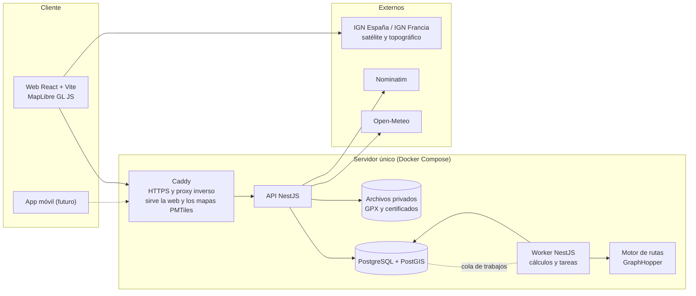

# OnWay — Documento 04: Arquitectura y stack

Versión: 1.4 (borrador) · Fecha: 2026-11-05 · Depende de: documentos 01 (v1.4), 02 (v1.2) y 03 (v0.8)

Este documento decide **con qué y cómo** se construye OnWay: lenguaje, frameworks, base de datos, despliegue, proveedores externos, seguridad y estrategia para la futura app móvil. Parte de las restricciones de un proyecto didáctico (documento 03, sección 14).

> **Sincronizado.** Los documentos 01, 02 y 03 recogen ya las decisiones tomadas tras los bocetos (registro con aprobación, teléfono y correo visibles para coordinador y administrador, certificado opcional, confirmación de participación al cerrar y meteorología por ubicación del dispositivo). El producto se llama OnWay.

Los elementos marcados *(propuesto)* los ha añadido el arquitecto y esperan tu confirmación. Los marcados *(a verificar)* dependen de una comprobación que no he podido hacer todavía.

---

## 1. Decisiones de arquitectura

Prefijo **AD** (Architecture Decision) para distinguirlas de las decisiones de producto D-xx del documento 01.

| ID | Decisión | Alternativas descartadas | Estado |
|---|---|---|---|
| AD-01 | **Lenguaje: TypeScript** en backend, frontend y paquetes compartidos | Python (mejor ecosistema raster para la v2, pero dos lenguajes y no es lo que se estudia en clase) | Confirmada |
| AD-02 | **Backend: NestJS** | Fastify (menos estructura), Express (hay que montar todo a mano) | Confirmada |
| AD-03 | **Frontend: React + Vite** como aplicación de una sola página | Angular, Vue, Next.js (no hace falta renderizado en servidor: todo va tras el login) | Confirmada |
| AD-04 | **Despliegue: un único servidor virtual con Docker Compose, con 8 GB de RAM como punto de partida y un techo de 20 €/mes en total** (servidor, copias y dominio). Objetivo: unos 12–15 €/mes. El servidor no se contrata hasta tener la primera entrega lista | Plataformas gratuitas (no dan RAM para el motor de rutas), varios servicios en la nube (coste por estar encendidos), servidor de 4 GB (sin margen para el motor de rutas) | Confirmada (presupuesto tuyo: 10–20 €/mes; la elección del plan la delegaste en el arquitecto) |
| AD-05 | **Monolito modular**: una API y un worker que comparten el mismo código y la misma base de datos | Microservicios (coste y complejidad sin necesidad) | Propuesta |
| AD-06 | **PostgreSQL + PostGIS** como única base de datos | Base documental o geoespacial aparte | Propuesta |
| AD-07 | **Aislamiento por organización en dos capas**: filtro en la aplicación y *Row Level Security* en PostgreSQL | Solo filtro en código (un olvido filtra datos de otra organización) | Propuesta |
| AD-08 | **Cola de trabajos en PostgreSQL** (pg-boss), sin Redis | Redis + BullMQ (un servicio más que mantener) | Propuesta |
| AD-09 | **Contrato de API primero**: esquemas Zod compartidos, OpenAPI generado, cliente tipado | Tipos duplicados a mano entre web y API | Propuesta |
| AD-10 | **Mapas con MapLibre GL JS**; mapa base vectorial propio (Protomaps); satélite y topográfico desde los servicios abiertos de IGN España e IGN Francia | Google Maps (licencia y coste), Mapbox (de pago) | Propuesta |
| AD-11 | **Motor de rutas detrás de una interfaz**, con una prueba técnica antes de fijarlo. Candidato inicial: GraphHopper. **Elegido GraphHopper 11.1 tras la prueba técnica (§7.6)** | Fijarlo ya sin medir | Confirmada (2026-11-01) |
| AD-12 | **Datos sensibles cifrados en la aplicación** (AES-256-GCM), con huella HMAC para detectar documentos duplicados | Cifrado solo de disco, o guardarlos en claro | Propuesta |
| AD-13 | **Móvil: web instalable (PWA) ahora, decisión de envoltorio nativo más adelante** | Decidir ya React Native o Capacitor | Propuesta |
| AD-14 | **Mapas y datos externos cargados en el servidor propio** siempre que sea posible (elevación, mapa base), para no depender de cupos | Llamar a APIs externas en cada consulta | Propuesta |

---

## 2. Vista general



Puntos clave:
- El navegador pide los mapas base directamente al servidor propio y el satélite a IGN. La API nunca hace de intermediaria de teselas.
- La API y el worker son **la misma base de código con dos puntos de entrada**. Esto cumple "un solo servicio desplegable" del documento 03 y permite que los cálculos largos no bloqueen las peticiones.
- El motor de rutas es el único componente que no es TypeScript. Corre en su propio contenedor y se llama por HTTP desde el worker.

---

## 3. Stack por capa

| Capa | Elección | Notas |
|---|---|---|
| Lenguaje | TypeScript en modo estricto | Un solo lenguaje para API, worker, web y paquetes compartidos |
| Gestor de paquetes y repositorio | pnpm con workspaces (monorepo) | Estructura en la sección 4 |
| Backend | NestJS | Módulos, inyección de dependencias, guards para roles |
| Validación y contratos | Zod 4 (`strictObject`) | Un mismo esquema valida en la API y genera tipos en la web. En H0 la API valida con un interceptor propio sobre los esquemas, sin `nestjs-zod` |
| Documentación de API | OpenAPI generado | Cliente tipado generado para la web y, más adelante, para móvil |
| Base de datos | PostgreSQL 16 con PostGIS | Geometría 3D (con altitud), índices espaciales GiST |
| Acceso a datos | Drizzle ORM sobre el driver `pg` (node-postgres), con SQL propio para lo espacial | Prisma no maneja bien PostGIS. El driver `pg` y su `Pool` permiten fijar `app.org_id`, `app.user_id` y `app.role` al abrir cada transacción |
| Migraciones | SQL escrito a mano en `db/migrations/`, aplicado por el migrador de Drizzle (`migrate()`) con su diario `meta/_journal.json`; la 0001 (extensiones y roles) la ejecuta un superusuario en el arranque de la base | Aislamiento por organización desde la primera migración (R-05). No se usa `drizzle-kit` |
| Cola de trabajos | pg-boss | Usa la propia base de datos, con progreso y reintentos |
| Autenticación | Propia: Argon2id, sesión en base de datos con cookie segura y CSRF por HMAC | Argon2id con `crypto.argon2` de Node (≥ 24.7, sin dependencia nativa; parámetros m=19 MiB, t=2, p=1). Endpoint de tokens para móvil cuando llegue |
| Frontend | React 19 + Vite 7 + TypeScript, con `react-router` 7 como enrutador | Rutas por rol en un módulo puro (`apps/web/src/nav`) |
| Mapas en el navegador | MapLibre GL JS (con react-map-gl como envoltorio) | Sin claves ni cuotas |
| Estado del servidor | TanStack Query | Caché, reintentos, estado de los trabajos de cálculo |
| Interfaz | Componentes accesibles con controles grandes y alto contraste | Uso con guantes y luz solar. En H0 son componentes propios, sin librería de interfaz (objetivos de 48 px, foco visible, teclado); Radix u otra se valorará si un hito lo pide. **Rediseño `UI-rediseno` (v1.4):** tokens CSS semánticos con **dos temas** (`[data-theme]`; oscuro con el rojo de rescate como acento y claro de alto contraste), sobre la hoja propia y sin librería nueva. **Sin elección guardada se ve el oscuro**; el selector de Cuenta ofrece tres opciones («Oscuro», «Claro (alto contraste)» y «Como el sistema», que es la única que sigue a `prefers-color-scheme`). Arranque sin destello con un script clásico del propio origen (`theme-boot.js`, sin cambiar la CSP). La preferencia se guarda solo en el navegador (`localStorage`, valor validado contra una lista cerrada). Contraste calculado desde los tokens en una prueba. Fuente de rótulos `Bahnschrift`/DIN del sistema y `--font-mono` (monoespaciada del sistema) para coordenadas, altitudes, métricas y el código de invitación |
| Internacionalización | react-i18next, español y francés desde el primer día | Sin textos fijos en el código |
| Motor de rutas | GraphHopper 11.1 en contenedor propio (`routing`) | Sección 7 |
| Mapa base | Protomaps (PMTiles) extraído para los Pirineos | Sección 8 |
| Pruebas | Vitest (`jsdom` y Testing Library en la web), Testcontainers con PostGIS real, Playwright (Chromium) | Sección 12 |
| Formato y reglas | Prettier (`pnpm format:check`) y ESLint 10 con `typescript-eslint` (`pnpm lint`), ambos en la integración continua | Desde H1-T1: configuración plana recomendada, sin reglas con tipos, y `no-restricted-imports` que confina `maplibre-gl`, `react-map-gl` y `pmtiles` a `apps/web/src/map/` y limita `@onway/geo` en la web a una lista explícita de funciones (regla inviolable 9). Lleva `@eslint/js` como dependencia de desarrollo: es el paquete de ESLint que da la configuración recomendada |
| Integración continua | GitHub Actions | |
| Servidor web | Caddy | HTTPS automático, sirve la web y los archivos PMTiles. En local, `docker compose up` lo publica en `http://localhost:8080` con proxy a `/api` |

**Versiones reales tras H0** (2026-10-30): Node 24 (imágenes `node:24.22.2-alpine3.24`), pnpm 9.12, TypeScript 5.9, NestJS 11 (Express 5), Drizzle ORM 0.45, `pg` 8.23, Zod 4.6, React 19.3, Vite 7.3, TanStack Query 5.105, react-router 7.18, react-i18next 17, Vitest 3.2, Testing Library 16, Testcontainers 12, Playwright 1.64, Prettier 3.9, PostGIS `postgis/postgis:16-3.4`, Caddy 2.11.

**Versiones reales tras H1** (2026-10-31, lo que fija `pnpm-lock.yaml`): lo de H0 más MapLibre GL JS 6.16, react-map-gl 8.1, pmtiles 4.5 (en el navegador) y 1.31.2 (herramienta de `geodata`), @protomaps/basemaps 5.7, geotiff 3.0 (lectura del DEM en el API), SunCalc 2.1 (sol y luna en `packages/geo`), ESLint 10.14, typescript-eslint 8.72, Vitest 3.2, Playwright 1.64 y TypeScript 5.9. Son las dependencias que aprobó el usuario para H1 y ninguna más; `pnpm audit --prod` sin avisos.

**Dependencias de H2** (aprobadas el 2026-10-31): `fast-xml-parser` 5.11 en `packages/geo` (lectura de GPX y KML; MIT, 6 dependencias directas también MIT, `pnpm audit` limpio; la línea 4.x tiene una sola pero está marcada como heredada) y `@types/multer` en desarrollo (tipos del `multer` que ya trae `@nestjs/platform-express`, con `pnpm.overrides.multer = ^2.5.0`). La escritura de GPX y KML es propia, sin librería.

---

## 4. Estructura del repositorio

```
onway/
├─ apps/
│  ├─ api/            NestJS: puntos de entrada http y worker
│  └─ web/            React + Vite
├─ packages/
│  ├─ contracts/      Esquemas Zod y tipos compartidos (la fuente de verdad del API)
│  ├─ geo/            Funciones puras de geometría (distancias, perfiles, GPX)
│  └─ i18n/           Textos es / fr
├─ infra/
│  ├─ compose.yml     Todos los servicios
│  ├─ Caddyfile
│  └─ routing/        Configuración del motor de rutas y script de preparación de datos
├─ db/
│  ├─ migrations/     Migraciones SQL a mano (documento 05)
│  └─ tests/          Pruebas del esquema y de las políticas de seguridad
├─ data/
│  └─ seed/           Datos de demostración ficticios (R-10)
├─ docs/              Los documentos 01 a 07 y las decisiones (ADR)
└─ CLAUDE.md          Instrucciones para Claude Code (documento 07)
```

Reglas de dependencia:
- `packages/*` no importan nada de `apps/*` ni de React ni de NestJS. Así los reutiliza una app móvil.
- `apps/web` solo conoce el API a través de `packages/contracts` y el cliente generado.
- La lógica de rutas y geometría vive en `packages/geo` y en el backend, nunca en componentes de interfaz (requisito de portabilidad del documento 01).

---

## 5. Backend: módulos y puertos

### 5.1 Módulos

Cada módulo del dominio (documento 03, sección 2) es un módulo de NestJS con sus propios controladores, servicios y acceso a datos. Un módulo solo habla con otro a través de su servicio público o de eventos.

| Módulo NestJS | Responsabilidad |
|---|---|
| `identity` | Registro, inicio de sesión, sesiones, aprobación de cuentas, roles, organizaciones |
| `profiles` | Perfil de rescatista, cursos y habilidades, certificados, datos sensibles cifrados |
| `teams` | Equipos y su localidad |
| `missions` | Misiones, puntos, ciclo de vida, cierre y confirmación de participación |
| `participation` | Ofertas de voluntariado, estados, acciones en bloque |
| `routes` | Biblioteca, versiones, derivación, validación, importación y exportación GPX/KML. **H2:** `RouteMeasurement` (la medición de todo trazado), lecturas con `bbox`, escrituras con candado de fila y exportación; el acceso a `routes`, `route_versions` y `route_segments` es SQL propio |
| `calculation` | Trabajos de cálculo, progreso, resultados |
| `weather` | Pronóstico a la altitud del punto, caché, luz y luna |
| `audit` | Registro de auditoría, consulta para el administrador |
| `files` | Almacenamiento privado de GPX y certificados. **H2:** subida (`uploadFile`) con tipo por contenido y tope de 10 MB, `FileStorage` y apertura de un archivo por su id (`ImportedTracks`); los certificados llegan en H5 |

### 5.2 Puertos (interfaces hacia lo externo)

Principio 7 del documento 03: lo externo se puede cambiar sin tocar el dominio. Cada puerto es una interfaz TypeScript con una implementación inyectada.

| Puerto | Implementación inicial | Alternativas previstas |
|---|---|---|
| `RoutingProvider` | **GraphHopper 11.1** (elegido en la prueba técnica, §7.6) | Valhalla 3.9.1 (plan B: adaptador y perfil en `poc/motor-rutas/`), pgRouting; módulo propio de superficie de coste (v2) |
| `ElevationProvider` | **Compuesto (H1)**: archivos Copernicus GLO-30 del servidor (lectura por ventanas, interpolación bilineal) dentro de la caja de los Pirineos y, fuera de ella, la API de elevación de Open-Meteo (Copernicus GLO-90). Si ninguna responde, `OUTSIDE_COVERAGE` | MDT del IGN español, RGE ALTI francés |
| `WeatherProvider` | **Open-Meteo (H1)**: pronóstico a la altitud propia del punto (`elevation`), horario y diario de 7 días, isoterma de 0 °C; caché por celda y banda en `forecast_cache` | Meteoblue |
| `GeocodingProvider` | **Nominatim público (H1)**: `User-Agent` con contacto, 1 petición/s en toda la API, caché de 24 h | CartoCiudad (España), Base Adresse Nationale (Francia) |
| `FileStorage` | **Disco del servidor (H2)**: volumen `files` montado en `/files` del `api` (que es de solo lectura salvo ahí y `/tmp`), clave aleatoria `<aa>/<uuid>`, escritura atómica y permisos 0600; en pruebas, en memoria | Almacenamiento compatible con S3 |
| `Clock` | Reloj del sistema | Reloj fijo en pruebas |
| `Mailer` | **Resend** (recuperar contraseña; con el despliegue, H7). En desarrollo y pruebas, **registro en consola** (`ConsoleMailer`, `H5-acceso`); Mailpit descartado por ahora | SMTP propio, Brevo |

**Cómo se implementó en `H5-acceso`** *(issue #9; 2026-11-05).* *Mailer.* `apps/api/src/mail/`: el puerto `Mailer` (`send({ to, kind, locale, link })`, con `kind = 'password-reset'` y `locale` es o fr) y un único adaptador, `ConsoleMailer`, que escribe en la salida del `api` **una línea JSON de formato fijo** con exactamente cinco campos y en este orden (`event: "mail"`, `kind`, `to`, `locale`, `link`); el apoyo del E2E la lee de `docker compose logs api` (`apps/web/e2e/support/mail-log.ts`). `links.ts` construye el enlace `PUBLIC_BASE_URL/reset-password#token=…`. El doble de las pruebas es `RecordingMailer` (`apps/api/test/support`). *Configuración.* Se lee al arrancar y falla con un mensaje claro en vez de degradarse en silencio: `MAILER` solo admite `console` (Resend llega con el despliegue, H7, Q-28); `PUBLIC_BASE_URL` es un origen `http(s)://host[:puerto]` sin ruta, consulta ni fragmento; `MAILER_ALLOW_CONSOLE` es `true` o `false`, y `console` con `NODE_ENV=production` solo arranca con `true` (D-A7: las imágenes de la pila local, de la superposición E2E y del CI corren con `NODE_ENV=production`, y un enlace de recuperación no debe llegar por descuido a un registro de producción; el despliegue de H7 no lo fijará). **Con `NODE_ENV=production` las tres variables son obligatorias** y el error nombra todas las que faltan: un despliegue no hereda valores de desarrollo; fuera de producción valen `console`, `true` y `http://localhost:8080`. `infra/compose.yml` las fija para `api` y `worker` (ancla `x-mail-env`; `PUBLIC_BASE_URL` sigue el puerto publicado y `ONWAY_PUBLIC_URL` la sustituye), y la superposición E2E y el CI las heredan. Mailpit queda descartado: exigiría `nodemailer` y un servicio nuevo para un puerto que se reemplaza. *Registro.* `register` guarda la contraseña con Argon2id y solo crea una cuenta *pendiente*, sin sesión ni rol (RN-25, `auth_register`); código inválido, de otra organización y correo ya registrado dan el mismo `REGISTRATION_FAILED`, con el mismo cuerpo y estado. El idioma de la cuenta es el de la pantalla desde la que se registró. *Recuperar contraseña.* El token son 32 bytes aleatorios; a la base solo va su hash SHA-256 (`auth_request_password_reset`), caduca a 1 h (lo fija el `now()` de la base) y se consume una vez (`auth_consume_password_reset`, que también cierra todas las sesiones y quita el bloqueo). El token va en el **fragmento** del enlace, que el navegador no envía: no queda en el registro de Caddy ni en `Referer`. `forgotPassword` responde 202 con el mismo cuerpo exista o no el correo y hace siempre el mismo trabajo (token, hash y llamada a la función); **no espera al `Mailer`**, de modo que ni la latencia ni un fallo del envío distinguen los casos (si falla se registra sin el token, el enlace ni la dirección; la fila queda, cuenta para el tope de 3 por hora y cuenta, y caduca). Reciben enlace las cuentas activas y las pendientes; las rechazadas, desactivadas y anonimizadas, no (misma respuesta). El correo sale en el **idioma de la cuenta**, no en el de la pantalla desde la que se pide, porque `ForgotPasswordRequest` no lleva idioma. `resetPassword` espera al hash de la contraseña nueva, que cumple el mismo esquema que la del registro (`VALIDATION_FAILED` sin consumir el token); el token no tiene límite de longitud en el esquema, y uno inexistente, usado, caducado, demasiado corto o largo da el mismo `INVALID_RESET_TOKEN`. *Límite de los tres endpoints públicos.* `common/public-rate-limiter.ts`: ventana deslizante **en memoria**, por IP y operación (`register` 10 por 10 min, `forgotPassword` 5 por hora, `resetPassword` 10 por hora), con `RATE_LIMITED` y `retryAfterSeconds`; cuenta toda petición que llega, sea cual sea su resultado (contar solo los fallos permitiría sondear códigos), las rechazadas no alargan la ventana, el tiempo sale del `Clock` y guarda como mucho 10 000 claves. Es por proceso y se vacía al reiniciar el `api` (basta para un solo nodo; por eso la demostración E2E reinicia el `api` antes de empezar). La IP la fija `trust proxy` de Express (`common/client-ip.ts`), no la aplicación: `TRUSTED_PROXIES` (por defecto `loopback, linklocal, uniquelocal`, porque a la API solo llega Caddy por la red privada de Docker; `false` para ninguno) decide de quién se cree `X-Forwarded-For`, y sin proxy de confianza la cabecera se ignora; una IPv6 cuenta por su /64. *Administración.* `apps/api/src/admin/`: la bandeja (solo correo y nombre, Q-34), `decideSignupRequests` y el código de invitación. La decisión es **atómica** (D-A4): toda la selección en la transacción de la petición, `admin_decide_signup` por persona y cualquier fallo deshace el lote; un **cerrojo consultivo por organización** serializa dos decisiones simultáneas, porque la función SQL no comprueba el estado en sus `UPDATE`. El código de invitación son 16 caracteres de un alfabeto de 32 sin `I`, `O`, `0` ni `1`, en grupos de 4 (`randomInt`, 80 bits); rotarlo invalida el anterior en el acto y deja la fila de auditoría `invite_code_rotated` sin el código. Sin migración SQL: todo salvo la configuración descansa en las funciones de 0008 y 0009.

**Cómo se implementó en H3.** *Motor.* `apps/api/src/routing/`: el puerto `RoutingProvider` (`routing.ts`: origen, destino, puntos intermedios, zonas a evitar, número de alternativas → alternativas con geometría, distancia y **tipo de vía por tramo**; nunca se pide ni se usa la altitud del motor), el adaptador `GraphHopperRouting`, el doble `InMemoryRouting` de las pruebas del trabajo y `UnavailableRouting` cuando no hay `ROUTING_URL`. Errores traducidos a `NO_ROUTE_POSSIBLE`, `OUTSIDE_COVERAGE` y `ROUTING_UNAVAILABLE`. *Alternativas (D-H3-03):* primero las del motor (`algorithm=alternative_route`, `max_paths`, `max_share_factor` 0,8, `max_weight_factor` 2,5) y, si dan menos de las pedidas, se bloquean 200 m (cuadrado de 100 m de semilado) en puntos intermedios de la ruta principal, se vuelve a preguntar y se acepta el rodeo si comparte a lo sumo el 70 % con lo ya guardado (`sharedShare` de `packages/geo`) **y no es más de un 50 % más largo que la ruta principal** (decisión del usuario, 2026-11-01: pasado eso es otra ruta, no un rodeo; se aplica también a las alternativas propias del motor). Sin el tope, en el par francés de la prueba la segunda alternativa medía el doble que la principal (36,8 frente a 17,4 km); con él, el bloqueo prueba otros puntos de la ruta y da una de 20,1 km. *Zonas a evitar:* polígonos de la organización (con misión opcional) que se envían al motor como áreas bloqueadas. *Ajuste a caminos (`snapRoute`, `createRoute` con `snapToPaths`):* se unen los puntos en orden con una ruta del motor (no `/match`: funciona con puntos dispersos), y el servidor mide el resultado con su altitud; la composición se reparte por porcentaje de longitud sobre la línea ya preparada (`labelIntervals` y `groupIntervals` de `packages/geo`), un tramo por tipo consecutivo con su propia línea en `route_segments`.
*Trabajos.* `apps/api/src/jobs/`: la cola es pg-boss 12 (MIT) en el esquema `pgboss` de la misma base; `installJobQueue` (migrador, como propietario) instala el esquema y la cola `calculate` y da a `onway_app` solo lo necesario (doc 05 §9). El envío es **transaccional** con la fila de `calculation_jobs` (si no hay fila, no hay trabajo), con `retryLimit` 2 y espera creciente solo para fallos transitorios. `src/worker.ts` es el segundo punto de entrada del mismo código y se despliega como el servicio `worker`, sin puertos publicados, con comprobación de salud en el 3001. `JobRunner` lleva el trabajo de `pending` a `running` y a `completed`/`failed` con progreso; si el *worker* muere, pg-boss devuelve el trabajo a la cola al caducar y otro lo toma; guardar las rutas es idempotente por trabajo (`calculation_job_id`). `generateRoutes` comprueba INV-14 y que el motor responda antes de crear el trabajo.

**Cómo se implementó en H1 (T4).** Los adaptadores viven en `apps/api/src/geo/` y se inyectan por símbolo; `main.ts` monta siempre los reales y las pruebas inyectan los suyos (superficie sintética y geocodificador en memoria en `test:api`; nada de variables que cambien a falsos en la imagen). Las URL, el contacto de Nominatim y la carpeta del DEM salen de la configuración (`ELEVATION_DEM_DIR`, `OPEN_METEO_ELEVATION_URL`, `NOMINATIM_URL`, `NOMINATIM_CONTACT`). El DEM se lee con `geotiff` por bloques de 1024 x 1024 (nunca entero en memoria) y con a lo sumo 2 lecturas a la vez: el `api` queda en unos 75 MiB tras leer teselas de la caja (límite 512 MiB). El límite por usuario de `getElevation` es un cubo de 30 peticiones de ráfaga y 3 por segundo (D-H1-09); el de Nominatim es un cubo global de 1 petición por segundo con hasta 2 s de cola, pasados los cuales responde `RATE_LIMITED` con `retryAfterSeconds`. Los datos pesados los descarga el servicio `geodata` (sección 9).

**Cómo se implementó en H1 (T5): entorno, tiempo, luz y luna.** Módulo `apps/api/src/weather/` con `getEnvironment`. `OpenMeteoWeatherProvider` pide a `https://api.open-meteo.com/v1/forecast` (configurable con `OPEN_METEO_FORECAST_URL`) la **altitud propia** del punto en `elevation` (R-06; hay una prueba unitaria sobre la URL) con `timezone=auto`, 7 días, `wind_speed_unit=kmh` y las variables `temperature_2m`, `wind_speed_10m`, `wind_gusts_10m`, `precipitation`, `snowfall`, `cloud_cover` y `freezing_level_height` (isoterma de 0 °C), en `current`, `hourly` y, agregadas, `daily`. Las horas locales se devuelven como instantes UTC y una hora sin temperatura, viento, precipitación o nubosidad se descarta en vez de inventarla. **Caché** `forecast_cache`: clave (proveedor, celda de 0,01°, banda de altitud de 100 m), validez de 3 h; la altitud que se pide al proveedor es la de la banda (así lo guardado es función de la clave, y el redondeo es de ±50 m). Una sola llamada en curso por celda: las peticiones simultáneas esperan la misma y la primera guarda el resultado. Si el proveedor falla: `stale` (último dato, con su hora, aunque haya caducado) o `unavailable`, siempre 200 (doc 06); la celda no vuelve a preguntarse durante 60 s. **Salud pasiva (D-H1-12):** `getHealth` no llama al proveedor; `weatherProvider` vale `false` solo si la última llamada real falló hace menos de 30 min, y entonces `status` es `degraded`. **Ubicación (INV-30, RN-26):** la posición del dispositivo se redondea a su celda de ~1 km al recibirla (`roundToCell` de `@onway/geo`, idempotente: el cliente ya la redondea), la altitud es la del DEM en el centro de la celda, y no se guarda ni se registra: la única huella es la fila de la celda, sin usuario ni organización. El API escribe una línea por petición (id, método, ruta, estado y tiempo) **sin cadena de consulta** y sin registrar `/health`. Sol y luna salen de `@onway/geo` (SunCalc 2, BSD-2, cálculo local): el día es el día solar local del punto (de una medianoche solar a la siguiente), sin zona horaria. `bulletins` va siempre vacío en H1 (RF-706 es Could).

### 5.3 Reglas transversales

- **Permisos en el servidor, siempre.** Un guard comprueba el rol y otro la pertenencia a la organización. Ningún permiso depende de lo que muestre la interfaz.
- **Los datos de contacto y sensibles no viajan en listados.** La lista de voluntarios devuelve nombre, equipo y localidad del equipo (RN-21). La ficha devuelve además cursos, habilidades, teléfono y correo, y solo al coordinador de una misión donde el rescatista se ofreció o fue añadido *(propuesto)*. Documento y dirección solo salen en el perfil del propio rescatista y en la consulta del administrador, que se audita.
- **Los eventos del documento 03 (sección 12)** se publican dentro del proceso con el emisor de eventos de NestJS. Si en la v3 hay notificaciones, serán suscriptores nuevos.

---

## 6. Datos

### 6.1 PostgreSQL y PostGIS

- Geometrías en SRID 4326, con altitud: `LineStringZ` para trazados y `PointZ` para puntos.
- Índice espacial GiST sobre las versiones de ruta desde la primera migración, aunque la búsqueda por punto llegue en la segunda entrega (documento 03, sección 13).
- Distancias y desniveles se calculan con funciones de PostGIS o con `packages/geo`, nunca en la interfaz.
- Todo dato de negocio lleva `organization_id`.

### 6.2 Aislamiento por organización

1. **Capa de aplicación.** Cada consulta se hace dentro de una transacción en la que se fija la organización del usuario.
2. **Capa de base de datos.** Políticas de *Row Level Security* sobre cada tabla de negocio comparan `organization_id` con esa variable de transacción. Si el código se olvida del filtro, la base de datos devuelve cero filas.
3. **Requisito crítico.** La aplicación se conecta con un rol de base de datos que **no** es superusuario ni propietario de las tablas. De otra forma, RLS se salta. Esto se comprueba con una prueba automática.

### 6.3 Cifrado de datos sensibles (AD-12)

- Documento de identidad y dirección se cifran por campo con AES-256-GCM antes de guardarse, con identificador de clave para poder rotarla.
- La clave maestra no vive en la base de datos: está en un archivo de secretos del servidor, fuera del repositorio y de las copias de seguridad de la base.
- Para detectar documentos duplicados sin descifrar, se guarda una huella HMAC-SHA256 del número normalizado, con una clave distinta.
- La consulta de estos datos por parte del administrador se registra en la auditoría (quién, cuándo, de quién).
- **Certificados de curso:** archivos privados, no públicos. Se sirven con enlace firmado de corta duración. Cada apertura por un coordinador o por el administrador se registra *(propuesto)*.

### 6.4 Copias de seguridad

Volcado diario de la base de datos, cifrado, enviado a un almacenamiento externo al servidor. Se prueba la restauración al menos una vez. Es parte de la fiabilidad que pide el documento 01.

---

## 7. Motor de rutas

Es el mayor riesgo técnico (R-01). La decisión se toma midiendo, no por preferencia.

### 7.1 Qué hay que resolver, por fases

| Fase | Necesidad | Enfoque |
|---|---|---|
| v1 | Rutas sobre carreteras, pistas y senderos existentes, con varias alternativas hacia el mismo objetivo | Motor sobre la red de OpenStreetMap |
| Segunda entrega | Cortar una ruta en un punto y recalcular solo el tramo final | La misma interfaz con un origen distinto: no exige un motor nuevo |
| v2 | Tramos campo a través, sin camino | Superficie de coste sobre el modelo de elevación, unida a la red |

### 7.2 Candidatos para la red (v1)

| Candidato | A favor | En contra |
|---|---|---|
| **GraphHopper** | Perfiles personalizables con *custom model* (penalizar pendiente, dificultad del sendero), rutas alternativas, funciona con extractos regionales | Hay que ajustar y probar un perfil de senderismo propio para montaña. Necesita mucha RAM en áreas grandes, por eso se usa un extracto de los Pirineos y acceso a disco mapeado |
| **Valhalla** | Perfil peatonal, alternativas, más ligero de montar | Menos fácil de personalizar para montaña |
| **pgRouting** | Dentro de la propia base de datos, control total | Hay que construir los costes y el grafo a mano |

Dato verificado: la documentación de GraphHopper indica que preparar una red mundial exige entre 60 y 120 GB de memoria, con opción de reducirlo con almacenamiento mapeado en disco. Eso confirma que hay que trabajar con un **extracto regional** (cuadro de los Pirineos, España y Francia), no con países enteros. *(Licencias verificadas el 2026-11-01: GraphHopper Apache-2.0, Valhalla MIT; ver §7.6.)*

### 7.3 Prueba técnica previa (PoC)

Antes de comprometer la implementación, una prueba aislada de unos pocos días.

- **Zona:** 3 pares origen-destino reales de los Pirineos, **fijados por el usuario**: Refugio de Coronas → Aneto, Parking de Bujaruelo → Brecha de Rolando y Parking de la Pradera de Ordesa → Monte Perdido (los tres del lado español; la redacción original pedía «uno a cada lado de la frontera y uno que la cruce»). El lado francés se midió con un cuarto par extra, Aparcamiento de Gavarnie → Vignemale, que no forma parte de la aceptación.
- **Qué se compara:** GraphHopper frente a Valhalla (pgRouting solo si ambos fallan).
- **Criterios de aceptación:**
  1. Devuelve al menos 2 alternativas razonablemente distintas por par (D-04: pueden compartir tramos).
  2. Prefiere senderos y pistas marcados frente a carretera cuando el destino está en montaña.
  3. Evita pendientes extremas configurables.
  4. Calcula en pocos segundos con el extracto cargado.
  5. Funciona dentro del presupuesto de memoria de la sección 11.1.
  6. *(añadido en el plan de la prueba)* Respeta una zona a evitar (RF-507): un polígono sobre la ruta principal y la nueva ruta no lo cruza, o el motor dice que no hay camino.
  7. *(añadido)* Ajusta un dibujo burdo a los caminos (`snapRoute`): queda a ≤ 10 m de la red y conserva el orden.
  8. *(añadido)* Devuelve el tipo de vía de cada tramo, mapeable a `road`, `track` o `path`, sin tramos desconocidos (RF-503).
- **Resultado esperado:** un informe corto que fija el motor y los pesos del perfil, y guarda los casos como pruebas automáticas. **Hecho: §7.6.**

### 7.4 Elevación

- Base global: Copernicus DEM GLO-30, 30 m, formato GeoTIFF optimizado, descarga gratuita sin cuenta. **Limitación a tener en cuenta:** es un modelo de **superficie** (incluye bosque y edificios), no de terreno desnudo. Para pendientes en senderos bajo arbolado puede introducir error.
- Mejora prevista: modelos de terreno nacionales de mayor resolución de IGN España e IGN Francia *(a verificar disponibilidad, resolución y licencia)*.
- Las métricas de una ruta importada se recalculan siempre con el modelo propio (R-07).
- **`ElevationProvider` por lotes (H2):** `elevationsAt(puntos)`. El modelo local agrupa por tesela y lee bloques de 256 píxeles una sola vez; Open-Meteo, de 100 en 100 con un tope de 1 500 puntos remotos por petición (por encima, `OUTSIDE_COVERAGE`); el compuesto pregunta a cada fuente solo por lo que falta.
- **Cómo se mide una ruta (H2, D-H2-01/03):** redondeo a 7 decimales (~1 cm), depurado de vértices a menos de 5 m, densificado a 30 m (la resolución del modelo), altitud de cada vértice, remuestreo cada 30 m, **mediana de 3**, **umbral de 3 m** para el desnivel y pendiente máxima sobre una **ventana de 60 m**; perfil de 500 puntos como mucho y un decimal. La altitud y las métricas de un archivo o del cliente no se usan nunca.
- **Precisión (calibrada con ruido simulado de ±1 a ±5 m):** rampa del 10 % con ruido de ±5 m, desnivel con error de menos del 5 %; colina de 300 m con ruido de ±3 m, menos del 3 %; terreno llano con ruido de ±2 m, desnivel cero. Peor caso, ruido de ±5 m: una colina da un 7 % de más y un terreno llano inventa del orden de 69 m en 6 km. **Límite del modelo:** un relieve de menos de unos 200 m de longitud de onda se subestima entre un 14 % y un 30 % con un modelo de 30 m (quitar el suavizado lo evitaría, pero con ruido de ±5 m inventaría cientos de metros de desnivel: se prefiere subestimar). Medido en la pila: una pista de 20 000 vértices se mide en 0,4 s con ~90 MiB en el `api`.

### 7.5 Campo a través (v2) y el lenguaje

Los cálculos raster (superficie de coste, pendiente, obstáculos) son más cómodos en Python que en TypeScript. Esta decisión **no se toma ahora**. El puerto `RoutingProvider` permite en la v2 añadir un pequeño servicio en Python sin tocar el dominio. Lo anoto como riesgo R-12.

### 7.6 Resultado de la prueba técnica (2026-11-01)

La prueba vive en `poc/motor-rutas/` (fuera del workspace, de `compose.yml` y del CI; ver su `README.md`) y el veredicto completo en `poc/motor-rutas/results/veredicto.md`.

- **Decisión: GraphHopper 11.1 (Apache-2.0) para H3.** Valhalla 3.9.1 (MIT) queda como plan B documentado; pgRouting no hizo falta (los dos candidatos cumplen).
- **Datos:** instantánea de Geofabrik `261031` recortada a los Pirineos (95 MB, 12,7 M de nodos; solo viales, barreras y restricciones de giro). Los tres pares del usuario más el par francés extra. Los casos están en `poc/motor-rutas/cases/` y se ejecutan con `node poc/motor-rutas/run-cases.mjs --engine graphhopper|valhalla` (regresión para H3).
- **Resultado:** los dos motores cumplen 7 de los 8 criterios en los tres pares del usuario. **El criterio 3 (pendiente) solo se cumple en una sonda elegida a posteriori y con un umbral relativo (la pendiente máxima medida baja a ≤ 0,7 × la inicial); el literal del plan (no pasar del límite, y avisar) no se cumple ni se evalúa.** GraphHopper también cumple el par francés; Valhalla falla el criterio 2 (30,5 % de su ruta principal por carretera). Tiempos de 47–154 ms (GraphHopper) y 36–380 ms (Valhalla), muy por debajo de los 5 s.
- **Por qué GraphHopper:** el *custom model* da reglas por dificultad SAC, tipo de vía y pendiente (Valhalla documenta unas 16 opciones de peatón, pero ninguna pendiente máxima, ningún peso por nivel SAC y ninguna forma de penalizar carreteras sin clasificar o secundarias); sus rutas principales son más directas (las de Valhalla son un 27–45 % más largas en dos pares); devuelve el tipo de vía por tramo en la misma respuesta.
- **Perfil de montaña** (`poc/motor-rutas/graphhopper/mountain.json`, primera pasada razonada): escala SAC ≥ 6 prohibida, 5 ×0,3 y 4 ×0,6 (el perfil de a pie de serie prohíbe desde el 2); carreteras de coche ×0,5 en la prioridad; velocidades reducidas por pendiente. **Debe revisarlo alguien que conozca esas rutas.**
- **Alternativas:** la búsqueda propia (`algorithm=alternative_route`, `max_paths=3`, `max_share_factor=0,8`, `max_weight_factor=2,5`) dio dos rutas en dos de los tres pares; en `ordesa-perdido` ninguna. Se resuelve en el servidor con `proposeRoutes`: bloquear 200 m en medio de la ruta principal y volver a preguntar (el rodeo debe compartir ≤ 70 % con las ya guardadas).
- **Memoria:** hasta ≈1,2 GiB sirviendo con `-Xmx2g` en un contenedor de 3 GB (muestreo a 1 Hz, observado y no acotado); la carga llega a 1,9 GiB (el grafo puede construirse fuera del servidor). Valhalla: 0,7 GiB sirviendo y 2,5 GiB al cargar. Confirma la estimación de 1–2 GB.
- **La altitud del motor no sirve para métricas.** GraphHopper suma todas las subidas y bajadas sin filtro (en `ordesa-perdido` da 758 m de bajada en una ruta que solo sube; OnWay, 34 m) y su fuente (Skadi) sitúa el fondo del cañón de Ordesa unos 220 m más alto que Copernicus GLO-30. Subida y bajada se miden siempre con la medición de OnWay (§7.4); los dos miden desnivel acumulado, no neto.
- **Condiciones para H3 (cerradas en H3, ver el párrafo siguiente):** (1) alimentar el motor con el mismo DEM de OnWay (GLO-30), primera tarea de H3, y repetir el criterio 3 sobre los tres pares con el umbral literal del plan (hoy solo se cumplió en una sonda elegida a posteriori y con un umbral relativo); (2) `proposeRoutes` y el resto de la estrategia de alternativas en el servidor, detrás de `RoutingProvider`; (3) revisión de los pesos por una persona del dominio; (4) decidir cada cuánto se regenera el extracto.
- **Cómo se cumplieron en H3.** (1) *DEM propio:* `build-hgt` (`apps/api/src/cli/`, con `DemElevationProvider`) escribe teselas de 1° × 1° en el formato de la caché Skadi de GraphHopper (GraphHopper solo descarga una tesela que no esté en su caché, y las nuestras se copian ahí antes de arrancar), así que el motor ve la misma altitud que mide OnWay (el aparcamiento de Ordesa a 1314 m, no a 1535 m; la subida medida con nuestro algoritmo difiere ≤ 0,5 %). Cada tesela tarda ~43 s: 12 teselas son ~10 minutos la primera vez. El criterio 3 con su texto literal se evalúa en el corredor (`3L`): GraphHopper guarda `max_slope` en 5 bits y satura en el 31 %, de modo que con un límite ≤ 30 % los tres pares quedan sin ruta (el «no hay otra salida» del criterio, que cuenta como cumplido) y `generateRoutes` no expone ese límite; la sonda `bujaruelo-goriz` sigue bajando de 94,5 % a 44,9 % con un límite de 25 %. (2) *Estrategia de alternativas en el servidor:* §5.2. (3) *Pesos:* los del perfil siguen siendo los de la prueba técnica y **los revisa una persona del dominio**: `specs/H3-generacion-rutas/revision-pesos.md` (pendiente). (4) *Regeneración del extracto:* a mano; el servicio `routing-data` compara la instantánea (`SNAPSHOT` de `infra/routing/prepare.sh`), la caja, las regiones y la estrategia de recorte con lo que ya hay, y no vuelve a descargar nada si coinciden; cambiar la instantánea reconstruye red y grafo. Una regeneración periódica queda para cuando haya despliegue.
- **Regresión real (H3).** `infra/scripts/routing-regression.sh` (y el workflow manual `routing-regression`, no en cada push) levanta el motor con el extracto y el DEM de verdad en un proyecto aparte (`onway-regression`, `infra/compose.regression.yml`, puerto 18990) y pasa los casos de `poc/motor-rutas/cases/` con `run-cases.mjs`. Resultado del 2026-11-01 (`poc/motor-rutas/results/h3-regression*.json`): los tres pares del usuario y el par francés cumplen los criterios 1, 2, 3 (texto literal), 4, 6, 7 y 8, y la sonda de pendiente; p95 de 17, 48, 53 y 126 ms; la segunda alternativa comparte 43 %, 68 %, 24 % y 28 % con la principal; composición sin «desconocido»; pico de memoria del motor 1770 MiB (con `-Xmx2g`, muestreo de `docker stats` a 1 Hz: lo observado, no una cota).
- **Dos fallos que solo se vieron con datos reales** (la red inventada del CI y del E2E no los provoca): `osmium extract` no reconocía el formato del archivo temporal `.part`, y con la estrategia `complete_ways` el extracto traía nodos hasta la latitud 41,9, donde OnWay no tiene teselas de altitud (empiezan en 42,0), y el motor intentaba descargar una y se caía. Ahora el recorte usa `--output-format pbf` y `--strategy simple` (los nodos quedan dentro de la caja −1,9…3,3 / 42,0…43,2) y la marca del volumen incluye la estrategia.
- **No medido:** puntos intermedios obligatorios con datos reales (sí con la red inventada), carga simultánea y qué ruta prefiere un rescatista. El lado francés se midió con un solo par. **Frontera (RF-304):** las rutas principales de `bujaruelo-brecha` pasan por el collado de la frontera (Port de Boucharo); el cruce de extremo a extremo (un origen a cada lado) se prueba en el E2E con una frontera inventada, y con datos reales no hay un par que lo haga.

---

## 8. Mapas

### 8.1 Capas

| Capa | Origen | Cómo se sirve |
|---|---|---|
| Carreteras (mapa base) | OpenStreetMap, vía Protomaps | Un extracto PMTiles de los Pirineos (lon −2…4, lat 42…44, hasta zoom 14) en el volumen `geodata`, servido por Caddy en `/tiles/` con peticiones por rango, junto con sus fuentes y sprites; estilo de `@protomaps/basemaps` (idioma de la interfaz y **tema**: sabor y sprites `v4/dark` o `v4/light` según el tema elegido; el cambio entra con `setStyle` sin volver a montar el mapa). Satélite y topográfico (IGN) no siguen al tema. Fuera de la caja se ve vacío |
| Satélite | IGN España (PNOA y Sentinel-2) e IGN Francia (ortofotos) | WMTS desde el navegador. Cada tesela se compone en el navegador (`apps/web/src/map/ign-mix.ts`): se pide a la fuente o fuentes que la tocan, la española debajo y la francesa encima con su blanco puro «sin datos» hecho transparente |
| Topográfico | Mapa Topográfico Nacional (MTN) de IGN España y Plan IGN de Francia (con curvas de nivel y sombreado propios) | WMTS desde el navegador, compuesto por tesela (`apps/web/src/map/ign-mix.ts`, protocolo `ign-topo://`): el Plan IGN debajo y encima el MTN, que se descarta solo si es el relieve borroso de relleno con que contesta fuera de su cobertura (se mide el detalle de la tesela, `detailOf`; en las teselas del borde, solo los bloques de relleno). El MTN cubre toda España y una franja del lado francés (Gavarnie, Luchón y Andorra sí; Lourdes, Pau, Foix y Perpiñán no). Antes iba al revés (franjas francesas encima de España) y sobre el Pirineo español el Plan IGN perdía el detalle y en zoom alto salía en blanco o 404 (2026-11-01). Las curvas de nivel generadas desde el modelo de elevación son RF-303 (H9) |

La capa que se pide cambia según la zona visible. Los límites por país son rectángulos propios (España peninsular y Baleares; Francia en seis franjas de longitud con el borde sur un poco al sur de la frontera): una aproximación nuestra, no un dato de IGN. **Hueco conocido (R-13):** ni PNOA ni IGN Francia cubren Andorra con detalle: allí el satélite cae a la imagen de menor resolución y el topográfico a la de España; la capa de carreteras sí la cubre. Plan B de satélite: otro proveedor en plan gratuito (§9).

### 8.2 Lo verificado

Capacidades leídas el **2026-10-31** en los `GetCapabilities` oficiales; las teselas se pidieron desde un origen distinto (CORS abierto, `Access-Control-Allow-Origin: *` en los dos).

- **IGN España, satélite:** `https://www.ign.es/wmts/pnoa-ma`, capa `OI.OrthoimageCoverage` («Imágenes de satélite Sentinel y ortofotos PNOA»: Sentinel-2 por debajo de 1:70 000 y PNOA por encima), `GoogleMapsCompatible`, niveles 0–20, JPEG, solo KVP. `Fees`: «No se aplican condiciones»; `AccessConstraints`: **CC BY 4.0**. Fuera de España devuelve Sentinel-2 de 10 m (pixelado), no un error.
- **IGN España, topográfico:** `https://www.ign.es/wmts/mapa-raster`, capa `MTN` («Cartografía del IGN»: MTN 1:50 000, 1:25 000 y alta resolución desde 1,4 m/píxel), mismas condiciones y CC BY 4.0. Fuera de España devuelve una tesela lisa.
- **IGN Francia (Géoplateforme):** `https://data.geopf.fr/wmts`, `TileMatrixSet` `PM`, sin cuenta ni clave para estas capas: `ORTHOIMAGERY.ORTHOPHOTOS` («Photographies aériennes», 0–19, JPEG) y `GEOGRAPHICALGRIDSYSTEMS.PLANIGNV2` («Plan IGN», 0–19, PNG, con curvas de nivel y sombreado). Condiciones: https://cartes.gouv.fr/cgu (el WMTS público «n'est pas soumis à une limite d'usage»; datos con la Licence Ouverte / Etalab 2.0 salvo licencia específica). **No hay SCAN 25 en abierto** en ese servicio: la capa topográfica francesa es el Plan IGN. Las ortofotos devuelven teselas **completamente blancas** (200, no 404) al otro lado de la frontera, de ahí la composición por tesela del satélite.
- **Protomaps:** el mapa base se distribuye como obra producida bajo ODbL y exige atribución a OpenStreetMap. El planeta completo ocupa unos 120 GB, así que se extrae solo la región con la herramienta `pmtiles extract` (§9.0). Recomiendan alojar la copia en almacenamiento propio en lugar de enlazar la descarga.

### 8.3 Pendiente *(Q-26)*

- Resuelta la parte de H1: capas, nombres y condiciones de uso en línea (§8.2). La web declara los dos anfitriones de IGN en un solo módulo (`src/map/ign.ts`) y la CSP de Caddy los repite en `img-src` y `connect-src`; una prueba exige que coincidan.
- **Abierta:** si las licencias permiten **pregenerar teselas para uso offline** (v2.1). CC BY 4.0 y Licence Ouverte lo permiten en principio, pero las condiciones de uso intensivo de los servicios no se han contrastado.
- Ninguna ficha publica cuota; el WMTS francés dice no tener límite. No garantiza que no exista uno efectivo para un uso intensivo.

### 8.4 Modo sin conexión (v2)

Como el mapa base ya es un archivo PMTiles, la descarga de una región consiste en guardar un archivo o un rango de él. Las capas raster de IGN requerirían pregenerar teselas, de ahí la verificación anterior.

### 8.5 Atribuciones

Se muestran siempre bajo el mapa, también a 375 px, sin plegar tras un botón (D-H1-17), según la capa activa:

- Carreteras: «Datos © colaboradores de OpenStreetMap (ODbL), mapa base de Protomaps».
- Satélite: «Imágenes PNOA y Sentinel-2 © Instituto Geográfico Nacional de España / CNIG (CC BY 4.0)» y «© IGN, Géoplateforme (Licence Ouverte 2.0)».
- Topográfico: «Cartografía © Instituto Geográfico Nacional de España / CNIG (CC BY 4.0)» y «© IGN, Géoplateforme (Licence Ouverte 2.0)».
- Con altitud derivada del modelo (el personal), la cita de Copernicus DEM GLO-30 (§9.0).
- Open-Meteo se cita en la tarjeta del tiempo (T9). Las atribuciones son texto sin enlaces: la web no abre ninguna dirección externa (§10).

---

## 9. Proveedores externos: límites verificados

Es la prueba de la sección 9.1 del documento 03.

| Proveedor | Uso | Límite o condición verificada | Consecuencia de diseño |
|---|---|---|---|
| **Open-Meteo** | Pronóstico a la altitud del punto | Gratuito solo no comercial. Hasta 600 llamadas por minuto, 5.000 por hora, 10.000 al día y 300.000 al mes. Datos CC BY 4.0 | Sobrado para el proyecto. Aun así: caché por punto y altitud redondeados, y se agrupan peticiones de la misma celda |
| **Nominatim** (público) | Dirección a coordenadas | Máximo 1 petición por segundo. Obligatorio identificar la aplicación en User-Agent. Obligatorio cachear resultados. **Prohibido el autocompletado en cliente** | La búsqueda de dirección en Crear misión (vista 5) se lanza **al pulsar buscar**, no al teclear. Caché de resultados en servidor. Si crece el uso: CartoCiudad y BAN |
| **IGN España / Francia** | Teselas de satélite y topográficas | Sin cuota publicada en España; el WMTS público francés «no sujeto a límite de uso» (§8.2) | Atribución visible. Plan B: otro proveedor de satélite en plan gratuito |
| **Copernicus DEM GLO-30** | Elevación | Gratuito, sin cuenta, en archivos descargables. Algunos países no tienen todas las teselas públicas | Se descarga la caja de los Pirineos al servidor. Cero cupo |
| **Resend** | Correo transaccional (solo recuperar contraseña en v1) | Plan gratuito: 3.000 correos al mes y 100 al día. Para enviar a cualquier destinatario exige verificar un dominio propio | Detrás del puerto `Mailer`. Hasta tener dominio (Q-28) solo llega al propietario de la cuenta, suficiente para desarrollar. Sin notificaciones activas en v1 (doc. 02 §4.1) |
| **Protomaps / OSM** | Mapa base | ODbL, atribución obligatoria | Archivo propio. Cero cupo |

### 9.0 Lo que descarga y consulta el servicio `geodata` y la `api` (H1-T4, verificado el 2026-10-30)

| Fuente | Dirección oficial | Licencia y atribución | Uso |
|---|---|---|---|
| Copernicus DEM GLO-30 (AWS Open Data, sin cuenta) | `https://copernicus-dem-30m.s3.amazonaws.com/<tesela>/<tesela>.tif` | Gratuito para el público general; aviso obligatorio «© DLR e.V. 2010-2014 and © Airbus Defence and Space GmbH 2014-2018 provided under COPERNICUS by the European Union and ESA; all rights reserved» (con «produced using Copernicus WorldDEM-30 …» si se adapta). Es un modelo de superficie (R-15) | 12 teselas de 1° x 1° de la caja **lon −2…4, lat 42…44**: 466 149 644 bytes, cada una con tamaño y SHA-256 fijados en `infra/geodata/manifest.json` |
| Protomaps, compilación diaria del planeta | `https://build.protomaps.com/AAAAMMDD.pmtiles` (índice en `https://build-metadata.protomaps.dev/builds.json`) | ODbL, obra producida: atribución a OpenStreetMap. El cubo solo conserva la última semana y la última de cada versión de parche, así que la compilación (esquema 4.x) se elige al ejecutar y el extracto se conserva en el volumen propio | `pmtiles extract` de la misma caja, hasta zoom 14: 403 MB (compilación `20261030`, 41 867 teselas). Tope de 1 GiB |
| Fuentes y sprites de Protomaps | `https://github.com/protomaps/basemaps-assets` (commit `028c18f…` fijado) | Fuentes SIL OFL 1.1; sprites derivados de tangrams/icons (MIT) | Noto Sans Regular, Medium e Italic y `sprites/v4`: 14 MB, con una suma de comprobación del árbol de archivos. Desde `UI-rediseno` se usan los sprites `dark` además de los `light` (ya vienen en el volumen: el manifiesto incluye `v4` entero) |
| Herramienta `pmtiles` | `https://github.com/protomaps/go-pmtiles/releases` v1.31.2 | BSD-3 | Solo dentro de la imagen de `geodata`, con el SHA-256 de la release comprobado al construirla |
| Open-Meteo, elevación | `https://api.open-meteo.com/v1/elevation` | CC BY 4.0, no comercial, mismo cupo que el pronóstico | Fuera de la caja, con caché de 2000 puntos de ~11 m |
| Open-Meteo, pronóstico (H1-T5, verificado el 2026-10-31) | `https://api.open-meteo.com/v1/forecast` | CC BY 4.0, uso no comercial, sin clave; la tarjeta del tiempo cita a Open-Meteo (T9) | Una llamada por celda de ~1 km y banda de 100 m cada 3 h, con `elevation`, `freezing_level_height` y `timezone=auto` |
| SunCalc 2.1 (paquete npm `suncalc`) | `https://github.com/mourner/suncalc` | BSD-2-Clause | Sol y luna en `@onway/geo`; sin red. Referencias de las pruebas: US Naval Observatory (`aa.usno.navy.mil/api/rstt/oneday`) y sunrise-sunset.org, consultadas el 2026-10-31 solo para fijar valores, no desde las pruebas |

Descarga total de la primera vez: **~843 MB** (466 MB de DEM, 403 MB de PMTiles y 14 MB de fuentes) en unos 90 s con una conexión doméstica rápida; la segunda vez no descarga nada (comprueba las sumas y termina en ~1 s). El tope total es 2 GiB. Si una parte falla, `geodata` lo anota en `status.json` y la pila arranca igual (sin mapa base, o con `OUTSIDE_COVERAGE` en lo que no cubra Open-Meteo).

**Cómo se identifica la aplicación ante Nominatim.** La política del servicio público pide un `User-Agent` o `Referer` que identifique la aplicación. El 2026-10-30 respondió `403 Access denied` («See https://operations.osmfoundation.org/policies/nominatim/») a `OnWay/0.1 (portfolio demo; contact: onway-demo@example.org)`, y el 2026-10-31 respondió `200` a `OnWay/0.1 (+https://github.com/CristianAntVal85/OnWay)`: el motivo fue el contacto ficticio, no la red. Por eso el valor por defecto es la página pública del proyecto, que no lleva datos personales (R-10) y es verdadera; quien publique la aplicación fija `NOMINATIM_CONTACT` a su URL o contacto. Se usa también al hablar con Open-Meteo. Si el servicio público retirara el acceso, la búsqueda degrada (`UPSTREAM_UNAVAILABLE`, la misión se crea por mapa o coordenadas), el `api` registra solo el estado recibido, y el cambio de proveedor es un adaptador nuevo tras el puerto `GeocodingProvider` (CartoCiudad para España, Géoplateforme de IGN para Francia), sin tocar dominio ni web. Las pruebas y el E2E usan `providers-stub` y no dependen de esto.

### 9.1 Presupuesto de llamadas meteorológicas

La pantalla de inicio consulta el tiempo en la ubicación del dispositivo y, al pinchar, en el objetivo de una misión. Con el redondeo de coordenadas (~1 km) y una caché de varias horas, el número de llamadas depende del número de **celdas distintas**, no de usuarios. Aun con decenas de coordinadores, queda muy por debajo de 10.000 al día. La posición del dispositivo se usa solo para esta consulta y **no se guarda**: se redondea a su celda al llegar y no se registra (H1-T5, INV-30). Cada celda y banda cuesta una llamada cada 3 h, una sola con peticiones simultáneas, y 60 s de pausa tras un fallo; en H1 no hay límite por usuario: quien recorra muchas celdas distintas gasta una llamada por celda (riesgo residual de R-09, anotado en `docs/estado.md`).

---

## 10. Seguridad

| Área | Medida |
|---|---|
| Contraseñas | Argon2id. Bloqueo temporal tras intentos fallidos (RF-101), con limitación de peticiones |
| Sesiones | Cookie `HttpOnly`, `Secure`, `SameSite` estricta; sesión guardada en base de datos para poder revocarla; protección CSRF |
| Móvil futuro | Endpoint de tokens de acceso y renovación, sin cambiar los permisos |
| Autorización | Rol y organización comprobados en el servidor, más RLS en la base de datos (sección 6.2) |
| Alta de cuentas | La persona se registra y queda en espera. Un administrador aprueba y asigna el rol. El rol de coordinador nunca lo concede el registro *(propuesto)*. Un código de invitación asocia la solicitud a su organización *(propuesto)* |
| Datos sensibles | Cifrado por campo, acceso solo del propio rescatista y el administrador, auditoría (sección 6.3) |
| Datos de contacto | Teléfono y correo obligatorios, visibles para coordinador y administrador. El correo de contacto es el de inicio de sesión |
| Archivos subidos | Tipo y tamaño validados, almacenados fuera del directorio público, servidos con enlace firmado |
| Transporte y cabeceras | HTTPS siempre (Caddy), cabeceras de seguridad, CORS restringido |
| Secretos | Variables de entorno y archivo de secretos fuera del repositorio. Nunca en el código |
| Dependencias | Revisión automática de vulnerabilidades en integración continua |
| Aviso de uso | La aplicación indica visiblemente que no sustituye a un sistema real de rescate (R-03) |
| Datos de demostración | Siempre ficticios (R-10). El README lo deja escrito |

---

## 11. Despliegue

### 11.1 Servidor único

Un servidor virtual con Docker Compose y estos servicios:

| Servicio | Memoria estimada | Nota |
|---|---|---|
| Caddy | muy baja | HTTPS automático, sirve la web, proxy hacia la API, archivos PMTiles |
| API NestJS | 300–500 MB | |
| Worker NestJS | 300–500 MB | Mismo código que la API |
| PostgreSQL + PostGIS | 0,5–1 GB | Ajustado para poca memoria |
| GraphHopper (`routing`) | 1–2 GB *(medido en H3 con datos reales: 1,83 GiB sirviendo con `-Xmx2g` y tope de 3 GB; la prueba técnica midió ≈1,2 GiB y 1,9 GiB al cargar)* | Extracto de los Pirineos; sin salida a Internet. El grafo se construye en ~30 s |
| `routing-data` | hasta 2 GB, solo mientras corre | Servicio de un solo uso: descarga y recorta la red (~1,3 GB) y convierte el relieve; después no ocupa memoria |

La suma se acerca a los 4 GB de RAM, sin margen para el sistema, la caché de disco ni los picos del cálculo. **Medido en H3 (clon limpio, datos reales, tras generar 3 rutas):** motor 1,83 GiB, API 79 MiB, *worker* 78 MiB, PostgreSQL 79 MiB y Caddy 24 MiB: unos 2,1 GiB en uso, y los topes de memoria de `compose.yml` suman 4,9 GiB, dentro de los 8 GB del plan elegido (R-12).

**Decisión (Q-27, cerrada con tu presupuesto de 10–20 €/mes):**
- **Proveedor:** Hetzner Cloud, en una región de la Unión Europea (Alemania o Finlandia). Motivos: precio por GB de RAM entre los mejores del mercado, facturación por horas, tráfico incluido, centros de datos en la UE (importa con datos personales y RGPD) y baja latencia con España y Francia.
- **Plan:** el de **8 GB de RAM y 4 vCPU compartidas** de la gama económica. Cubre el motor de rutas (1–2 GB estimados), PostgreSQL, API y worker con margen, y deja sitio para la v2.
- **Techo:** 20 €/mes en total. **Objetivo:** 12–15 €/mes (servidor ~9–12 €, copias de seguridad ~2–3 €, dominio ~1 €/mes).
- **Descartados:** los planes con CPU dedicada, que cuestan varias veces más y no hacen falta, y el plan de 4 GB, que dejaría el motor de rutas al límite.
- **Precio exacto:** los precios de Hetzner cambiaron en 2026 y las fuentes que consulté no coinciden entre sí. No fijo una cifra: se confirma en su web al contratar. Si el plan de 8 GB supera los 20 €, se recortan alternativas (por ejemplo, un extracto de mapa más pequeño) antes que subir el presupuesto.
- **Cuándo contratar:** no antes de la primera entrega. El desarrollo y la prueba técnica van en local con Docker Compose, así que no pagas servidor durante los meses de construcción. Se podría alquilar uno por horas para medir la memoria real del motor de rutas.
- **Copias de seguridad:** almacenamiento externo barato, separado del servidor (un buzón de almacenamiento del mismo proveedor o un bucket compatible con S3).

### 11.2 Entorno de desarrollo

`docker compose up` levanta todo en local con datos de demostración ficticios. Es parte del producto de portfolio (documento 03, sección 14): cualquiera clona el repositorio y lo ve funcionando.

### 11.3 Integración y entrega continuas

- En cada cambio: formato, tipos, pruebas unitarias, pruebas de integración con PostGIS real y pruebas de extremo a extremo.
- Al fusionar en la rama principal: se construyen las imágenes y se publican en el registro de GitHub.
- Despliegue: el servidor descarga las imágenes nuevas y reinicia los servicios, sin tiempo de espera largo.

### 11.4 Observabilidad mínima

Registros estructurados, endpoint de salud para API, worker y motor de rutas, y un comprobador externo gratuito que avise si cae. Degradación controlada: si cae el motor de rutas o el proveedor meteorológico, se siguen consultando misiones y rutas ya validadas (documento 01, requisito de fiabilidad).

---

## 12. Estrategia de pruebas

| Nivel | Qué cubre | Herramienta |
|---|---|---|
| Unitarias | Reglas de dominio, funciones de geometría, estados de misión y participación | Vitest |
| Invariantes | Una prueba por cada INV-xx del documento 03, especialmente las de aislamiento, inmutabilidad de versiones y visibilidad de datos | Vitest + base real |
| Integración | Consultas espaciales, RLS, cola de trabajos | Testcontainers con PostGIS |
| Contrato | El API respeta los esquemas Zod y el OpenAPI | Generado desde los esquemas |
| Extremo a extremo | Flujos de las vistas: crear misión, ofrecerse, aceptar, cerrar con asistencia, aprobar cuenta. En H0: la demostración completa contra `docker compose up`, en escritorio y a 375 px. En H1 (`apps/web/e2e/h1-demo.spec.ts`, 11 pruebas por proyecto): con `compose.yml` + `infra/compose.e2e.yml` (DEM sintético y `providers-stub`, sin salir a Internet) el coordinador crea una misión pinchando el objetivo en el mapa, añade orígenes por coordenadas (decimal y GMS) y por dirección, un intermedio y una reunión (esta en otro país, con confirmación), cambia las tres capas con sus atribuciones a la vista, ve el tiempo, la luz y la luna de una ubicación concedida y del objetivo y la tarjeta «no disponible» con el proveedor caído, activa con el aviso de «sin ruta validada», cierra y reabre; el rescatista ve la misión activa sin rutas y no la ve en planificación; el historial lo refleja; una organización ajena recibe 404; y un recorrido solo con teclado y en francés. Una vigilancia de red comprueba en cada prueba que el navegador solo habla con el propio origen y con los servicios de IGN (las teselas se sustituyen por una imagen vacía). Cada ejecución crea misiones «E2E …» y las deja cerradas: el registro de auditoría es de solo añadir. En H2 (`apps/web/e2e/h2-demo.spec.ts`, 10 pruebas por proyecto): el coordinador ve la biblioteca de demostración en lista y mapa, mueve el mapa y la lista pide la zona, filtra y busca; importa un GPX inventado con altitudes falsas (rechaza uno de más de 10 MB y un PDF que se llama `.gpx`), ve la vista previa con las métricas del servidor y lo guarda en Borrador; edita (escribiendo una coordenada y, en escritorio, arrastrando un vértice) y se crea la versión 2; las compara y valida la 2 con el aviso; deriva una copia, exporta varias rutas en un GPX sin autor, exporta una versión, la vuelve a importar y obtiene la misma geometría; archiva una ruta; importa puntos en una misión; el administrador lee sin botones de escritura y el rescatista no tiene acceso; una organización ajena no ve nada (404); y un recorrido con teclado y en francés. Las rutas «E2E …» quedan archivadas. En `H5-acceso` (`apps/web/e2e/h5-acceso-demo.spec.ts`, 6 pruebas por formato, en escritorio y a 375 px —este último en el proyecto propio `mobile-access`, que espera a `desktop` porque regenerar el código de invitación afecta a toda la organización—): el administrador ve el código, una persona nueva se registra con él y lee «Solicitud recibida», el administrador la aprueba como rescatista y ella llega a «Completa tu perfil»; recuperar la contraseña con el enlace que sale por el registro del `api` (la antigua deja de valer y el enlace usado, también); regenerar el código en francés y solo con teclado. El apoyo lee el enlace de `docker compose logs api` y `global-setup.ts` reinicia el `api` para vaciar el limitador en memoria; las cuentas «E2E …» quedan rechazadas o desactivadas | Playwright |
| Motor de rutas | **Cada push (CI, trabajo `routing`):** la suite `pnpm --filter @onway/api test:routing` (10 pruebas: alternativas, preferencia por sendero, zona esquivada o `NO_ROUTE_POSSIBLE` limpio, ajuste a la red, composición, altitud del motor sin efecto) contra el **GraphHopper real** sobre la red inventada `data/seed/network.osm` y el terreno sintético, sin descargas. **A mano o con el workflow `routing-regression` (`workflow_dispatch`):** los casos de la prueba técnica (`poc/motor-rutas/cases/`, `run-cases.mjs`) con el extracto y el DEM reales, con `infra/scripts/routing-regression.sh` | Vitest con el contenedor; `run-cases.mjs` |
| Trabajos | `test:api` con el doble en memoria (lógica del trabajo, INV-14, permisos, aislamiento, errores) y con **pg-boss real** sobre PostGIS (supervivencia a la muerte del *worker*, ejecución única) | Vitest + Testcontainers |

---

## 13. Camino a iOS y Android

Lo que se asegura desde la v1 para no rehacer nada:
- Toda la lógica está detrás de la API y los permisos son del servidor (D-01).
- Contratos y cliente tipado en `packages/*`, sin dependencias de React ni del navegador.
- Autenticación preparada para tokens.
- Interfaz instalable como aplicación web (PWA).

La elección entre envolver la web (Capacitor, rápido) o hacer una app nativa en React Native/Expo (mapas nativos y descarga offline mejores) se **pospone** hasta la v2. Se decide con el modo sin conexión delante.

---

## 14. Riesgos y supuestos nuevos

| ID | Riesgo o supuesto | Mitigación |
|---|---|---|
| R-11 | El motor de rutas no entrega rutas de calidad para montaña con el perfil estándar | Prueba técnica (sección 7.3) antes de construir. Plan B: otro candidato. **Resuelto (2026-11-01, §7.6):** el perfil de montaña de GraphHopper entrega rutas casi enteras por sendero y pista; queda por repetir con el DEM propio |
| R-12 | El análisis de terreno de la v2 es más cómodo en Python que en TypeScript | Puerto `RoutingProvider`: se añade un servicio Python solo para eso, sin tocar el dominio |
| R-13 | Los servicios gratuitos de IGN pueden cambiar sus condiciones o limitar el uso sin aviso | Atribución visible, proveedor sustituible y alternativa de satélite documentada |
| R-14 | Memoria del servidor insuficiente para el motor de rutas | Extracto regional, acceso a disco mapeado, medir en la prueba. El punto de partida ya es 8 GB; el siguiente escalón de 16 GB solo entraría si el techo de 20 € lo permite |
| R-15 | El modelo de elevación Copernicus incluye vegetación y sobreestima altitudes bajo arbolado | Indicarlo, y mejorar con modelos de terreno nacionales cuando se verifiquen |
| R-16 | Precio y disponibilidad del servidor cambian | Docker Compose portable: se puede mover a otro proveedor sin cambios |

---

## 15. Preguntas abiertas de este documento

| ID | Pregunta | Quién |
|---|---|---|
| Q-26 | ~~Capas, nombres y condiciones reales de los servicios de IGN España y Francia~~ **Resuelta en H1 (§8.2, 2026-10-31).** Abierta solo: si permiten teselas para uso offline (v2.1) | Se verifica con sus capacidades y licencias |
| Q-27 | ~~Proveedor y plan del servidor~~ **Cerrada:** Hetzner Cloud, UE, 8 GB y 4 vCPU compartidas, techo de 20 €/mes, contratar tras la primera entrega (sección 11.1) | Arquitecto |
| Q-28 | Dominio propio para HTTPS (necesario para cookies seguras y certificado). Cuesta unos 10–15 € al año. Se compra al contratar el servidor, no antes | Tú, más adelante |
| Q-29 | ~~Archivos en disco o en almacenamiento tipo S3~~ **Cerrada:** disco del servidor con copia cifrada externa, detrás del puerto `FileStorage`; pasar a S3 es cambiar una implementación | Arquitecto |
| Q-30 | ~~ORM~~ **Cerrada:** Drizzle ORM con SQL propio para lo espacial. Si en clase usáis otra herramienta de acceso a datos, cambia la capa de datos y no el resto | Arquitecto |

---

## 16. Siguientes documentos

- **05 Modelo de datos** (v0.1, escrito): tablas, tipos, índices, políticas RLS y migraciones SQL en `db/`, a partir del documento 03. Fija que las migraciones son SQL a mano, con `drizzle-kit generate --custom`, y que la parte espacial queda por verificar con la imagen de PostGIS.
- **06 Contratos de API** (v0.2, escrito): 95 endpoints, esquemas Zod en `packages/contracts`, errores, OpenAPI generado y 71 pruebas de contrato.
- **07 Plan de implementación y `CLAUDE.md`:** orden de construcción por entregas, convenciones, comandos y reglas para Claude Code.

---

## Registro de cambios

| Versión | Fecha | Cambios |
|---|---|---|
| 1.4 | 2026-11-05 | Cambio de alcance `UI-rediseno` (issue #14), aprobación. §3 fila «Interfaz»: tokens semánticos con dos temas, oscuro sin elección guardada y selector de tres opciones, arranque sin destello, preferencia en el navegador y `--font-mono`. §8.1 fila «Carreteras»: estilo y sprites según el tema (satélite y topográfico no cambian). §9.0 fila de fuentes y sprites: se usan los `dark`. Sin cambios de decisión de arquitectura ni de CSP |
| 1.3 | 2026-11-05 | Cierre de `H5-acceso` (T10). §5.2: «cómo se implementará» pasa a «cómo se implementó» con lo construido: formato fijo de la línea de `ConsoleMailer`, las tres variables obligatorias con `NODE_ENV=production` (D-A7), el limitador por IP y operación con sus límites reales y `TRUSTED_PROXIES`, `forgotPassword` que no espera al `Mailer`, `INVALID_RESET_TOKEN` único con el token sin límite de longitud, cerrojo consultivo y lote atómico de las decisiones y formato del código de invitación. §12: la demostración de `H5-acceso`. Sin cambios de decisión |
| 1.2 | 2026-11-05 | Cambio de alcance `H5-acceso` (issue #9). Fila `Mailer`: consola en desarrollo y pruebas, Resend con el despliegue. §5.2: cómo se implementará el puerto, el enlace de recuperación con el token en el fragmento, el límite de los tres endpoints públicos y por qué se descarta Mailpit |
| 1.0.1 | 2026-11-01 | §8.1: el topográfico compone por tesela el MTN de IGN España encima del Plan IGN (antes, franjas francesas encima de España: en blanco y con poco detalle sobre el Pirineo español) |
| 1.1 | 2026-11-01 | H3. §5.2: cómo se implementaron el motor, la estrategia de alternativas, los trabajos (pg-boss) y el *worker*. §7.6: cómo se cumplieron las condiciones de H3 (DEM propio con `build-hgt`, criterio 3 literal, pesos pendientes de revisión, regeneración del extracto), la regresión real y dos fallos que solo se vieron con datos reales. §11.1: servicios `routing-data`, `routing` y `worker` y la memoria medida de la pila. §12: `test:routing`, regresión real y pruebas de trabajos |
| 1.0 | 2026-11-01 | Prueba técnica del motor cerrada: AD-11 confirmada con **GraphHopper 11.1** (Valhalla 3.9.1 como plan B); §7.3 con los tres pares fijados por el usuario y los criterios 6–8; nueva §7.6 con el resultado, el perfil, la estrategia de alternativas, la memoria y las condiciones para H3; R-11 resuelto; §11.1 con la memoria medida; §12 con la ubicación de los casos de regresión |
| 0.9 | 2026-10-31 | H2-T10: §5.1 y §5.2 con `files` y `routes` implementados y el `FileStorage` en disco (volumen `files`); §7.4 con el `ElevationProvider` por lotes, cómo se mide una ruta, sus parámetros y su precisión; §3 y §12 con `fast-xml-parser` y `@types/multer` y las pruebas de H2 (E2E `h2-demo.spec.ts`); Caddy limita el cuerpo de `/api` a 12 MB y la API acepta JSON de hasta 2 MB |
| 0.8 | 2026-10-31 | H1, validación: §9.0 corrige la causa del `403` de Nominatim (el contacto ficticio de `example.org`, no la red ni la IP): el `User-Agent` por defecto pasa a ser la página pública del proyecto, comprobado con `200`. Q-26 y el resto, sin cambios |
| 0.7 | 2026-10-31 | H1-T10: §3 con ESLint incorporado y las versiones reales tras H1; §12 con la prueba de extremo a extremo de H1 y su vigilancia de red; Q-26 queda resuelta en lo de H1 y abierta solo en lo offline (v2.1), como ya figuraba. H1-T6: §8.1 con las tres capas tal como se construyeron (PMTiles propio en `/tiles/`; satélite compuesto por tesela; topográfico apilado), §8.2 con los `GetCapabilities` leídos el 2026-10-31 (capas, formatos, licencias, sin SCAN 25 público francés, teselas blancas de IGN Francia fuera de su país), §8.3 y Q-26 (parte de H1 resuelta), §8.5 con las atribuciones y el hueco de Andorra, CSP con los dos anfitriones de IGN. H1-T5: §5.2 con `WeatherProvider` Open-Meteo, caché por celda y banda, degradación (`stale`/`unavailable`), salud pasiva, redondeo de la ubicación y registro sin consulta; §9.0 con el pronóstico de Open-Meteo y SunCalc; §9.1 con el presupuesto de llamadas. H1-T4: §5.2 con `ElevationProvider` compuesto (GLO-30 local + Open-Meteo) y `GeocodingProvider` Nominatim implementados; §9.0 con las fuentes de `geodata` verificadas (URL oficiales, licencias, atribuciones, tamaños, caja lon −2…4 / lat 42…44) y el rechazo de Nominatim al `User-Agent` con contacto de `example.org` |
| 0.6 | 2026-10-30 | Cierre de H0: sección 3 con lo realmente elegido (driver `pg`, `react-router`, Prettier, Argon2id de `crypto.argon2` de Node, migrador de Drizzle sobre SQL a mano sin `drizzle-kit`, validación sin `nestjs-zod`, componentes propios, jsdom y Testing Library, Testcontainers 12) y versiones reales. Sección 12: la prueba E2E de H0 |
| 0.5 | 2026-10-29 | Recuperar contraseña: puerto `Mailer` con Resend (sección 9). Referencias a 01 (v0.7) y 05 (v0.3) |
| 0.4 | 2026-10-29 | Árbol del repositorio con `db/`. Documento 06 escrito; referencias actualizadas a 01 (v0.6) y 02 (v0.5) |
| 0.3 | 2026-10-29 | El producto pasa a llamarse OnWay. Referencias actualizadas a los documentos 01 (v0.5), 02 (v0.4) y 03 (v0.3), ya reconciliados. Retirada la nota de pendiente de sincronizar |
| 0.2 | 2026-10-29 | Presupuesto de 10–20 €/mes: servidor de 8 GB con techo de 20 €, Hetzner Cloud en la UE, contratar tras la primera entrega. Cerradas Q-27, Q-29 y Q-30 por delegación del propietario. Q-28 (dominio) sigue abierta |
| 0.1 | 2026-10-29 | Primera versión. Confirmadas: TypeScript, NestJS, React + Vite, servidor único de ~5 €/mes. Límites de proveedores verificados el mismo día (Open-Meteo, Nominatim, IGN España, Copernicus, Protomaps) |
