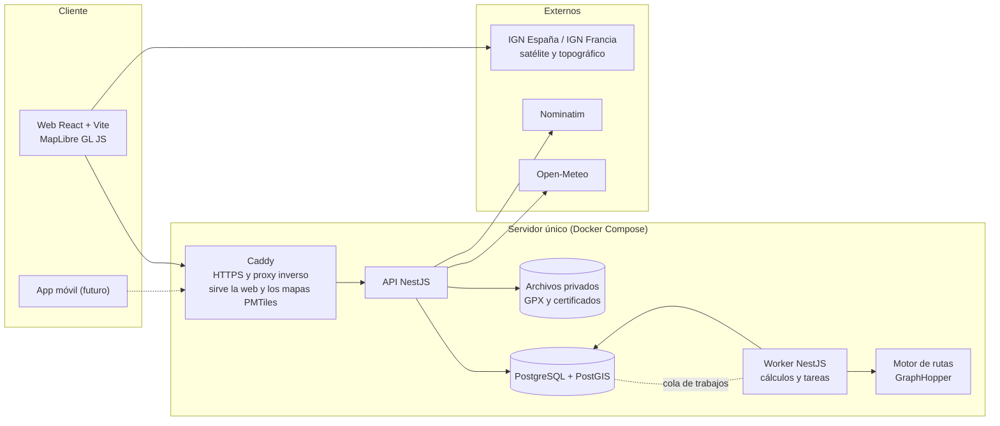

# OnWay — Documento 04: Arquitectura y stack

Versión: 0.7 (borrador) · Fecha: 2026-10-30 · Depende de: documentos 01 (v0.7), 02 (v0.5) y 03 (v0.4)

Este documento decide **con qué y cómo** se construye OnWay: lenguaje, frameworks, base de datos, despliegue, proveedores externos, seguridad y estrategia para la futura app móvil. Parte de las restricciones de un proyecto didáctico (documento 03, sección 14).

> **Sincronizado.** Los documentos 01, 02 y 03 recogen ya las decisiones tomadas tras los bocetos (registro con aprobación, teléfono y correo visibles para coordinador y administrador, certificado opcional, confirmación de participación al cerrar y meteorología por ubicación del dispositivo). El producto se llama OnWay.

Los elementos marcados *(propuesto)* los ha añadido el arquitecto y esperan tu confirmación. Los marcados *(a verificar)* dependen de una comprobación que no he podido hacer todavía.

---

## 1. Decisiones de arquitectura

Prefijo **AD** (Architecture Decision) para distinguirlas de las decisiones de producto D-xx del documento 01.

| ID | Decisión | Alternativas descartadas | Estado |
|---|---|---|---|
| AD-01 | **Lenguaje: TypeScript** en backend, frontend y paquetes compartidos | Python (mejor ecosistema raster para la v2, pero dos lenguajes y no es lo que se estudia en clase) | Confirmada |
| AD-02 | **Backend: NestJS** | Fastify (menos estructura), Express (hay que montar todo a mano) | Confirmada |
| AD-03 | **Frontend: React + Vite** como aplicación de una sola página | Angular, Vue, Next.js (no hace falta renderizado en servidor: todo va tras el login) | Confirmada |
| AD-04 | **Despliegue: un único servidor virtual con Docker Compose, con 8 GB de RAM como punto de partida y un techo de 20 €/mes en total** (servidor, copias y dominio). Objetivo: unos 12–15 €/mes. El servidor no se contrata hasta tener la primera entrega lista | Plataformas gratuitas (no dan RAM para el motor de rutas), varios servicios en la nube (coste por estar encendidos), servidor de 4 GB (sin margen para el motor de rutas) | Confirmada (presupuesto tuyo: 10–20 €/mes; la elección del plan la delegaste en el arquitecto) |
| AD-05 | **Monolito modular**: una API y un worker que comparten el mismo código y la misma base de datos | Microservicios (coste y complejidad sin necesidad) | Propuesta |
| AD-06 | **PostgreSQL + PostGIS** como única base de datos | Base documental o geoespacial aparte | Propuesta |
| AD-07 | **Aislamiento por organización en dos capas**: filtro en la aplicación y *Row Level Security* en PostgreSQL | Solo filtro en código (un olvido filtra datos de otra organización) | Propuesta |
| AD-08 | **Cola de trabajos en PostgreSQL** (pg-boss), sin Redis | Redis + BullMQ (un servicio más que mantener) | Propuesta |
| AD-09 | **Contrato de API primero**: esquemas Zod compartidos, OpenAPI generado, cliente tipado | Tipos duplicados a mano entre web y API | Propuesta |
| AD-10 | **Mapas con MapLibre GL JS**; mapa base vectorial propio (Protomaps); satélite y topográfico desde los servicios abiertos de IGN España e IGN Francia | Google Maps (licencia y coste), Mapbox (de pago) | Propuesta |
| AD-11 | **Motor de rutas detrás de una interfaz**, con una prueba técnica antes de fijarlo. Candidato inicial: GraphHopper | Fijarlo ya sin medir | Propuesta |
| AD-12 | **Datos sensibles cifrados en la aplicación** (AES-256-GCM), con huella HMAC para detectar documentos duplicados | Cifrado solo de disco, o guardarlos en claro | Propuesta |
| AD-13 | **Móvil: web instalable (PWA) ahora, decisión de envoltorio nativo más adelante** | Decidir ya React Native o Capacitor | Propuesta |
| AD-14 | **Mapas y datos externos cargados en el servidor propio** siempre que sea posible (elevación, mapa base), para no depender de cupos | Llamar a APIs externas en cada consulta | Propuesta |

---

## 2. Vista general



Puntos clave:
- El navegador pide los mapas base directamente al servidor propio y el satélite a IGN. La API nunca hace de intermediaria de teselas.
- La API y el worker son **la misma base de código con dos puntos de entrada**. Esto cumple "un solo servicio desplegable" del documento 03 y permite que los cálculos largos no bloqueen las peticiones.
- El motor de rutas es el único componente que no es TypeScript. Corre en su propio contenedor y se llama por HTTP desde el worker.

---

## 3. Stack por capa

| Capa | Elección | Notas |
|---|---|---|
| Lenguaje | TypeScript en modo estricto | Un solo lenguaje para API, worker, web y paquetes compartidos |
| Gestor de paquetes y repositorio | pnpm con workspaces (monorepo) | Estructura en la sección 4 |
| Backend | NestJS | Módulos, inyección de dependencias, guards para roles |
| Validación y contratos | Zod 4 (`strictObject`) | Un mismo esquema valida en la API y genera tipos en la web. En H0 la API valida con un interceptor propio sobre los esquemas, sin `nestjs-zod` |
| Documentación de API | OpenAPI generado | Cliente tipado generado para la web y, más adelante, para móvil |
| Base de datos | PostgreSQL 16 con PostGIS | Geometría 3D (con altitud), índices espaciales GiST |
| Acceso a datos | Drizzle ORM sobre el driver `pg` (node-postgres), con SQL propio para lo espacial | Prisma no maneja bien PostGIS. El driver `pg` y su `Pool` permiten fijar `app.org_id`, `app.user_id` y `app.role` al abrir cada transacción |
| Migraciones | SQL escrito a mano en `db/migrations/`, aplicado por el migrador de Drizzle (`migrate()`) con su diario `meta/_journal.json`; la 0001 (extensiones y roles) la ejecuta un superusuario en el arranque de la base | Aislamiento por organización desde la primera migración (R-05). No se usa `drizzle-kit` |
| Cola de trabajos | pg-boss | Usa la propia base de datos, con progreso y reintentos |
| Autenticación | Propia: Argon2id, sesión en base de datos con cookie segura y CSRF por HMAC | Argon2id con `crypto.argon2` de Node (≥ 24.7, sin dependencia nativa; parámetros m=19 MiB, t=2, p=1). Endpoint de tokens para móvil cuando llegue |
| Frontend | React 19 + Vite 7 + TypeScript, con `react-router` 7 como enrutador | Rutas por rol en un módulo puro (`apps/web/src/nav`) |
| Mapas en el navegador | MapLibre GL JS (con react-map-gl como envoltorio) | Sin claves ni cuotas |
| Estado del servidor | TanStack Query | Caché, reintentos, estado de los trabajos de cálculo |
| Interfaz | Componentes accesibles con controles grandes y alto contraste | Uso con guantes y luz solar. En H0 son componentes propios, sin librería de interfaz (objetivos de 48 px, foco visible, teclado); Radix u otra se valorará si un hito lo pide |
| Internacionalización | react-i18next, español y francés desde el primer día | Sin textos fijos en el código |
| Motor de rutas | GraphHopper (candidato) en contenedor propio | Sección 7 |
| Mapa base | Protomaps (PMTiles) extraído para los Pirineos | Sección 8 |
| Pruebas | Vitest (`jsdom` y Testing Library en la web), Testcontainers con PostGIS real, Playwright (Chromium) | Sección 12 |
| Formato | Prettier (`pnpm format:check` en la integración continua) | ESLint con `typescript-eslint` está aprobado pero no se ha incorporado todavía: el plan de H0 solo exigía formato |
| Integración continua | GitHub Actions | |
| Servidor web | Caddy | HTTPS automático, sirve la web y los archivos PMTiles. En local, `docker compose up` lo publica en `http://localhost:8080` con proxy a `/api` |

**Versiones reales tras H0** (2026-10-30): Node 24 (imágenes `node:24.22.2-alpine3.24`), pnpm 9.12, TypeScript 5.9, NestJS 11 (Express 5), Drizzle ORM 0.45, `pg` 8.23, Zod 4.6, React 19.3, Vite 7.3, TanStack Query 5.105, react-router 7.18, react-i18next 17, Vitest 3.2, Testing Library 16, Testcontainers 12, Playwright 1.64, Prettier 3.9, PostGIS `postgis/postgis:16-3.4`, Caddy 2.11.

---

## 4. Estructura del repositorio

```
onway/
├─ apps/
│  ├─ api/            NestJS: puntos de entrada http y worker
│  └─ web/            React + Vite
├─ packages/
│  ├─ contracts/      Esquemas Zod y tipos compartidos (la fuente de verdad del API)
│  ├─ geo/            Funciones puras de geometría (distancias, perfiles, GPX)
│  └─ i18n/           Textos es / fr
├─ infra/
│  ├─ compose.yml     Todos los servicios
│  ├─ Caddyfile
│  └─ routing/        Configuración del motor de rutas y script de preparación de datos
├─ db/
│  ├─ migrations/     Migraciones SQL a mano (documento 05)
│  └─ tests/          Pruebas del esquema y de las políticas de seguridad
├─ data/
│  └─ seed/           Datos de demostración ficticios (R-10)
├─ docs/              Los documentos 01 a 07 y las decisiones (ADR)
└─ CLAUDE.md          Instrucciones para Claude Code (documento 07)
```

Reglas de dependencia:
- `packages/*` no importan nada de `apps/*` ni de React ni de NestJS. Así los reutiliza una app móvil.
- `apps/web` solo conoce el API a través de `packages/contracts` y el cliente generado.
- La lógica de rutas y geometría vive en `packages/geo` y en el backend, nunca en componentes de interfaz (requisito de portabilidad del documento 01).

---

## 5. Backend: módulos y puertos

### 5.1 Módulos

Cada módulo del dominio (documento 03, sección 2) es un módulo de NestJS con sus propios controladores, servicios y acceso a datos. Un módulo solo habla con otro a través de su servicio público o de eventos.

| Módulo NestJS | Responsabilidad |
|---|---|
| `identity` | Registro, inicio de sesión, sesiones, aprobación de cuentas, roles, organizaciones |
| `profiles` | Perfil de rescatista, cursos y habilidades, certificados, datos sensibles cifrados |
| `teams` | Equipos y su localidad |
| `missions` | Misiones, puntos, ciclo de vida, cierre y confirmación de participación |
| `participation` | Ofertas de voluntariado, estados, acciones en bloque |
| `routes` | Biblioteca, versiones, derivación, validación, importación y exportación GPX |
| `calculation` | Trabajos de cálculo, progreso, resultados |
| `weather` | Pronóstico a la altitud del punto, caché, luz y luna |
| `audit` | Registro de auditoría, consulta para el administrador |
| `files` | Almacenamiento privado de GPX y certificados |

### 5.2 Puertos (interfaces hacia lo externo)

Principio 7 del documento 03: lo externo se puede cambiar sin tocar el dominio. Cada puerto es una interfaz TypeScript con una implementación inyectada.

| Puerto | Implementación inicial | Alternativas previstas |
|---|---|---|
| `RoutingProvider` | GraphHopper | Valhalla, pgRouting; módulo propio de superficie de coste (v2) |
| `ElevationProvider` | **Compuesto (H1)**: archivos Copernicus GLO-30 del servidor (lectura por ventanas, interpolación bilineal) dentro de la caja de los Pirineos y, fuera de ella, la API de elevación de Open-Meteo (Copernicus GLO-90). Si ninguna responde, `OUTSIDE_COVERAGE` | MDT del IGN español, RGE ALTI francés |
| `WeatherProvider` | **Open-Meteo (H1)**: pronóstico a la altitud propia del punto (`elevation`), horario y diario de 7 días, isoterma de 0 °C; caché por celda y banda en `forecast_cache` | Meteoblue |
| `GeocodingProvider` | **Nominatim público (H1)**: `User-Agent` con contacto, 1 petición/s en toda la API, caché de 24 h | CartoCiudad (España), Base Adresse Nationale (Francia) |
| `FileStorage` | Disco del servidor (volumen) | Almacenamiento compatible con S3 |
| `Clock` | Reloj del sistema | Reloj fijo en pruebas |
| `Mailer` | **Resend** (recuperar contraseña). En desarrollo y pruebas, registro en consola o Mailpit | SMTP propio, Brevo |

**Cómo se implementó en H1 (T4).** Los adaptadores viven en `apps/api/src/geo/` y se inyectan por símbolo; `main.ts` monta siempre los reales y las pruebas inyectan los suyos (superficie sintética y geocodificador en memoria en `test:api`; nada de variables que cambien a falsos en la imagen). Las URL, el contacto de Nominatim y la carpeta del DEM salen de la configuración (`ELEVATION_DEM_DIR`, `OPEN_METEO_ELEVATION_URL`, `NOMINATIM_URL`, `NOMINATIM_CONTACT`). El DEM se lee con `geotiff` por bloques de 1024 x 1024 (nunca entero en memoria) y con a lo sumo 2 lecturas a la vez: el `api` queda en unos 75 MiB tras leer teselas de la caja (límite 512 MiB). El límite por usuario de `getElevation` es un cubo de 30 peticiones de ráfaga y 3 por segundo (D-H1-09); el de Nominatim es un cubo global de 1 petición por segundo con hasta 2 s de cola, pasados los cuales responde `RATE_LIMITED` con `retryAfterSeconds`. Los datos pesados los descarga el servicio `geodata` (sección 9).

**Cómo se implementó en H1 (T5): entorno, tiempo, luz y luna.** Módulo `apps/api/src/weather/` con `getEnvironment`. `OpenMeteoWeatherProvider` pide a `https://api.open-meteo.com/v1/forecast` (configurable con `OPEN_METEO_FORECAST_URL`) la **altitud propia** del punto en `elevation` (R-06; hay una prueba unitaria sobre la URL) con `timezone=auto`, 7 días, `wind_speed_unit=kmh` y las variables `temperature_2m`, `wind_speed_10m`, `wind_gusts_10m`, `precipitation`, `snowfall`, `cloud_cover` y `freezing_level_height` (isoterma de 0 °C), en `current`, `hourly` y, agregadas, `daily`. Las horas locales se devuelven como instantes UTC y una hora sin temperatura, viento, precipitación o nubosidad se descarta en vez de inventarla. **Caché** `forecast_cache`: clave (proveedor, celda de 0,01°, banda de altitud de 100 m), validez de 3 h; la altitud que se pide al proveedor es la de la banda (así lo guardado es función de la clave, y el redondeo es de ±50 m). Una sola llamada en curso por celda: las peticiones simultáneas esperan la misma y la primera guarda el resultado. Si el proveedor falla: `stale` (último dato, con su hora, aunque haya caducado) o `unavailable`, siempre 200 (doc 06); la celda no vuelve a preguntarse durante 60 s. **Salud pasiva (D-H1-12):** `getHealth` no llama al proveedor; `weatherProvider` vale `false` solo si la última llamada real falló hace menos de 30 min, y entonces `status` es `degraded`. **Ubicación (INV-30, RN-26):** la posición del dispositivo se redondea a su celda de ~1 km al recibirla (`roundToCell` de `@onway/geo`, idempotente: el cliente ya la redondea), la altitud es la del DEM en el centro de la celda, y no se guarda ni se registra: la única huella es la fila de la celda, sin usuario ni organización. El API escribe una línea por petición (id, método, ruta, estado y tiempo) **sin cadena de consulta** y sin registrar `/health`. Sol y luna salen de `@onway/geo` (SunCalc 2, BSD-2, cálculo local): el día es el día solar local del punto (de una medianoche solar a la siguiente), sin zona horaria. `bulletins` va siempre vacío en H1 (RF-706 es Could).

### 5.3 Reglas transversales

- **Permisos en el servidor, siempre.** Un guard comprueba el rol y otro la pertenencia a la organización. Ningún permiso depende de lo que muestre la interfaz.
- **Los datos de contacto y sensibles no viajan en listados.** La lista de voluntarios devuelve nombre, equipo y localidad del equipo (RN-21). La ficha devuelve además cursos, habilidades, teléfono y correo, y solo al coordinador de una misión donde el rescatista se ofreció o fue añadido *(propuesto)*. Documento y dirección solo salen en el perfil del propio rescatista y en la consulta del administrador, que se audita.
- **Los eventos del documento 03 (sección 12)** se publican dentro del proceso con el emisor de eventos de NestJS. Si en la v3 hay notificaciones, serán suscriptores nuevos.

---

## 6. Datos

### 6.1 PostgreSQL y PostGIS

- Geometrías en SRID 4326, con altitud: `LineStringZ` para trazados y `PointZ` para puntos.
- Índice espacial GiST sobre las versiones de ruta desde la primera migración, aunque la búsqueda por punto llegue en la segunda entrega (documento 03, sección 13).
- Distancias y desniveles se calculan con funciones de PostGIS o con `packages/geo`, nunca en la interfaz.
- Todo dato de negocio lleva `organization_id`.

### 6.2 Aislamiento por organización

1. **Capa de aplicación.** Cada consulta se hace dentro de una transacción en la que se fija la organización del usuario.
2. **Capa de base de datos.** Políticas de *Row Level Security* sobre cada tabla de negocio comparan `organization_id` con esa variable de transacción. Si el código se olvida del filtro, la base de datos devuelve cero filas.
3. **Requisito crítico.** La aplicación se conecta con un rol de base de datos que **no** es superusuario ni propietario de las tablas. De otra forma, RLS se salta. Esto se comprueba con una prueba automática.

### 6.3 Cifrado de datos sensibles (AD-12)

- Documento de identidad y dirección se cifran por campo con AES-256-GCM antes de guardarse, con identificador de clave para poder rotarla.
- La clave maestra no vive en la base de datos: está en un archivo de secretos del servidor, fuera del repositorio y de las copias de seguridad de la base.
- Para detectar documentos duplicados sin descifrar, se guarda una huella HMAC-SHA256 del número normalizado, con una clave distinta.
- La consulta de estos datos por parte del administrador se registra en la auditoría (quién, cuándo, de quién).
- **Certificados de curso:** archivos privados, no públicos. Se sirven con enlace firmado de corta duración. Cada apertura por un coordinador o por el administrador se registra *(propuesto)*.

### 6.4 Copias de seguridad

Volcado diario de la base de datos, cifrado, enviado a un almacenamiento externo al servidor. Se prueba la restauración al menos una vez. Es parte de la fiabilidad que pide el documento 01.

---

## 7. Motor de rutas

Es el mayor riesgo técnico (R-01). La decisión se toma midiendo, no por preferencia.

### 7.1 Qué hay que resolver, por fases

| Fase | Necesidad | Enfoque |
|---|---|---|
| v1 | Rutas sobre carreteras, pistas y senderos existentes, con varias alternativas hacia el mismo objetivo | Motor sobre la red de OpenStreetMap |
| Segunda entrega | Cortar una ruta en un punto y recalcular solo el tramo final | La misma interfaz con un origen distinto: no exige un motor nuevo |
| v2 | Tramos campo a través, sin camino | Superficie de coste sobre el modelo de elevación, unida a la red |

### 7.2 Candidatos para la red (v1)

| Candidato | A favor | En contra |
|---|---|---|
| **GraphHopper** | Perfiles personalizables con *custom model* (penalizar pendiente, dificultad del sendero), rutas alternativas, funciona con extractos regionales | Hay que ajustar y probar un perfil de senderismo propio para montaña. Necesita mucha RAM en áreas grandes, por eso se usa un extracto de los Pirineos y acceso a disco mapeado |
| **Valhalla** | Perfil peatonal, alternativas, más ligero de montar | Menos fácil de personalizar para montaña |
| **pgRouting** | Dentro de la propia base de datos, control total | Hay que construir los costes y el grafo a mano |

Dato verificado: la documentación de GraphHopper indica que preparar una red mundial exige entre 60 y 120 GB de memoria, con opción de reducirlo con almacenamiento mapeado en disco. Eso confirma que hay que trabajar con un **extracto regional** (cuadro de los Pirineos, España y Francia), no con países enteros. *(La licencia de cada candidato está a verificar antes de elegir; entiendo que GraphHopper es de código abierto con licencia permisiva.)*

### 7.3 Prueba técnica previa (PoC)

Antes de comprometer la implementación, una prueba aislada de unos pocos días.

- **Zona:** 3 pares origen-destino reales de los Pirineos, uno a cada lado de la frontera y uno que la cruce.
- **Qué se compara:** GraphHopper frente a Valhalla (pgRouting solo si ambos fallan).
- **Criterios de aceptación:**
  1. Devuelve al menos 2 alternativas razonablemente distintas por par (D-04: pueden compartir tramos).
  2. Prefiere senderos y pistas marcados frente a carretera cuando el destino está en montaña.
  3. Evita pendientes extremas configurables.
  4. Calcula en pocos segundos con el extracto cargado.
  5. Funciona dentro del presupuesto de memoria de la sección 9.
- **Resultado esperado:** un informe corto que fija el motor y los pesos del perfil, y guarda los casos como pruebas automáticas.

### 7.4 Elevación

- Base global: Copernicus DEM GLO-30, 30 m, formato GeoTIFF optimizado, descarga gratuita sin cuenta. **Limitación a tener en cuenta:** es un modelo de **superficie** (incluye bosque y edificios), no de terreno desnudo. Para pendientes en senderos bajo arbolado puede introducir error.
- Mejora prevista: modelos de terreno nacionales de mayor resolución de IGN España e IGN Francia *(a verificar disponibilidad, resolución y licencia)*.
- Las métricas de una ruta importada se recalculan siempre con el modelo propio (R-07).

### 7.5 Campo a través (v2) y el lenguaje

Los cálculos raster (superficie de coste, pendiente, obstáculos) son más cómodos en Python que en TypeScript. Esta decisión **no se toma ahora**. El puerto `RoutingProvider` permite en la v2 añadir un pequeño servicio en Python sin tocar el dominio. Lo anoto como riesgo R-12.

---

## 8. Mapas

### 8.1 Capas

| Capa | Origen | Cómo se sirve |
|---|---|---|
| Carreteras (mapa base) | OpenStreetMap, vía Protomaps | Un archivo PMTiles de los Pirineos en el servidor, servido por Caddy |
| Satélite | Ortofotos de IGN España (PNOA) e IGN Francia | Servicio de teselas WMTS de cada instituto, desde el navegador |
| Topográfico | Mapas de IGN España e IGN Francia + curvas de nivel generadas desde el modelo de elevación | Servicios WMTS y capa generada en el navegador |

La capa que se pide cambia según la zona visible (lado español o francés).

### 8.2 Lo verificado

- **IGN España, PNOA:** servicio `https://www.ign.es/wmts/pnoa-ma`, licencia CC BY 4.0 y acceso público sin limitaciones, sin cuota publicada. La atribución se compone con "Instituto Geográfico Nacional / Centro Nacional de Información Geográfica".
- **IGN Francia:** servicio `https://data.geopf.fr/wmts`, con acceso público sin condiciones listadas en su ficha. Las bases de ortofotos, Plan IGN y BD TOPO se abrieron bajo Licence Ouverte 2.0 desde enero de 2021.
- **Protomaps:** el mapa base se distribuye como obra producida bajo ODbL y exige atribución a OpenStreetMap. El planeta completo ocupa unos 120 GB, así que se extrae solo la región con la herramienta `pmtiles extract`. Recomiendan alojar la copia en almacenamiento propio en lugar de enlazar la descarga.

### 8.3 A verificar *(Q-26)*

- Qué capas concretas, nombres y formatos ofrecen ambos servicios (se leen en su `GetCapabilities`) y si hay mapas topográficos a escala de montaña en abierto en ambos lados.
- Si un servicio gratuito tolera el uso previsto sin condiciones de uso razonable. Ninguna ficha publica cuota, pero eso no garantiza que no exista.
- Si las licencias permiten **pregenerar teselas para uso offline** (v2).

### 8.4 Modo sin conexión (v2)

Como el mapa base ya es un archivo PMTiles, la descarga de una región consiste en guardar un archivo o un rango de él. Las capas raster de IGN requerirían pregenerar teselas, de ahí la verificación anterior.

### 8.5 Atribuciones

Se muestran siempre en el mapa: OpenStreetMap, IGN España / CNIG, IGN Francia, Open-Meteo, y la cita de Copernicus DEM si se muestra algo derivado.

---

## 9. Proveedores externos: límites verificados

Es la prueba de la sección 9.1 del documento 03.

| Proveedor | Uso | Límite o condición verificada | Consecuencia de diseño |
|---|---|---|---|
| **Open-Meteo** | Pronóstico a la altitud del punto | Gratuito solo no comercial. Hasta 600 llamadas por minuto, 5.000 por hora, 10.000 al día y 300.000 al mes. Datos CC BY 4.0 | Sobrado para el proyecto. Aun así: caché por punto y altitud redondeados, y se agrupan peticiones de la misma celda |
| **Nominatim** (público) | Dirección a coordenadas | Máximo 1 petición por segundo. Obligatorio identificar la aplicación en User-Agent. Obligatorio cachear resultados. **Prohibido el autocompletado en cliente** | La búsqueda de dirección en Crear misión (vista 5) se lanza **al pulsar buscar**, no al teclear. Caché de resultados en servidor. Si crece el uso: CartoCiudad y BAN |
| **IGN España / Francia** | Teselas de satélite y topográficas | Sin cuota publicada (ver 8.3) | Atribución visible. Plan B: otro proveedor de satélite en plan gratuito |
| **Copernicus DEM GLO-30** | Elevación | Gratuito, sin cuenta, en archivos descargables. Algunos países no tienen todas las teselas públicas | Se descarga la caja de los Pirineos al servidor. Cero cupo |
| **Resend** | Correo transaccional (solo recuperar contraseña en v1) | Plan gratuito: 3.000 correos al mes y 100 al día. Para enviar a cualquier destinatario exige verificar un dominio propio | Detrás del puerto `Mailer`. Hasta tener dominio (Q-28) solo llega al propietario de la cuenta, suficiente para desarrollar. Sin notificaciones activas en v1 (doc. 02 §4.1) |
| **Protomaps / OSM** | Mapa base | ODbL, atribución obligatoria | Archivo propio. Cero cupo |

### 9.0 Lo que descarga y consulta el servicio `geodata` y la `api` (H1-T4, verificado el 2026-10-30)

| Fuente | Dirección oficial | Licencia y atribución | Uso |
|---|---|---|---|
| Copernicus DEM GLO-30 (AWS Open Data, sin cuenta) | `https://copernicus-dem-30m.s3.amazonaws.com/<tesela>/<tesela>.tif` | Gratuito para el público general; aviso obligatorio «© DLR e.V. 2010-2014 and © Airbus Defence and Space GmbH 2014-2018 provided under COPERNICUS by the European Union and ESA; all rights reserved» (con «produced using Copernicus WorldDEM-30 …» si se adapta). Es un modelo de superficie (R-15) | 12 teselas de 1° x 1° de la caja **lon −2…4, lat 42…44**: 466 149 644 bytes, cada una con tamaño y SHA-256 fijados en `infra/geodata/manifest.json` |
| Protomaps, compilación diaria del planeta | `https://build.protomaps.com/AAAAMMDD.pmtiles` (índice en `https://build-metadata.protomaps.dev/builds.json`) | ODbL, obra producida: atribución a OpenStreetMap. El cubo solo conserva la última semana y la última de cada versión de parche, así que la compilación (esquema 4.x) se elige al ejecutar y el extracto se conserva en el volumen propio | `pmtiles extract` de la misma caja, hasta zoom 14: 403 MB (compilación `20261030`, 41 867 teselas). Tope de 1 GiB |
| Fuentes y sprites de Protomaps | `https://github.com/protomaps/basemaps-assets` (commit `028c18f…` fijado) | Fuentes SIL OFL 1.1; sprites derivados de tangrams/icons (MIT) | Noto Sans Regular, Medium e Italic y `sprites/v4`: 14 MB, con una suma de comprobación del árbol de archivos |
| Herramienta `pmtiles` | `https://github.com/protomaps/go-pmtiles/releases` v1.31.2 | BSD-3 | Solo dentro de la imagen de `geodata`, con el SHA-256 de la release comprobado al construirla |
| Open-Meteo, elevación | `https://api.open-meteo.com/v1/elevation` | CC BY 4.0, no comercial, mismo cupo que el pronóstico | Fuera de la caja, con caché de 2000 puntos de ~11 m |
| Open-Meteo, pronóstico (H1-T5, verificado el 2026-10-31) | `https://api.open-meteo.com/v1/forecast` | CC BY 4.0, uso no comercial, sin clave; la tarjeta del tiempo cita a Open-Meteo (T9) | Una llamada por celda de ~1 km y banda de 100 m cada 3 h, con `elevation`, `freezing_level_height` y `timezone=auto` |
| SunCalc 2.1 (paquete npm `suncalc`) | `https://github.com/mourner/suncalc` | BSD-2-Clause | Sol y luna en `@onway/geo`; sin red. Referencias de las pruebas: US Naval Observatory (`aa.usno.navy.mil/api/rstt/oneday`) y sunrise-sunset.org, consultadas el 2026-10-31 solo para fijar valores, no desde las pruebas |

Descarga total de la primera vez: **~843 MB** (466 MB de DEM, 403 MB de PMTiles y 14 MB de fuentes) en unos 90 s con una conexión doméstica rápida; la segunda vez no descarga nada (comprueba las sumas y termina en ~1 s). El tope total es 2 GiB. Si una parte falla, `geodata` lo anota en `status.json` y la pila arranca igual (sin mapa base, o con `OUTSIDE_COVERAGE` en lo que no cubra Open-Meteo).

**Nominatim rechaza el `User-Agent` de demostración.** El 2026-10-30, el servicio público respondió `403 Access denied` («See https://operations.osmfoundation.org/policies/nominatim/») a una petición con `OnWay/0.1 (portfolio demo; contact: onway-demo@example.org)`. La política exige un contacto real; el de `example.org` (D-H1-15, R-10) no lo es. La búsqueda de dirección degrada como está previsto (`UPSTREAM_UNAVAILABLE`, la misión se crea por mapa o coordenadas), el `api` registra el estado recibido, y quien ejecute la demostración fija `NOMINATIM_CONTACT` a un contacto propio o apunta `NOMINATIM_URL` a otro geocodificador (CartoCiudad, BAN o Nominatim propio). Las pruebas y el E2E usan `providers-stub` y no dependen de esto.

### 9.1 Presupuesto de llamadas meteorológicas

La pantalla de inicio consulta el tiempo en la ubicación del dispositivo y, al pinchar, en el objetivo de una misión. Con el redondeo de coordenadas (~1 km) y una caché de varias horas, el número de llamadas depende del número de **celdas distintas**, no de usuarios. Aun con decenas de coordinadores, queda muy por debajo de 10.000 al día. La posición del dispositivo se usa solo para esta consulta y **no se guarda**: se redondea a su celda al llegar y no se registra (H1-T5, INV-30). Cada celda y banda cuesta una llamada cada 3 h, una sola con peticiones simultáneas, y 60 s de pausa tras un fallo; en H1 no hay límite por usuario: quien recorra muchas celdas distintas gasta una llamada por celda (riesgo residual de R-09, anotado en `docs/estado.md`).

---

## 10. Seguridad

| Área | Medida |
|---|---|
| Contraseñas | Argon2id. Bloqueo temporal tras intentos fallidos (RF-101), con limitación de peticiones |
| Sesiones | Cookie `HttpOnly`, `Secure`, `SameSite` estricta; sesión guardada en base de datos para poder revocarla; protección CSRF |
| Móvil futuro | Endpoint de tokens de acceso y renovación, sin cambiar los permisos |
| Autorización | Rol y organización comprobados en el servidor, más RLS en la base de datos (sección 6.2) |
| Alta de cuentas | La persona se registra y queda en espera. Un administrador aprueba y asigna el rol. El rol de coordinador nunca lo concede el registro *(propuesto)*. Un código de invitación asocia la solicitud a su organización *(propuesto)* |
| Datos sensibles | Cifrado por campo, acceso solo del propio rescatista y el administrador, auditoría (sección 6.3) |
| Datos de contacto | Teléfono y correo obligatorios, visibles para coordinador y administrador. El correo de contacto es el de inicio de sesión |
| Archivos subidos | Tipo y tamaño validados, almacenados fuera del directorio público, servidos con enlace firmado |
| Transporte y cabeceras | HTTPS siempre (Caddy), cabeceras de seguridad, CORS restringido |
| Secretos | Variables de entorno y archivo de secretos fuera del repositorio. Nunca en el código |
| Dependencias | Revisión automática de vulnerabilidades en integración continua |
| Aviso de uso | La aplicación indica visiblemente que no sustituye a un sistema real de rescate (R-03) |
| Datos de demostración | Siempre ficticios (R-10). El README lo deja escrito |

---

## 11. Despliegue

### 11.1 Servidor único

Un servidor virtual con Docker Compose y estos servicios:

| Servicio | Memoria estimada | Nota |
|---|---|---|
| Caddy | muy baja | HTTPS automático, sirve la web, proxy hacia la API, archivos PMTiles |
| API NestJS | 300–500 MB | |
| Worker NestJS | 300–500 MB | Mismo código que la API |
| PostgreSQL + PostGIS | 0,5–1 GB | Ajustado para poca memoria |
| GraphHopper | 1–2 GB *(estimación, se mide en la prueba técnica)* | Extracto de los Pirineos |

La suma se acerca a los 4 GB de RAM, sin margen para el sistema, la caché de disco ni los picos del cálculo.

**Decisión (Q-27, cerrada con tu presupuesto de 10–20 €/mes):**
- **Proveedor:** Hetzner Cloud, en una región de la Unión Europea (Alemania o Finlandia). Motivos: precio por GB de RAM entre los mejores del mercado, facturación por horas, tráfico incluido, centros de datos en la UE (importa con datos personales y RGPD) y baja latencia con España y Francia.
- **Plan:** el de **8 GB de RAM y 4 vCPU compartidas** de la gama económica. Cubre el motor de rutas (1–2 GB estimados), PostgreSQL, API y worker con margen, y deja sitio para la v2.
- **Techo:** 20 €/mes en total. **Objetivo:** 12–15 €/mes (servidor ~9–12 €, copias de seguridad ~2–3 €, dominio ~1 €/mes).
- **Descartados:** los planes con CPU dedicada, que cuestan varias veces más y no hacen falta, y el plan de 4 GB, que dejaría el motor de rutas al límite.
- **Precio exacto:** los precios de Hetzner cambiaron en 2026 y las fuentes que consulté no coinciden entre sí. No fijo una cifra: se confirma en su web al contratar. Si el plan de 8 GB supera los 20 €, se recortan alternativas (por ejemplo, un extracto de mapa más pequeño) antes que subir el presupuesto.
- **Cuándo contratar:** no antes de la primera entrega. El desarrollo y la prueba técnica van en local con Docker Compose, así que no pagas servidor durante los meses de construcción. Se podría alquilar uno por horas para medir la memoria real del motor de rutas.
- **Copias de seguridad:** almacenamiento externo barato, separado del servidor (un buzón de almacenamiento del mismo proveedor o un bucket compatible con S3).

### 11.2 Entorno de desarrollo

`docker compose up` levanta todo en local con datos de demostración ficticios. Es parte del producto de portfolio (documento 03, sección 14): cualquiera clona el repositorio y lo ve funcionando.

### 11.3 Integración y entrega continuas

- En cada cambio: formato, tipos, pruebas unitarias, pruebas de integración con PostGIS real y pruebas de extremo a extremo.
- Al fusionar en la rama principal: se construyen las imágenes y se publican en el registro de GitHub.
- Despliegue: el servidor descarga las imágenes nuevas y reinicia los servicios, sin tiempo de espera largo.

### 11.4 Observabilidad mínima

Registros estructurados, endpoint de salud para API, worker y motor de rutas, y un comprobador externo gratuito que avise si cae. Degradación controlada: si cae el motor de rutas o el proveedor meteorológico, se siguen consultando misiones y rutas ya validadas (documento 01, requisito de fiabilidad).

---

## 12. Estrategia de pruebas

| Nivel | Qué cubre | Herramienta |
|---|---|---|
| Unitarias | Reglas de dominio, funciones de geometría, estados de misión y participación | Vitest |
| Invariantes | Una prueba por cada INV-xx del documento 03, especialmente las de aislamiento, inmutabilidad de versiones y visibilidad de datos | Vitest + base real |
| Integración | Consultas espaciales, RLS, cola de trabajos | Testcontainers con PostGIS |
| Contrato | El API respeta los esquemas Zod y el OpenAPI | Generado desde los esquemas |
| Extremo a extremo | Flujos de las vistas: crear misión, ofrecerse, aceptar, cerrar con asistencia, aprobar cuenta. En H0: la demostración completa contra `docker compose up`, en escritorio y a 375 px | Playwright |
| Motor de rutas | Casos de la prueba técnica, guardados como regresión | Vitest con el contenedor |

---

## 13. Camino a iOS y Android

Lo que se asegura desde la v1 para no rehacer nada:
- Toda la lógica está detrás de la API y los permisos son del servidor (D-01).
- Contratos y cliente tipado en `packages/*`, sin dependencias de React ni del navegador.
- Autenticación preparada para tokens.
- Interfaz instalable como aplicación web (PWA).

La elección entre envolver la web (Capacitor, rápido) o hacer una app nativa en React Native/Expo (mapas nativos y descarga offline mejores) se **pospone** hasta la v2. Se decide con el modo sin conexión delante.

---

## 14. Riesgos y supuestos nuevos

| ID | Riesgo o supuesto | Mitigación |
|---|---|---|
| R-11 | El motor de rutas no entrega rutas de calidad para montaña con el perfil estándar | Prueba técnica (sección 7.3) antes de construir. Plan B: otro candidato |
| R-12 | El análisis de terreno de la v2 es más cómodo en Python que en TypeScript | Puerto `RoutingProvider`: se añade un servicio Python solo para eso, sin tocar el dominio |
| R-13 | Los servicios gratuitos de IGN pueden cambiar sus condiciones o limitar el uso sin aviso | Atribución visible, proveedor sustituible y alternativa de satélite documentada |
| R-14 | Memoria del servidor insuficiente para el motor de rutas | Extracto regional, acceso a disco mapeado, medir en la prueba. El punto de partida ya es 8 GB; el siguiente escalón de 16 GB solo entraría si el techo de 20 € lo permite |
| R-15 | El modelo de elevación Copernicus incluye vegetación y sobreestima altitudes bajo arbolado | Indicarlo, y mejorar con modelos de terreno nacionales cuando se verifiquen |
| R-16 | Precio y disponibilidad del servidor cambian | Docker Compose portable: se puede mover a otro proveedor sin cambios |

---

## 15. Preguntas abiertas de este documento

| ID | Pregunta | Quién |
|---|---|---|
| Q-26 | Capas, nombres y condiciones reales de los servicios de IGN España y Francia, y si permiten teselas para uso offline | Se verifica con sus capacidades y licencias |
| Q-27 | ~~Proveedor y plan del servidor~~ **Cerrada:** Hetzner Cloud, UE, 8 GB y 4 vCPU compartidas, techo de 20 €/mes, contratar tras la primera entrega (sección 11.1) | Arquitecto |
| Q-28 | Dominio propio para HTTPS (necesario para cookies seguras y certificado). Cuesta unos 10–15 € al año. Se compra al contratar el servidor, no antes | Tú, más adelante |
| Q-29 | ~~Archivos en disco o en almacenamiento tipo S3~~ **Cerrada:** disco del servidor con copia cifrada externa, detrás del puerto `FileStorage`; pasar a S3 es cambiar una implementación | Arquitecto |
| Q-30 | ~~ORM~~ **Cerrada:** Drizzle ORM con SQL propio para lo espacial. Si en clase usáis otra herramienta de acceso a datos, cambia la capa de datos y no el resto | Arquitecto |

---

## 16. Siguientes documentos

- **05 Modelo de datos** (v0.1, escrito): tablas, tipos, índices, políticas RLS y migraciones SQL en `db/`, a partir del documento 03. Fija que las migraciones son SQL a mano, con `drizzle-kit generate --custom`, y que la parte espacial queda por verificar con la imagen de PostGIS.
- **06 Contratos de API** (v0.2, escrito): 95 endpoints, esquemas Zod en `packages/contracts`, errores, OpenAPI generado y 71 pruebas de contrato.
- **07 Plan de implementación y `CLAUDE.md`:** orden de construcción por entregas, convenciones, comandos y reglas para Claude Code.

---

## Registro de cambios

| Versión | Fecha | Cambios |
|---|---|---|
| 0.7 | 2026-10-30 | H1-T5: §5.2 con `WeatherProvider` Open-Meteo, caché por celda y banda, degradación (`stale`/`unavailable`), salud pasiva, redondeo de la ubicación y registro sin consulta; §9.0 con el pronóstico de Open-Meteo y SunCalc; §9.1 con el presupuesto de llamadas. H1-T4: §5.2 con `ElevationProvider` compuesto (GLO-30 local + Open-Meteo) y `GeocodingProvider` Nominatim implementados; §9.0 con las fuentes de `geodata` verificadas (URL oficiales, licencias, atribuciones, tamaños, caja lon −2…4 / lat 42…44) y el rechazo de Nominatim al `User-Agent` con contacto de `example.org` |
| 0.6 | 2026-10-30 | Cierre de H0: sección 3 con lo realmente elegido (driver `pg`, `react-router`, Prettier, Argon2id de `crypto.argon2` de Node, migrador de Drizzle sobre SQL a mano sin `drizzle-kit`, validación sin `nestjs-zod`, componentes propios, jsdom y Testing Library, Testcontainers 12) y versiones reales. Sección 12: la prueba E2E de H0 |
| 0.5 | 2026-10-29 | Recuperar contraseña: puerto `Mailer` con Resend (sección 9). Referencias a 01 (v0.7) y 05 (v0.3) |
| 0.4 | 2026-10-29 | Árbol del repositorio con `db/`. Documento 06 escrito; referencias actualizadas a 01 (v0.6) y 02 (v0.5) |
| 0.3 | 2026-10-29 | El producto pasa a llamarse OnWay. Referencias actualizadas a los documentos 01 (v0.5), 02 (v0.4) y 03 (v0.3), ya reconciliados. Retirada la nota de pendiente de sincronizar |
| 0.2 | 2026-10-29 | Presupuesto de 10–20 €/mes: servidor de 8 GB con techo de 20 €, Hetzner Cloud en la UE, contratar tras la primera entrega. Cerradas Q-27, Q-29 y Q-30 por delegación del propietario. Q-28 (dominio) sigue abierta |
| 0.1 | 2026-10-29 | Primera versión. Confirmadas: TypeScript, NestJS, React + Vite, servidor único de ~5 €/mes. Límites de proveedores verificados el mismo día (Open-Meteo, Nominatim, IGN España, Copernicus, Protomaps) |
