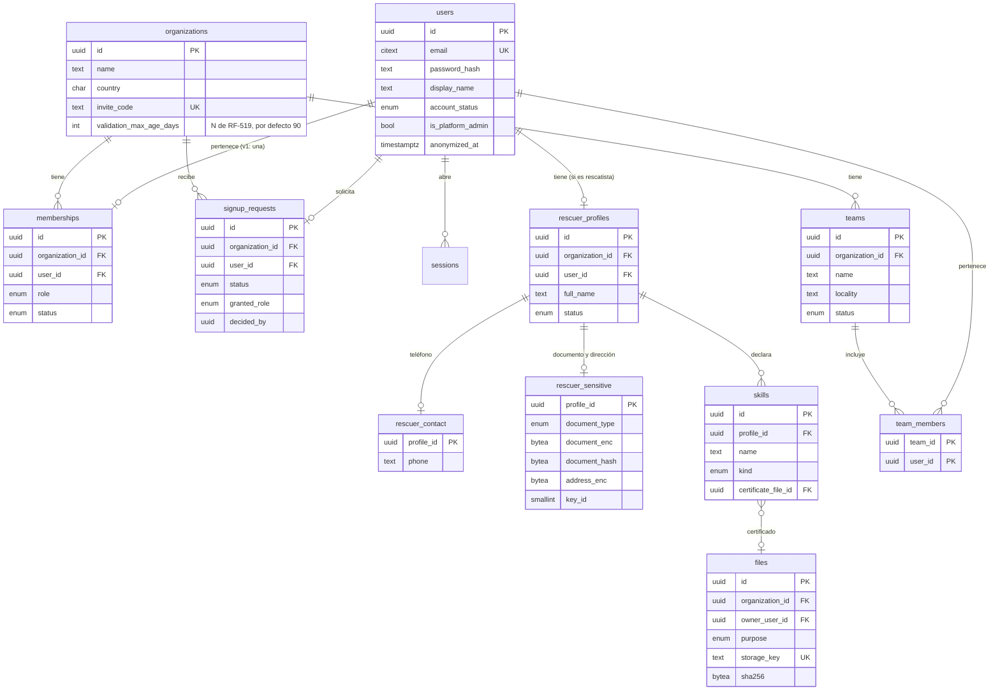
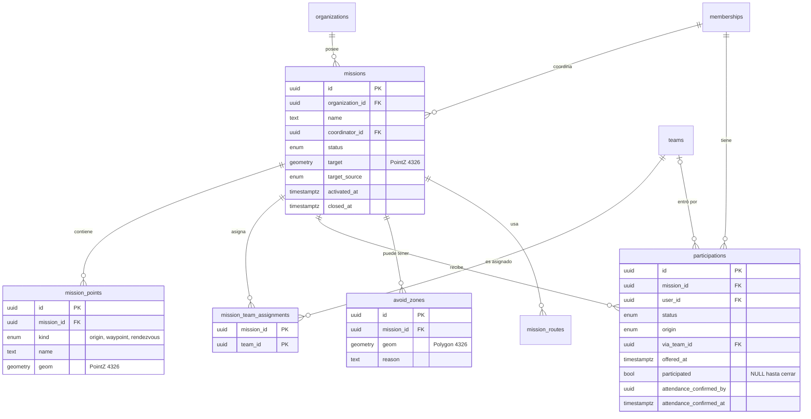
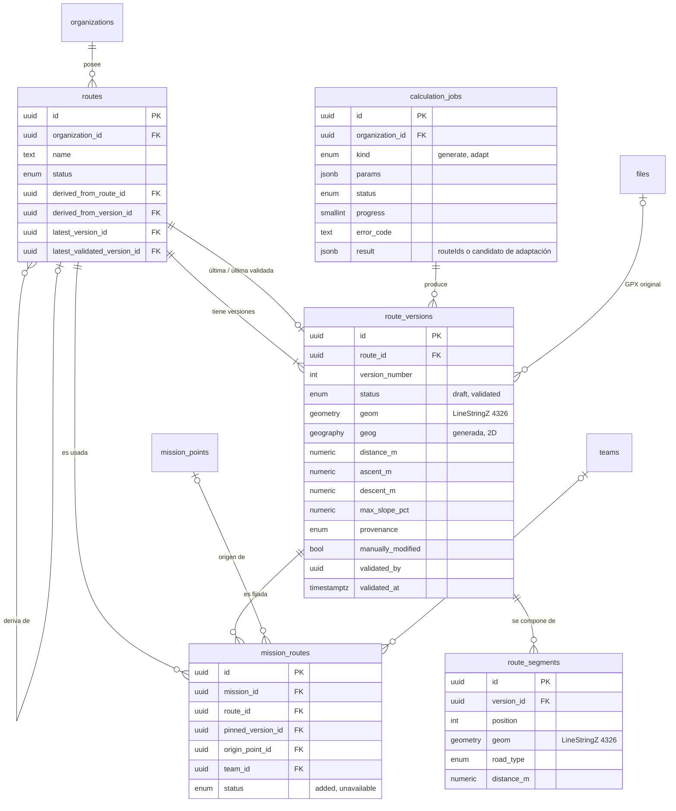

# OnWay — Documento 05: Modelo de datos

Versión: 0.3 (borrador) · Fecha: 2026-10-30 · Depende de: documentos 01 (v0.7), 02 (v0.5), 03 (v0.4) y 04 (v0.5)

Este documento traduce el modelo de dominio (documento 03) a una base de datos PostgreSQL 16 con PostGIS: tablas, tipos, claves, restricciones, índices, seguridad por filas y plan de migraciones. **El esquema está escrito como SQL ejecutable** (carpeta `db/` del proyecto) y se ha probado en un PostgreSQL 16 real con 97 comprobaciones de invariantes y permisos. Lo espacial (PostGIS) no se ha podido ejecutar en el entorno de trabajo y queda marcado como **por verificar** (sección 12).

Los elementos marcados *(propuesto)* los he decidido yo para poder avanzar y están pendientes de confirmar.

---

## 1. Qué contiene este documento y qué no

| Contenido | Dónde |
|---|---|
| Decisiones de diseño de la base de datos | Sección 2 |
| Diagramas entidad-relación | Sección 3 |
| Catálogo de tablas | Sección 4 |
| Cómo se hace cumplir cada invariante del documento 03 | Sección 5 |
| Seguridad por filas, roles y funciones | Sección 6 |
| Cifrado de datos sensibles | Sección 7 |
| Índices y consultas clave | Sección 8 |
| Plan de migraciones y datos de ejemplo | Secciones 9 y 10 |
| Pruebas de la base de datos | Sección 11 |
| Qué no está verificado | Sección 12 |

Los archivos SQL son la **fuente de verdad** del esquema:

| Archivo | Contenido |
|---|---|
| `db/migrations/0001_extensions_roles.sql` | Extensiones, roles y funciones de contexto |
| `db/migrations/0002_identity.sql` | Organizaciones, usuarios, sesiones, membresías, solicitudes de alta |
| `db/migrations/0003_profiles_files_teams.sql` | Archivos privados, perfiles (tres tablas), cursos y habilidades, equipos |
| `db/migrations/0004_missions.sql` | Misiones, puntos, asignación de equipos, participación |
| `db/migrations/0005_routes.sql` | Trabajos de cálculo, rutas, versiones, tramos, rutas en misión, zonas a evitar |
| `db/migrations/0006_audit_cache.sql` | Auditoría y caché meteorológica |
| `db/migrations/0007_invariants.sql` | Disparadores que hacen cumplir las invariantes que no caben en una restricción |
| `db/migrations/0008_rls_grants.sql` | Funciones de identidad, concesiones y políticas de seguridad por filas |
| `db/tests/seed_and_tests.sql`, `db/tests/run_tests.sql`, `db/tests/run.sh`, `db/tests/stub.py` | Pruebas de la base de datos (sección 11) |

## 2. Decisiones de diseño

| ID | Decisión | Motivo |
|---|---|---|
| DB-01 | **SQL escrito a mano como fuente de verdad** (migraciones numeradas). Drizzle se usa para consultas tipadas y se mantiene su esquema en TypeScript; las migraciones se generan con `drizzle-kit generate --custom` y contienen este SQL | Drizzle no expresa bien RLS, disparadores, columnas generadas ni geometría. Lo importante (seguridad, invariantes) no debe depender de lo que un generador sepa describir |
| DB-02 | **Identificadores `uuid`** generados por la base (`gen_random_uuid()`) | No se pueden adivinar ni contar. Sirven igual en la futura app móvil |
| DB-03 | **Fechas `timestamptz`** siempre. Las unidades son metros (`_m`) y porcentajes (`_pct`), y se llaman así en el nombre de la columna (INV-17) | Sin ambigüedad de zona horaria ni de unidades |
| DB-04 | **Enumerados nativos de PostgreSQL** para estados y tipos | Valores validados por la base. Añadir un valor es una migración trivial |
| DB-05 | **Claves foráneas compuestas con `organization_id`.** Cada tabla padre tiene `UNIQUE (id, organization_id)` y la hija la referencia con ambas columnas | La base de datos impide por construcción enlazar entidades de dos organizaciones (documento 03, sección 10), sin depender de que el código lo recuerde |
| DB-06 | **Geometría en SRID 4326 con altitud** (`PointZ`, `LineStringZ`). Además, una columna `geography` generada, en 2D, para medir distancias en metros | `ST_DWithin` y `ST_Distance` en metros necesitan `geography`; la altitud se conserva en `geometry` |
| DB-07 | **Versiones de ruta inmutables por disparador**, no solo por convención | INV-04 es la garantía de seguridad más importante del producto |
| DB-08 | **Usuarios globales, sin `organization_id`.** El correo es único en toda la plataforma. Todo lo que depende de la organización cuelga de la membresía | El inicio de sesión ocurre antes de conocer la organización. Mantiene abierta la opción de varias membresías |
| DB-09 | **El perfil del rescatista se divide en tres tablas** (`rescuer_profiles`, `rescuer_contact`, `rescuer_sensitive`) con visibilidad distinta cada una | La seguridad por filas protege filas, no columnas. Separar por tabla hace que la propia base de datos haga cumplir INV-18 e INV-28 |
| DB-10 | **Roles de base de datos sin privilegios especiales:** `onway_owner` (migraciones), `onway_app` (API y worker) y `onway_platform` (alta de organizaciones). Ni `onway_app` ni `onway_platform` son superusuario ni `BYPASSRLS` | Si la aplicación fuera propietaria o superusuaria, RLS no se aplicaría (documento 04, sección 6.2) |
| DB-11 | **Seguridad por filas con políticas restrictivas de organización más políticas permisivas por rol** | Una política restrictiva se aplica siempre y no puede relajarse añadiendo otras permisivas |
| DB-12 | **Funciones `SECURITY DEFINER` para lo que RLS no puede expresar:** inicio de sesión, registro, aprobación de cuentas, lectura auditada de datos sensibles y eliminación de datos propios | Operaciones que cruzan varias tablas con reglas propias, o que ocurren antes de tener sesión. Cada una comprueba el rol y la organización dentro |
| DB-13 | **La aplicación no puede cambiar `account_status`, `email` ni `is_platform_admin`** de un usuario directamente (permisos por columna) | Evita que alguien se apruebe a sí mismo (INV-25, INV-29) aunque encuentre una vulnerabilidad en la API |
| DB-14 | **Auditoría de solo añadir y sin claves foráneas** | Debe sobrevivir a la anonimización y al archivado (INV-22) |
| DB-15 | **Sin borrado lógico general.** Se usa el estado (`archived`, `disabled`, `deleted`) donde el dominio lo pide; lo demás se borra de verdad | Menos columnas y consultas que recordar. El rastro está en la auditoría |

## 3. Diagramas entidad-relación

Se muestran solo claves y columnas relevantes. El detalle está en el SQL.

### 3.1 Identidad, perfiles y equipos



### 3.2 Misiones y participación



### 3.3 Rutas



### 3.4 Transversales

`audit_log` (registro de solo añadir, sin claves foráneas), `forecast_cache` (caché meteorológica por celda de ~1 km, sin organización) y `sessions` (sesiones por hash, sin organización).

### 3.5 Diferencias respecto al documento 03

El documento 03 es conceptual. Al bajarlo a tablas hubo que tomar estas decisiones. **La del perfil en tres tablas está confirmada y el documento 03 (v0.4) ya la recoge**; las demás son detalles de implementación que el 03 no necesita:

| Documento 03 | Base de datos | Motivo |
|---|---|---|
| Perfil de rescatista, una entidad | **Tres tablas:** perfil, contacto y sensibles | DB-09 |
| Correo de contacto | No existe columna: es `users.email` | INV-31 |
| Sin entidad de sesión | Tabla `sessions` con el hash del identificador | Cookies de sesión (documento 04) |
| Usuario con estado | Además `is_platform_admin`, `failed_logins`, `locked_until`, `anonymized_at` | Superadministrador (Q-01), bloqueo por intentos (RF-101), INV-22 |
| Participación | Además `via_team_id` | Mostrar con qué equipo participó en el historial |
| Archivo privado, propietario = perfil | `owner_user_id` | Más simple. Equivale al perfil, que es uno por usuario |
| Pronóstico en caché | Clave por proveedor, celda de latitud y longitud (0,01°) y banda de altitud (100 m) | Es el redondeo que fija la regla (RF-704) |

## 4. Catálogo de tablas

| Tabla | Módulo | Qué guarda | Filas esperadas (demo) | RLS |
|---|---|---|---|---|
| `organizations` | Identidad | Organizaciones y su código de invitación | 1–3 | Sí |
| `users` | Identidad | Cuentas de acceso, globales | decenas | Sí |
| `sessions` | Identidad | Sesiones activas (hash) | decenas | No |
| `memberships` | Identidad | Rol de un usuario en una organización | decenas | Sí |
| `signup_requests` | Identidad | Solicitudes de alta | decenas | Sí |
| `files` | Archivos | Certificados y GPX importados | decenas | Sí |
| `rescuer_profiles` | Perfiles | Nombre y estado del perfil | decenas | Sí |
| `rescuer_contact` | Perfiles | Teléfono | decenas | Sí |
| `rescuer_sensitive` | Perfiles | Documento y dirección, cifrados | decenas | Sí |
| `skills` | Perfiles | Cursos y habilidades, con certificado opcional | cientos | Sí |
| `teams`, `team_members` | Equipos | Equipos con localidad y sus miembros | decenas | Sí |
| `missions` | Misiones | Misiones y su objetivo | decenas | Sí |
| `mission_points` | Misiones | Orígenes, intermedios y puntos de reunión | cientos | Sí |
| `mission_team_assignments` | Misiones | Equipos asignados | decenas | Sí |
| `participations` | Participación | Voluntarios y participantes, con asistencia confirmada | cientos | Sí |
| `calculation_jobs` | Planificación | Trabajos de cálculo | cientos | Sí |
| `routes` | Biblioteca | Identidad estable de cada ruta | decenas a miles | Sí |
| `route_versions` | Biblioteca | Versiones inmutables con geometría y métricas | decenas a miles | Sí |
| `route_segments` | Biblioteca | Tramos de cada versión | miles | Sí |
| `mission_routes` | Misiones | Rutas añadidas a una misión, con versión fijada | cientos | Sí |
| `avoid_zones` | Planificación | Zonas a evitar | pocas | Sí |
| `audit_log` | Auditoría | Registro de solo añadir | miles | Sí |
| `forecast_cache` | Información ambiental | Caché de pronóstico | cientos | No |
| `password_resets` | Identidad | Tokens de recuperación de contraseña (solo hash, un uso, caducan). Sin permisos para `onway_app`: se usa por funciones | decenas | Activada, sin políticas |

Volumen total pequeño: la base cabe holgadamente en la memoria asignada (documento 04). La tabla que más crecerá es `route_versions`, por la geometría. Con 10.000 rutas de unos 2.000 puntos cada una serían del orden de cientos de MB, dentro del presupuesto.

## 5. Invariantes: cómo se hace cumplir cada una

Las 32 invariantes del documento 03, sección 7. "Restricción" es una restricción declarada (clave, `CHECK`, clave foránea). "Disparador" está en `0007`. "RLS" está en `0008`. "Aplicación" significa que no se puede expresar en la base de datos y se cubre en el código y con una prueba automática.

| Inv. | Mecanismo | Dónde / cómo |
|---|---|---|
| INV-01 | **RLS + claves compuestas** | Política restrictiva `org_isolation` en 20 tablas. Claves foráneas compuestas (DB-05) |
| INV-02 | Restricción | `missions.coordinator_id NOT NULL`, `target NOT NULL`, clave foránea a la membresía |
| INV-03 | Disparador | `missions_guard`: el responsable es un miembro activo con rol coordinador o administrador (Q-14) |
| INV-04 | Disparador | `route_versions_guard`: solo se permite Borrador → Validada; una validada no se edita ni se borra. `route_segments_immutable` |
| INV-05 | RLS | `versions_rescuer`, `mroutes_rescuer` con `version_is_validated()` |
| INV-06 | Restricción | Clave foránea compuesta `(pinned_version_id, route_id)` → `route_versions (id, route_id)` |
| INV-07 | Disparador | `routes_archive_guard`. Además, `mission_routes.route_id` impide borrar una ruta usada |
| INV-08 | RLS | `missions_select`: el rescatista solo ve `active` y `closed` |
| INV-09 | RLS + disparador | `part_offer`, `part_withdraw`; `participations_guard` exige misión activa y rescatista |
| INV-10 | RLS | El rescatista no puede dejar una participación en `accepted`; solo `pending` o `withdrawn` |
| INV-11 | Disparador | `assert_mission_open` en cuatro tablas hijas. `missions_guard` bloquea editar una misión cerrada |
| INV-12 | Restricción | `UNIQUE (mission_id, user_id)` |
| INV-13 | Restricción | `UNIQUE (mission_id, route_id)` |
| INV-14 | Aplicación | Generar desde una misión exige objetivo y un origen. Es una regla de la petición, no del dato |
| INV-15 | Aplicación + restricción | La versión nace `draft` por defecto; las métricas las calcula el servidor al importar |
| INV-16 | Aplicación | Cada servicio escribe en `audit_log` en la misma transacción. Prueba: cada operación de escritura deja una fila |
| INV-17 | Convención | Columnas con sufijo `_m` y `_pct`, tipos `numeric` |
| INV-18 | **Estructura + RLS** | `rescuer_sensitive` solo es legible por el propio usuario. El administrador usa `read_rescuer_sensitive()`. El coordinador no tiene vía |
| INV-19 | Función | `read_rescuer_sensitive()` escribe en `audit_log` en la misma transacción que la lectura. No hay otra vía |
| INV-20 | Disparador | `participations_guard`: una oferta pendiente exige perfil `complete` |
| INV-21 | Consulta + índice | Historial = participaciones con `participated` de misiones `closed`. Sin tabla propia. Índice parcial `participations_history_idx` |
| INV-22 | Función | `delete_own_rescuer_data()` borra datos, anonimiza al usuario y conserva participaciones y auditoría |
| INV-23 | Restricción | `teams.locality NOT NULL CHECK (...)` |
| INV-24 | Restricción | `UNIQUE (organization_id, document_hash)` |
| INV-25 | Restricción + función | `users.account_status` solo cambia por funciones (DB-13). Una cuenta sin membresía no pasa ninguna política |
| INV-26 | Aplicación + auditoría | La apertura de un certificado ajeno la registra el servicio al firmar el enlace. La base solo garantiza que el archivo sea del propio rescatista (`skills_guard`) |
| INV-27 | Restricción + disparador | `CHECK (participated IS NULL OR status = 'accepted')`; `participations_guard` lo limpia al dejar de estar aceptado |
| INV-28 | **Estructura + RLS** | `contact_select`: propio, administrador o coordinador con participación pendiente o aceptada |
| INV-29 | RLS + función | Solo `admin_decide_signup()` crea membresías; solo el administrador puede cambiar un rol (`memberships_admin`) |
| INV-30 | Estructura | `forecast_cache` no tiene columna de usuario ni de organización |
| INV-31 | Estructura | No existe una columna de correo de contacto |
| INV-32 | Estructura + RLS | Tres tablas (`rescuer_profiles`, `rescuer_contact`, `rescuer_sensitive`), cada una con sus propias políticas |

**Pendientes de reforzar con prueba de aplicación:** INV-14, INV-15, INV-16, INV-26. Son reglas sobre procesos, no sobre datos.

## 6. Seguridad por filas, roles y funciones

### 6.1 Contexto de cada transacción

La API y el worker abren cada transacción fijando tres variables locales (`set_config(..., true)`), a partir de la sesión autenticada o del trabajo en cola:

```sql
SELECT set_config('app.org_id',  '<uuid de la organización>',          true);
SELECT set_config('app.user_id', '<uuid del usuario>',                 true);
SELECT set_config('app.role',    'coordinator' /* o rescuer o admin */, true);
```

Si faltan, las políticas no dejan ver nada (la prueba "sin contexto no se ve ninguna misión" lo comprueba). En NestJS, esto se hace en un único punto: el proveedor de la conexión por petición, que abre la transacción, fija el contexto y la cierra al terminar. **Ninguna consulta de negocio se ejecuta fuera de ese envoltorio.**

### 6.2 Roles de base de datos

| Rol | Uso | Privilegios |
|---|---|---|
| `onway_owner` | Migraciones, datos de ejemplo. Propietario del esquema | Todos. No lo usa la aplicación. Las funciones `SECURITY DEFINER` pertenecen a este rol |
| `onway_app` | API y worker | `SELECT/INSERT/UPDATE/DELETE` sujeto a RLS. No puede cambiar ni borrar la auditoría. En `users` solo puede actualizar `display_name`, `locale` y `password_hash`. No inserta en `signup_requests` ni en `users` |
| `onway_platform` | Alta de organizaciones y de su primer administrador | Solo `organizations`, `users`, `memberships`. **No ve perfiles, contacto, datos sensibles ni archivos** (documento 03, sección 10) |

### 6.3 Matriz de visibilidad

Además del filtro de organización, que se aplica siempre. C = lectura, E = escritura. El rescatista ve solo lo suyo o lo que corresponde a misiones que puede ver.

| Tabla | Administrador | Coordinador | Rescatista |
|---|---|---|---|
| `organizations` | C, E | C | C |
| `users` | C (miembros y solicitudes) | C (miembros) | C (la suya) |
| `memberships` | C, E (rol) | C | C (la suya) |
| `signup_requests` | C | — | — |
| `rescuer_profiles` | C | C | C, E (la suya) |
| `rescuer_contact` | C | C (solo con participación pendiente o aceptada) | C, E (la suya) |
| `rescuer_sensitive` | **nada directo** (función auditada) | — | C, E (la suya) |
| `skills` | C | C | C, E (las suyas) |
| `files` | C | C | C, E (los suyos) |
| `teams`, `team_members` | C, E | C, E | C (los suyos) |
| `missions` | C, E | C, E | C (solo activas y cerradas) |
| `mission_points` | C, E | C, E | C (de misiones visibles) |
| `mission_team_assignments` | C, E | C, E | — |
| `participations` | C, E | C, E | C (las suyas); crear oferta; retirarla |
| `routes`, `route_versions`, `route_segments` | C, E | C, E | C (solo las fijadas y validadas de misiones visibles) |
| `mission_routes` | C, E | C, E | C (versión fijada validada, misión visible) |
| `calculation_jobs`, `avoid_zones` | C, E | C, E | — |
| `audit_log` | C (toda la organización) | — | C (los accesos a sus datos) |

El administrador puede hacer lo del coordinador en las tablas de misiones y rutas porque `app_is_staff()` agrupa a ambos. Si Q-14 resuelve que el administrador **no** trabaja con misiones, basta cambiar `app_is_staff()` en esas políticas por una función que solo acepte `coordinator`.

### 6.4 Funciones `SECURITY DEFINER`

| Función | Hace | Comprueba |
|---|---|---|
| `auth_find_user(email)` | Busca la cuenta para el inicio de sesión (antes de conocer la organización) | — |
| `auth_record_attempt(user, éxito)` | Cuenta intentos fallidos, bloquea y registra el último acceso | — |
| `auth_register(email, hash, nombre, código, idioma)` | Crea usuario pendiente y su solicitud | Código válido y correo nuevo. Error genérico si no (RF-104) |
| `admin_decide_signup(user, aprobar, rol)` | Aprueba o rechaza, crea la membresía y el perfil incompleto, audita | Rol `admin`, misma organización, solicitud pendiente |
| `admin_set_account_status(user, estado)` | Activa o desactiva una cuenta y su membresía, cierra sesiones, audita | Rol `admin`, misma organización |
| `read_rescuer_sensitive(perfil)` | Devuelve documento y dirección cifrados y **audita en la misma transacción** | Rol `admin`, misma organización |
| `delete_own_rescuer_data()` | Elimina y anonimiza los datos propios, devuelve las claves de los certificados a borrar del disco | El propio usuario |
| `version_is_validated(version)` | Auxiliar de política, evita recursión entre políticas | — |

Las funciones fijan `search_path = public`, se revocan a `PUBLIC` y se conceden solo a `onway_app`. Los disparadores que consultan otras tablas también son `SECURITY DEFINER`, para ver todas las filas aunque quien escribe esté limitado por RLS. Esta lección salió de una prueba: un rescatista podía ofrecerse a una misión en planificación, porque su propio disparador no veía la misión.

### 6.5 Lo que RLS no cubre

| Riesgo | Dónde se cubre |
|---|---|
| Que una respuesta de lista incluya campos de más (por ejemplo el teléfono) | Lista de campos permitidos por endpoint en `packages/contracts` y prueba de contrato (documento 06) |
| Registro de apertura de certificados (INV-26) | Servicio `files`, al firmar el enlace |
| Cifrado y descifrado de documento y dirección | Aplicación, sección 7 |
| Que alguien abra una conexión con otro rol | Credenciales de `onway_app` en el archivo de secretos. `onway_owner` solo se usa en el despliegue |
| Lectura de tablas por inyección de SQL | Consultas parametrizadas siempre, y que el rol de la aplicación tenga el menor privilegio posible (esta sección) |

## 7. Cifrado de datos sensibles

Resumen de lo ya decidido en el documento 04, sección 6.3, con el formato concreto.

| Elemento | Detalle |
|---|---|
| Algoritmo | AES-256-GCM, en la aplicación, antes de guardar |
| Formato de `document_enc` y `address_enc` | `nonce (12 bytes) ‖ texto cifrado ‖ etiqueta (16 bytes)`. El texto cifrado de la dirección es un JSON con calle, número, piso, código postal, localidad, provincia y país |
| Datos autenticados adicionales | `profile_id ‖ nombre del campo`. Impide copiar un valor cifrado de un perfil a otro |
| Clave | `key_id` identifica la clave usada. Para rotar: nueva clave, volver a cifrar en segundo plano, retirar la antigua |
| Huella para duplicados | `HMAC-SHA256` con una clave distinta, sobre el documento normalizado: mayúsculas, sin espacios, guiones ni puntos, y con el tipo de documento delante *(propuesto)* |
| Dónde viven las claves | Archivo de secretos del servidor, fuera de la base de datos y de sus copias |
| Qué se pierde si se pierde la clave | Documento y dirección. Es un riesgo aceptado y se documenta en el README |

## 8. Índices y consultas clave

### 8.1 Índices

| Índice | Para qué |
|---|---|
| GiST en `route_versions.geom` y `.geog` | Biblioteca con mapa (primera entrega) y búsqueda por punto (segunda) |
| GiST en `missions.target`, `mission_points.geom`, `avoid_zones.geom` | Sugerencias cerca del objetivo y comprobaciones de zonas |
| GIN trigram en nombres de misión, ruta, perfil y habilidad | Búsqueda por nombre con `ILIKE` |
| `participations (mission_id, status, offered_at DESC)` | Lista de voluntarios con filtro por estado |
| `participations (user_id, mission_id) WHERE participated` | Historial del rescatista |
| `missions (organization_id, status, created_at DESC)` | Pestañas de misiones |
| `mission_routes (route_id)` | "Usada en…" de una ruta |
| `audit_log (organization_id, entity_type, entity_id, occurred_at DESC)` y por usuario sujeto | Consultas de auditoría y "quién ha accedido a mis datos" |
| Únicos parciales y sobre `lower(name)` | Nombre de equipo único; nombre de misión abierta único |

### 8.2 Consultas

**Biblioteca de rutas por área visible del mapa** (RF-512, primera entrega):

```sql
SELECT r.id, r.name, v.id AS version_id, v.status, v.distance_m, v.ascent_m,
       v.max_elevation_m, v.validated_at,
       (SELECT count(*) FROM mission_routes mr WHERE mr.route_id = r.id) AS missions_count
FROM routes r
JOIN route_versions v ON v.id = r.latest_version_id
WHERE r.status = 'active'
  AND v.geom && ST_MakeEnvelope($west, $south, $east, $north, 4326)   -- usa el índice GiST
ORDER BY v.created_at DESC
LIMIT 50 OFFSET $offset;
```

**Buscar rutas cerca de un punto** (RF-514, segunda entrega):

```sql
WITH p AS (SELECT ST_SetSRID(ST_MakePoint($lon, $lat), 4326) AS geom)
SELECT r.id, r.name, v.id AS version_id,
       ST_Distance(v.geog, p.geom::geography)           AS distance_m,
       ST_LineLocatePoint(v.geom, p.geom)               AS fraction_along   -- para cortar la ruta (RF-515)
FROM p, routes r
JOIN route_versions v ON v.id = r.latest_validated_version_id
WHERE r.status = 'active'
ORDER BY v.geog <-> p.geom::geography                    -- vecinos más próximos con el índice
LIMIT 20;
-- Los que pasan dentro del radio: añadir  AND ST_DWithin(v.geog, p.geom::geography, $radius_m)
```

**Lista de voluntarios** (RF-803): nombre, equipos con su localidad, estado y fecha. Nada más (RN-21).

```sql
SELECT pa.id, rp.full_name, pa.status, pa.offered_at,
       COALESCE(jsonb_agg(jsonb_build_object('team', t.name, 'locality', t.locality))
                FILTER (WHERE t.id IS NOT NULL), '[]') AS teams
FROM participations pa
JOIN rescuer_profiles rp ON rp.user_id = pa.user_id
LEFT JOIN team_members tm ON tm.user_id = pa.user_id AND tm.organization_id = pa.organization_id
LEFT JOIN teams t ON t.id = tm.team_id AND t.status = 'active'
WHERE pa.mission_id = $mission AND pa.status = $status
GROUP BY pa.id, rp.full_name
ORDER BY pa.offered_at DESC
LIMIT 25 OFFSET $offset;
```

**Acción en bloque sobre "los N resultados"** (documento 03, 8.6): se ejecuta sobre el conjunto filtrado y solo toca las filas que siguen en el estado esperado.

```sql
UPDATE participations SET status = 'accepted', decided_by = $me, decided_at = now()
WHERE mission_id = $mission AND status = 'pending' AND id = ANY($ids)
RETURNING id;      -- el recuento devuelto es "aplicadas"; el resto, "omitidas"
```

**Cerrar una misión confirmando la participación** (RF-208, documento 03, 8.7). Una sola transacción:

```sql
-- 1. Confirmar la asistencia de cada aceptado (los marcados en el diálogo)
UPDATE participations
   SET participated = (user_id = ANY($attended_user_ids)),
       attendance_confirmed_by = $me, attendance_confirmed_at = now()
 WHERE mission_id = $mission AND status = 'accepted';
-- 2. Cerrar
UPDATE missions SET status = 'closed', closed_at = now() WHERE id = $mission AND status = 'active';
-- 3. Auditar (marcados sobre el total)
INSERT INTO audit_log (organization_id, entity_type, entity_id, action, actor_user_id, detail)
VALUES ($org, 'mission', $mission, 'mission_closed', $me,
        jsonb_build_object('attended', $n_attended, 'accepted', $n_accepted));
```

El orden importa: la asistencia se escribe antes de cerrar, porque una misión cerrada no admite cambios (INV-11).

**Historial de un rescatista** (INV-21):

```sql
SELECT m.id, m.name, m.activated_at, m.closed_at, t.name AS team
FROM participations pa
JOIN missions m ON m.id = pa.mission_id AND m.status = 'closed'
LEFT JOIN teams t ON t.id = pa.via_team_id
WHERE pa.user_id = $user AND pa.participated
ORDER BY m.closed_at DESC;
```

**Misiones con una versión más nueva de una ruta** (RF-518):

```sql
SELECT mr.mission_id, mr.route_id, pv.version_number AS pinned, lv.version_number AS latest_validated
FROM mission_routes mr
JOIN route_versions pv ON pv.id = mr.pinned_version_id
JOIN routes r ON r.id = mr.route_id
JOIN route_versions lv ON lv.id = r.latest_validated_version_id
WHERE mr.mission_id = $mission AND lv.version_number > pv.version_number;
```

**Crear una versión nueva de una ruta** (INV-04): en una transacción, se inserta la versión con `version_number = max + 1` y se actualizan los punteros `latest_version_id` (y `latest_validated_version_id` al validar). Las claves foráneas de esos punteros son diferibles, para poder crear ruta y primera versión en la misma transacción.

## 9. Plan de migraciones

Las migraciones son aditivas y se ejecutan en orden. Cada entrega solo estrena las tablas que usa, pero **el esquema completo de la primera entrega se crea en la primera fase** para no mover la base de datos durante la implementación.

| Migración | Entrega | Contenido | Se puede probar sola con |
|---|---|---|---|
| 0001 | 1 | Extensiones (PostGIS, citext, pg_trgm), roles, funciones de contexto | Comprobar roles sin privilegios |
| 0002 | 1 | Identidad y sesiones | Registro, aprobación, inicio de sesión |
| 0003 | 1 | Archivos, perfiles, cursos, equipos | Alta de rescatista, certificado |
| 0004 | 1 | Misiones, puntos, participación | Crear misión, voluntariado, cierre |
| 0005 | 1 | Rutas, versiones, rutas en misión, trabajos, zonas | Biblioteca, generar, validar, añadir a misión |
| 0006 | 1 | Auditoría y caché meteorológica | Inicio |
| 0007 | 1 | Disparadores de invariantes | Pruebas de la sección 11 |
| 0008 | 1 | Funciones de identidad, concesiones y RLS | Pruebas de la sección 11 |
| 0009 | 1 | Recuperar contraseña: `password_resets` y dos funciones (Q-33) | Pedir, usar, caducar, límite por hora |
| 0010+ | 2 | Lo que traiga la segunda entrega (por ejemplo, etiquetas si se acepta Q-21) | — |

Orden de ejecución y responsabilidades:
- **0001** la ejecuta un superusuario una sola vez (crea extensiones y roles). **0002–0009** las ejecuta `onway_owner`.
- Las contraseñas de `onway_app` y `onway_platform` se fijan en el despliegue con `ALTER ROLE ... PASSWORD`, nunca en el repositorio.
- Las tablas internas de la cola (pg-boss) las crea la propia biblioteca en su esquema `pgboss`. `onway_app` recibe permisos sobre ese esquema en el despliegue.
- Cada migración debe poder aplicarse sobre una base vacía en CI con la imagen de PostGIS, y las pruebas de la sección 11 deben pasar después de la última.

## 10. Datos de ejemplo

Parte del proyecto (`data/seed/`), siempre ficticios (R-10). Se cargan como `onway_owner`, no por la API.

| Dato | Cantidad | Notas |
|---|---|---|
| Organizaciones | 2 | La segunda sirve para probar el aislamiento |
| Administrador y coordinadores | 1 y 2 | |
| Rescatistas | 12, con 2 de ellos con perfil incompleto y 3 con solicitud pendiente | Documentos y direcciones inventados, con letra de DNI válida |
| Equipos | 4, con localidades distintas, y rescatistas en 0, 1 y 2 equipos | |
| Cursos y habilidades | 20, algunos con certificado ficticio (un PDF de una página) | |
| Misiones | 6: dos en planificación, dos activas, dos cerradas | Las cerradas con participación confirmada y alguna desmarcada |
| Rutas | 8 en la biblioteca, con 1 a 3 versiones | Entre ellas una derivada, una archivada y una con borrador más nuevo que la validada |
| Objetivos | En el Pirineo, escogidos con la prueba técnica del motor de rutas (documento 04, sección 7.3) | La geometría de las rutas de ejemplo sale de esa prueba |

## 11. Pruebas de la base de datos

La base de datos tiene su propio juego de pruebas, independiente de la API, porque las invariantes viven aquí. En el repositorio irán en `apps/api/test/db/` y se ejecutan con Testcontainers sobre la imagen de PostGIS (documento 04, sección 12).

**Cobertura actual: 118 comprobaciones, todas correctas, sobre PostgreSQL 16.15.** Las 21 últimas son de la recuperación de contraseña (0009).

| Grupo | Qué se comprueba |
|---|---|
| Aislamiento | Sin contexto no se ve nada. Una organización no ve ni escribe en otra. Una ruta o versión de otra organización no se puede fijar en una misión |
| Visibilidad por rol | El rescatista no ve misiones en planificación ni datos de otros. El coordinador no lee datos sensibles y solo ve el teléfono de quien tiene participación. Los usuarios visibles son los esperados |
| Participación | Ofrecerse solo a misión activa y con perfil completo. No se puede ofrecer a otro, ni autoaceptarse, ni crearse como aceptado. Retirar y volver a ofrecerse |
| Cierre | Marcar "participó" solo en aceptados. Cerrar bloquea puntos, rutas, participaciones y la propia misión. Reabrir. Al quitar a un aceptado, se limpia la asistencia. No se vuelve a planificación |
| Rutas | Una versión validada no se edita ni se borra. Un borrador solo cambia a validada. Validada exige quién y cuándo. Versión de otra ruta, misma ruta dos veces, archivar una ruta en uso, origen que no es de tipo origen |
| Datos sensibles y auditoría | Lectura por el administrador solo por función, con auditoría en la misma transacción. El rescatista ve quién consultó sus datos. La auditoría no se puede modificar ni borrar |
| Registro y aprobación | Código válido e inválido, correo repetido, aprobar con rol, rechazar, no decidir dos veces, perfil que no puede completarse sin datos, un coordinador no puede aprobar |
| Eliminación | Las participaciones se conservan, el perfil queda anónimo, desaparecen contacto y datos sensibles |
| Plataforma y roles | La plataforma no lee perfiles, sensibles ni archivos. Ningún rol de aplicación es superusuario ni `BYPASSRLS`. Todas las tablas de negocio tienen RLS |
| Permisos por columna | Un rescatista no puede aprobarse a sí mismo cambiando `account_status` |

Cómo se ejecutan: `db/tests/run.sh` crea una base, aplica las migraciones y ejecuta los casos. Muestra una línea por caso (`PASS` o `FAIL`) y el total.

## 12. Qué no está verificado

| Qué | Estado | Cómo se cierra |
|---|---|---|
| **Columnas y funciones PostGIS** (`geometry`, `geography`, `ST_Force2D`, `ST_MakeEnvelope`, `ST_LineLocatePoint`, `<->` sobre `geography`) | **No ejecutado.** En el entorno de pruebas se sustituyeron por texto para validar todo lo demás. Las líneas espaciales llevan la marca `[GIS]` en el SQL | Aplicar 0001–0008 sobre `postgis/postgis:16` en la primera sesión de implementación y ejecutar las consultas de la sección 8.2 con datos reales |
| **Columna generada `geog`** con `ST_Force2D(geom)::geography` | Debería ser inmutable y admitida como columna generada; no comprobado | Si PostgreSQL la rechaza, sustituirla por un disparador que la rellene |
| **Rendimiento de la búsqueda por punto** con 10.000 rutas (objetivo menos de 2 s) | Sin medir | Prueba con rutas sintéticas en la segunda entrega |
| **Rendimiento de las políticas RLS** con subconsultas (contacto, rutas del rescatista) | Sin medir. Con los volúmenes del proyecto no debería importar | Medir con `EXPLAIN ANALYZE` con los datos de ejemplo |
| **Carga de la cola pg-boss** y sus permisos para `onway_app` | Sin probar | Primera fase de implementación |
| **Integración con Drizzle** de las migraciones personalizadas | Sin probar | Primera fase de implementación |

## 13. Supuestos y preguntas abiertas

**Supuestos tomados (propuestos)**

| Supuesto | Alternativa |
|---|---|
| Un usuario tiene una sola membresía en v1 (`UNIQUE (user_id)`) | Quitar esa restricción para permitir varias organizaciones |
| Las zonas a evitar viven en la organización, con misión opcional, y solo las ve el personal (Q-05, opción simple) | Que el rescatista también las vea, o que cuelguen siempre de una misión |
| Sin etiquetas en las rutas (Q-21, opción simple) | Tabla `route_tags` o columna `text[]` en 0009 |
| Teléfono con formato libre pero validado (`^\+?[0-9 ().-]{6,20}$`) | Normalizar a E.164 |
| Archivos de hasta 10 MB y de tipos PDF, JPEG, PNG, GPX y KML | Ajustarlo al implementar |
| Un certificado pertenece a un curso; no se permite certificado en una habilidad | Permitirlo también en habilidades |
| El código de invitación se guarda en claro y se puede regenerar | Guardarlo como hash. Complica mostrarlo al administrador |
| Un rescatista puede volver a ofrecerse tras retirar su oferta; un coordinador puede readmitir a un quitado | Estados terminales |
| El administrador puede hacer lo mismo que el coordinador en misiones y rutas (Q-14) | Solo gestionar usuarios y datos |
| Una cuenta rechazada no puede registrarse otra vez con el mismo correo | Permitir reintentar tras un plazo |

**Preguntas abiertas que afectan a este documento:** Q-05, Q-14, Q-21 (documento 01, sección 9) y Q-26 (capas de IGN y licencias de teselas sin conexión, que condicionará la v2, no el esquema).

## 14. Siguiente documento

El **documento 06 (contratos de API)** ya está escrito (v0.1). Se apoya en las funciones de la sección 6 y en las consultas de la sección 8 de este documento, y añadió dos columnas (ver registro de cambios). El siguiente es el **documento 07: plan de implementación y `CLAUDE.md`** para Claude Code.

## 15. Registro de cambios

**0.3 (2026-10-30)** Perfil en tres tablas confirmado por el propietario; documento 03 (v0.4) alineado, con la invariante INV-32. Migración 0009 (`password_resets`, `auth_request_password_reset`, `auth_consume_password_reset`) para recuperar contraseña (Q-33). 118 pruebas en verde.

**0.2 (2026-10-29)** El contrato de API (documento 06) pidió dos columnas: `organizations.validation_max_age_days` (migración 0002, por defecto 90, Q-35) y `calculation_jobs.result` (migración 0005). Las 97 pruebas siguen pasando.

**0.1 (2026-10-29)** Primera versión. Esquema SQL de ocho migraciones, probado en PostgreSQL 16 con 97 comprobaciones (parte espacial sin ejecutar). Una prueba descubrió que los disparadores debían ser `SECURITY DEFINER` para ver filas ocultas por RLS al rescatista; corregido.
