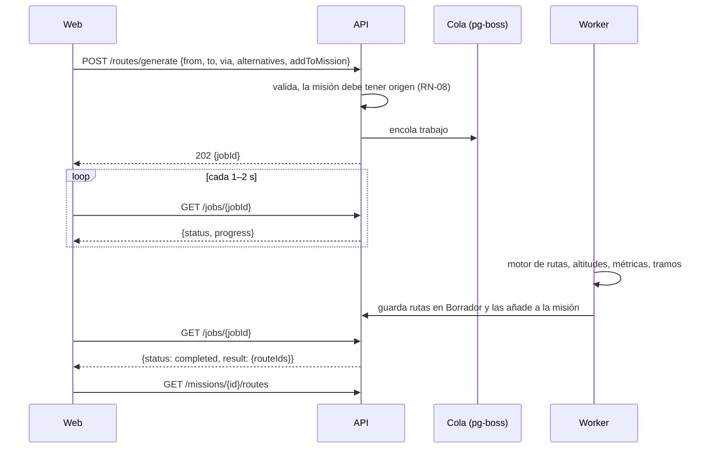
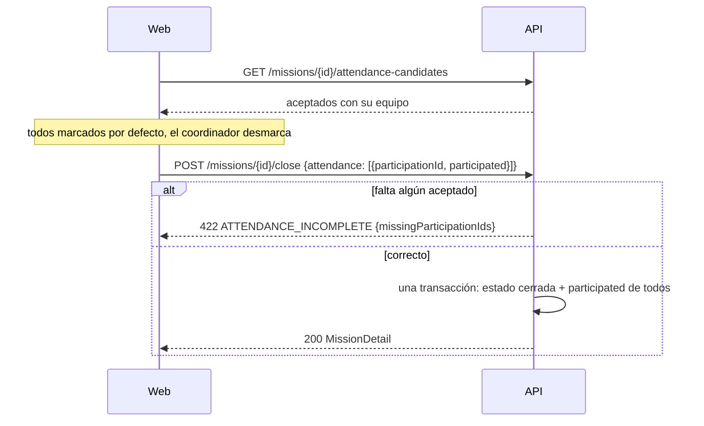
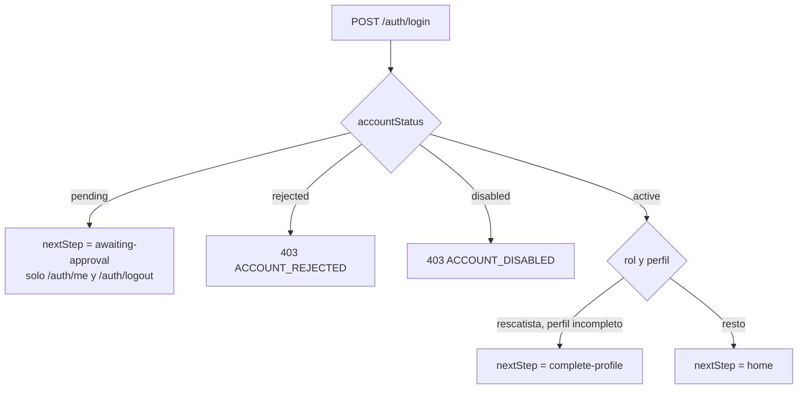

# OnWay — Documento 06: Contratos de API

**Versión:** 1.17 · **Estado:** borrador para revisión · **Fecha:** 22 de noviembre de 2026
**Depende de:** 01 (requisitos), 02 (vistas y permisos), 03 (dominio), 04 (arquitectura), 05 (datos)
**Código que lo acompaña:** `packages/contracts/` (esquemas Zod, registro de endpoints, pruebas y generadores)

---

## 1. Cómo leer este documento

El contrato **es código**: esquemas Zod en `packages/contracts/src/` y un registro de endpoints (`endpoints.ts`) que dice, para cada operación, ruta, roles, entrada, respuesta y errores. De ese registro se generan el OpenAPI, el cliente tipado de la web y **las tablas de las secciones 6 y 7 de este documento**. Si el código y este texto discrepan, manda el código; las tablas no se escriben a mano para que no puedan discrepar.

Qué se ha verificado y qué no está en la sección 11.

## 2. Decisiones de diseño

| Id | Decisión | Por qué |
|---|---|---|
| AC-01 | **REST sobre JSON**, prefijo `/api/v1`. La versión va en la ruta | Es lo que genera bien OpenAPI y el cliente tipado (AD-09). Un cambio incompatible crearía `/api/v2` sin romper una app móvil ya publicada |
| AC-02 | **Un registro único de endpoints** en `packages/contracts`. El controlador de NestJS declara el mismo esquema; una prueba de contrato comprueba que ruta, método y roles coinciden | Evita que web, API y documentación digan cosas distintas |
| AC-03 | **Dos familias de respuesta: personal y rescatista.** Todo lo del rescatista vive bajo `/my/...` y tiene sus propios tipos, sin reutilizar los del coordinador | La privacidad pasa a ser estructural: el tipo `MyMissionDetail` **no tiene** el campo `participants`, así que no puede filtrarse por descuido. Pruebas lo comprueban (§9) |
| AC-04 | **Sesión por cookie** (`onway_session`, `HttpOnly`, `Secure`, `SameSite=Strict`) y cabecera `X-CSRF-Token` en toda petición que no sea `GET`. El token se entrega en `login` y `me` | Doc. 04 §10. Para móvil se añadirá un endpoint de tokens sin tocar permisos; no está en v1 |
| AC-05 | **Un único formato de error** `{ error: { code, message, requestId, details? } }`. La web decide el texto por `code` (i18n), nunca por `message` | Dos idiomas (es/fr) y mensajes que cambian sin romper la interfaz |
| AC-06 | **Otra organización responde 404, no 403** | No se revela que existe un recurso ajeno |
| AC-07 | **Paginación por `page` y `pageSize`** (máx. 200) con `total`. Las bandejas añaden contadores por pestaña | Las organizaciones son pequeñas (cientos, no millones); paginar por posición permite «Seleccionar los 134 resultados» |
| AC-08 | **Acciones en bloque con selección explícita:** `ids`, o `filter` + `exceptIds`. «Quitar» exige `expectedCount` | Es la bandeja de correo del doc. 02 §3.7. Si entre tanto alguien retiró su oferta, la cifra no coincide y no se aplica nada (`STALE_RESOURCE`) |
| AC-09 | **Los cambios de estado son verbos**, no `PATCH status`: `activate`, `close`, `reopen`, `validate`, `archive`, `offer` | Cada transición tiene sus propias reglas y su propio cuerpo (cerrar lleva la lista de asistencia). El cliente no puede fijar un estado a mano |
| AC-10 | **El servidor calcula siempre altitudes, métricas y tramos.** El cliente envía solo geometría (y la altitud que traiga se ignora) | RN-07 y RN-10. Una ruta importada con métricas falsas no puede entrar |
| AC-11 | **Candidato → guardar.** Dibujar (`snap`), importar (`import/preview`) y adaptar devuelven un *candidato* sin guardar nada; para guardarlo se envía su geometría a `POST /routes`, `…/versions` o `…/derive` | El servidor no guarda estados intermedios. Descartar un candidato es no hacer nada |
| AC-12 | **Cálculos largos: `202` + `jobId` + sondeo** de `GET /jobs/{id}` cada 1–2 s | Generar alternativas tarda; la interfaz no se bloquea (RF-501) |
| AC-13 | **Archivos: se suben antes y se referencian por id.** Un certificado se abre con un enlace firmado de pocos minutos | El archivo nunca viaja dentro de un JSON y nunca tiene URL permanente |
| AC-14 | **Toda lectura que deja huella de auditoría es `POST`** (`readUserSensitive`, `getCertificateLink`) | Una caché o un rastreador no pueden repetirla sin que se note, y es evidente en el código que tiene efecto |
| AC-15 | **El servidor dice qué se puede hacer:** `actions` en la misión, `canOffer` y `offerBlockedReason` para el rescatista | La web pinta botones; la decisión sigue siendo del servidor (RF-103) y el móvil heredará la misma lógica |
| AC-16 | **Estricto en ambos sentidos.** Un campo desconocido en una petición se rechaza; un campo no declarado en una respuesta no existe | Prueba automática. Es lo que impide que «un campo de más» saque un dato personal |
| AC-17 | **Coordenadas como `{ lat, lon }`** y líneas como GeoJSON `[lon, lat, altitud]` | Evita el error clásico de invertir el orden en los puntos sueltos |
| AC-18 | **Sin `DELETE` de misiones; el único `DELETE` de rutas es `deleteRoute`** | RN-14: las rutas se archivan, y solo una archivada y sin misión se elimina del todo (issue #17). El borrado de datos personales tiene su propio camino (`DELETE /my/profile`) |

## 3. Convenciones

- **Identificadores:** UUID. **Fechas y horas:** ISO 8601 con zona (`2026-10-29T10:00:00Z`). **Fechas sin hora:** `2026-10-29`.
- **Texto:** UTF-8, con espacios recortados al validar. Los límites de longitud son los del esquema SQL.
- **Idioma de los errores:** `message` va en inglés y es para registros. La interfaz usa `code`.
- **Paginación:** `?page=1&pageSize=25`. Respuesta `{ items, page, pageSize, total }`.
- **Selección en bloque:** `{ "mode": "ids", "ids": [...] }` o `{ "mode": "filter", "filter": {...}, "exceptIds": [...] }`.
- **Límites de tasa:** inicio de sesión por cuenta (el bloqueo de 15 min tras 5 fallos lo aplica la base de datos); las tres operaciones públicas de acceso por **IP y operación** (`register` 10 por 10 min, `forgotPassword` 5 por hora, `resetPassword` 10 por hora; en memoria del `api`, doc. 04 §5.2); geocodificación 1 petición/s en servidor; el resto, un tope general por usuario. Al excederlo, `429 RATE_LIMITED` con `retryAfterSeconds`.
- **`Cache-Control: no-store`** en todo lo que lleve datos personales (`/my/profile/sensitive`, `/admin/users/{id}/sensitive`, `/my/data-export`).
- **Orden de rutas:** `/routes/snap`, `/routes/generate`, `/routes/near` e `/routes/import/preview` se declaran **antes** que `/routes/{routeId}` (una prueba lo vigila).

## 4. Errores

Todos los errores usan la misma forma. `details` solo existe para los códigos que lo tipan (§4.2).

```json
{ "error": { "code": "ATTENDANCE_INCOMPLETE", "message": "…", "requestId": "01J…", "details": { "missingParticipationIds": ["…"] } } }
```

### 4.1 Códigos y estado HTTP

| HTTP | Código |
|---|---|
| 400 | `VALIDATION_FAILED` |
| 401 | `UNAUTHENTICATED` `INVALID_CREDENTIALS` `SESSION_EXPIRED` |
| 403 | `FORBIDDEN` `CSRF_FAILED` `ACCOUNT_PENDING` `ACCOUNT_REJECTED` `ACCOUNT_DISABLED` `PROFILE_INCOMPLETE` |
| 404 | `NOT_FOUND` |
| 409 | `MISSION_CLOSED` `MISSION_NOT_ACTIVE` `INVALID_STATE_TRANSITION` `STALE_RESOURCE` `DUPLICATE_NAME` `ALREADY_OFFERED` `VERSION_IMMUTABLE` `ROUTE_IN_USE` `ROUTE_ALREADY_IN_MISSION` `COORDINATOR_HAS_MISSIONS` `LAST_ADMIN` `DOCUMENT_ALREADY_REGISTERED` `CONFIRMATION_REQUIRED` |
| 413 | `FILE_TOO_LARGE` |
| 415 | `UNSUPPORTED_FILE_TYPE` |
| 422 | `REGISTRATION_FAILED` `INVALID_RESET_TOKEN` `INVALID_DOCUMENT` `INVALID_FILE_CONTENT` `ATTENDANCE_INCOMPLETE` `MISSION_HAS_NO_ORIGIN` `OUTSIDE_COVERAGE` `NO_ROUTE_POSSIBLE` |
| 423 | `ACCOUNT_LOCKED` |
| 429 | `RATE_LIMITED` |
| 500 | `INTERNAL` |
| 502 | `UPSTREAM_UNAVAILABLE` |
| 503 | `ROUTING_UNAVAILABLE` |


Errores **transversales** que no se repiten en cada fila de la tabla de endpoints: `INTERNAL`, `RATE_LIMITED`; en todo lo que exige sesión, `UNAUTHENTICATED`, `SESSION_EXPIRED`, `FORBIDDEN`, `ACCOUNT_DISABLED` y (salvo `logout`/`me`) `ACCOUNT_PENDING`; en todo lo que no es `GET`, `CSRF_FAILED`; en lo que tiene entrada, `VALIDATION_FAILED`; en lo que tiene parámetros de ruta, `NOT_FOUND`.

### 4.2 Detalles tipados

| Código | `details` |
|---|---|
| `VALIDATION_FAILED` | `issues[]` con `path` (`origins.0.lat`), `code` y `message` |
| `ACCOUNT_LOCKED`, `RATE_LIMITED` | `retryAfterSeconds` |
| `COORDINATOR_HAS_MISSIONS` | `missionIds[]`: hay que reasignarlas antes de desactivar (RN-11) |
| `ROUTE_IN_USE` | `missions[]` con id y nombre: se explica en cuáles se usa (doc. 02 §8) |
| `CONFIRMATION_REQUIRED` | `warning: "no_validated_route"`: activar sin ruta validada avisa y se repite con `confirmWithoutValidatedRoute: true` |
| `ATTENDANCE_INCOMPLETE` | `missingParticipationIds[]`: aceptados que faltan en la lista de cierre |
| `PROFILE_INCOMPLETE` | `missing[]`: `fullName`, `phone`, `document`, `address` |
| `STALE_RESOURCE` | `currentUpdatedAt` (edición simultánea, Q-10) |

### 4.3 Qué errores no revelan nada

- `INVALID_CREDENTIALS` es el mismo para correo inexistente y contraseña errónea.
- `REGISTRATION_FAILED` es el mismo para código de invitación inválido y correo ya registrado.
- `DOCUMENT_ALREADY_REGISTERED` no dice de quién es el documento (INV-24).
- Un recurso de otra organización, o una misión en planificación pedida por un rescatista, responde `NOT_FOUND`.
- `POST /auth/password/forgot` responde siempre 202. `INVALID_RESET_TOKEN` es el mismo para token inexistente, usado, caducado o mal formado (también demasiado corto o largo: el esquema no limita su longitud, para que esa forma no se distinga de las demás). Una contraseña nueva que no cumple el esquema es `VALIDATION_FAILED` y no consume el token.

## 5. Decisión: solicitudes de alta (Q-34, confirmada)

Al contrastar el boceto 13 con el modelo de datos apareció una incoherencia: la lista de solicitudes enseñaba **«Equipo indicado»** y **«Datos completos»**, y RF-106 decía que cada solicitud indica si los datos del perfil están completos. Pero el registro solo recoge correo, nombre, contraseña y código de invitación, y el perfil se crea **al aprobar** (`admin_decide_signup`) y lo rellena la persona en su primer acceso. En el momento de la solicitud no existe ni equipo ni perfil que mirar.

**Decisión (confirmada por el propietario):** `SignupRequestItem` lleva `userId`, `email`, `displayName`, `status` y `requestedAt`. Se retiran las dos columnas del boceto y se reformula RF-106: *«el administrador ve la solicitud con el correo y el nombre indicados y la aprueba eligiendo el rol»*. Los equipos los asigna el coordinador o el administrador después, como ya dice doc. 02 §3.8.

Alternativa descartada: pedir equipo y datos en el registro. Alarga el formulario para quien aún no está aprobado, recoge datos personales de personas que quizá se rechacen y mezcla dos pasos que el doc. 02 mantiene separados.

## 6. Endpoints

El registro tiene **99 operaciones**, cada una asignada a un **hito de construcción** (H0–H9, documento 07): 97 de primera entrega y 2 de segunda (`listNearRoutes` en H8 y `adaptRoute` en H9; el contrato existe y el servidor responde `501` hasta entonces). El hito aparece junto al nombre de cada operación y en el OpenAPI como `x-milestone`; una prueba exige que todas tengan hito y que ninguna dependa de otra de un hito posterior.

| Hito | H0 | H1 | H2 | H3 | H4 | H5 | H6 | H7 | H8 | H9 |
|---|---|---|---|---|---|---|---|---|---|---|
| Operaciones | 5 | 18 | 15 | 6 | 9 | 28 | 16 | 0 | 1 | 1 |

Roles: *Rescatista*, *Coordinador*, *Admin*; *Pendiente* es una cuenta con sesión pero sin aprobar. En entrada, `campo?` es opcional. **Q-14 (resuelta, 2026-10-31: no):** las operaciones que escriben sobre misiones y rutas solo admiten *Coordinador* (constante `MISSION_WRITERS`); el administrador las lee. La base de datos lo repite en sus políticas de seguridad por filas y en INV-03 (migración 0011, doc. 05 §6.3), así que ya no basta cambiar la constante: habría que cambiar también la base.

### Sistema

| Operación | Petición | Quién | Entrada | Respuesta | Errores propios |
|---|---|---|---|---|---|
| `getHealth` · **H0**<br>Estado del servicio y de sus dependencias | `GET /health` | Público | — | 200: status, checks | — |

**Nota sobre `getHealth`.** Responde siempre 200: si una dependencia falla, `status` pasa a `degraded` y `checks` dice cuál. La base de datos se comprueba con `SELECT 1` sin contexto de usuario, como `onway_app`. `weatherProvider` es **pasivo** (D-H1-12, desde H1): refleja la última llamada real al proveedor del tiempo y nunca provoca una llamada solo para la salud (Open-Meteo tiene cupo, R-09); vale `false` únicamente si esa llamada falló en los últimos 30 minutos, y entonces `status` pasa a `degraded`; sin llamadas, o con la última correcta, vale `true`. `routingEngine` vale `false` mientras no exista su adaptador (`RoutingProvider`) y **no degrada `status`** hasta entonces: un `degraded` permanente dejaría de ser una señal útil para el comprobador externo. La nota está también en el `description` de la operación del OpenAPI.

### Acceso

| Operación | Petición | Quién | Entrada | Respuesta | Errores propios |
|---|---|---|---|---|---|
| `register` · **H5**<br>Solicitar el alta con código de invitación *(auditado)* | `POST /auth/register` | Público | cuerpo: email, password, passwordConfirm, displayName, inviteCode, locale? | 202: status | `REGISTRATION_FAILED` |
| `login` · **H0**<br>Iniciar sesión (cookie de sesión + token CSRF) | `POST /auth/login` | Público | cuerpo: email, password | 200: user, csrfToken | `INVALID_CREDENTIALS` `ACCOUNT_LOCKED` `ACCOUNT_DISABLED` `ACCOUNT_REJECTED` |
| `logout` · **H0**<br>Cerrar sesión | `POST /auth/logout` | Todos con sesión | — | 204 | — |
| `getMe` · **H0**<br>Usuario de la sesión actual y a dónde debe ir la web | `GET /auth/me` | Todos con sesión | — | 200: user, csrfToken | `SESSION_EXPIRED` |
| `updateMe` · **H5**<br>Cambiar nombre visible o idioma | `PATCH /auth/me` | Rescatista, Coordinador, Admin | cuerpo: displayName?, locale? | 200: user, csrfToken | — |
| `changePassword` · **H5**<br>Cambiar la contraseña (cierra las demás sesiones) *(auditado)* | `POST /auth/password/change` | Rescatista, Coordinador, Admin | cuerpo: currentPassword, newPassword | 204 | `INVALID_CREDENTIALS` `ACCOUNT_LOCKED` |
| `forgotPassword` · **H5**<br>Pedir enlace para restablecer contraseña | `POST /auth/password/forgot` | Público | cuerpo: email | 202: ok | — |
| `resetPassword` · **H5**<br>Restablecer la contraseña con el token recibido *(auditado)* | `POST /auth/password/reset` | Público | cuerpo: token, newPassword | 204 | `INVALID_RESET_TOKEN` |

**Tal como se construyó (`H5-acceso`).** `register`, `forgotPassword` y `resetPassword` están montadas (con `listSignupRequests`, `decideSignupRequests`, `getInviteCode` y `rotateInviteCode`, 58 con las 51 de H0 a H4; las otras 19 de H5 siguen sin montar y responden `404 NOT_FOUND`). Las tres son públicas, no llevan sesión ni CSRF y comparten un límite por IP y operación (`429 RATE_LIMITED` con `retryAfterSeconds`; los límites, en «Límites de tasa» de §1).
- *`register`.* Crea una cuenta *pendiente*, sin sesión ni rol (RN-25, INV-25), con la contraseña en Argon2id; el idioma de la cuenta es `locale` (por defecto `es`). Código de invitación inválido, de otra organización o correo ya registrado: el mismo `422 REGISTRATION_FAILED`, con el mismo cuerpo. Contraseña débil o distinta de la repetida: `400 VALIDATION_FAILED`. Deja una fila `signup_requested`. La cuenta puede iniciar sesión y `login` la lleva a la espera (`nextStep = awaiting-approval`).
- *`forgotPassword`.* Siempre `202 {ok: true}`, exista o no el correo y aunque el envío falle: no espera al puerto `Mailer`. Envía `PUBLIC_BASE_URL/reset-password#token=<token>` solo si la cuenta existe y es activa o pendiente, en el **idioma de la cuenta** (`ForgotPasswordRequest` no lleva idioma). Máximo 3 enlaces por hora y cuenta.
- *`resetPassword`.* `204` con un token válido; cierra todas las sesiones y quita el bloqueo por intentos. El token no tiene límite de longitud en el esquema: inexistente, usado, caducado (1 h), demasiado corto o largo dan el mismo `422 INVALID_RESET_TOKEN`. La contraseña nueva cumple el esquema del registro; si no, `400 VALIDATION_FAILED` y el token queda sin consumir.

### Organización

| Operación | Petición | Quién | Entrada | Respuesta | Errores propios |
|---|---|---|---|---|---|
| `getOrganization` · **H0**<br>Datos y configuración de mi organización | `GET /org` | Rescatista, Coordinador, Admin | — | 200: id, name, country, config | — |
| `listCoordinators` · **H1**<br>Coordinadores activos (selector «Coordinador responsable») | `GET /org/coordinators` | Coordinador, Admin | — | 200: items | — |

### Geo

| Operación | Petición | Quién | Entrada | Respuesta | Errores propios |
|---|---|---|---|---|---|
| `geocode` · **H1**<br>Buscar una dirección (solo al pulsar buscar) | `GET /geo/geocode` | Coordinador, Admin | consulta: q | 200: items | `UPSTREAM_UNAVAILABLE` |
| `getElevation` · **H1**<br>Altitud de un punto | `GET /geo/elevation` | Coordinador, Admin | consulta: lat, lon | 200: lat, lon, elevationM | `OUTSIDE_COVERAGE` |

### Inicio

| Operación | Petición | Quién | Entrada | Respuesta | Errores propios |
|---|---|---|---|---|---|
| `getEnvironment` · **H1**<br>Tiempo, luz y luna para la ubicación del dispositivo o el objetivo de una misión | `GET /environment` | Rescatista, Coordinador, Admin | consulta: lat?, lon?, missionId?, days? | 200: basis, missionId, location, weather, sun, moon, bulletins | `OUTSIDE_COVERAGE` `NOT_FOUND` |

### Misiones

| Operación | Petición | Quién | Entrada | Respuesta | Errores propios |
|---|---|---|---|---|---|
| `listMissions` · **H1**<br>Lista de misiones con pestañas por estado | `GET /missions` | Coordinador, Admin | consulta: page?, pageSize?, status?, q?, coordinatorId? | 200: items, page, pageSize, total | — |
| `createMission` · **H1**<br>Crear misión (nace En planificación) *(auditado)* | `POST /missions` | Coordinador | cuerpo: name, coordinatorId?, target, description?, teamIds?, rescuerIds?, origins?, routes? | 201: id, name, status, coordinator, target, origins, routes, participants, createdAt, … | `DUPLICATE_NAME` `OUTSIDE_COVERAGE` |
| `getMission` · **H1**<br>Detalle de misión (centro de trabajo) | `GET /missions/{missionId}` | Coordinador, Admin | ruta: missionId | 200: id, name, status, coordinator, target, origins, routes, participants, createdAt, … | — |
| `updateMission` · **H1**<br>Editar datos de la misión *(auditado)* | `PATCH /missions/{missionId}` | Coordinador | ruta: missionId<br>cuerpo: name?, description?, coordinatorId?, target?, expectedUpdatedAt? | 200: id, name, status, coordinator, target, origins, routes, participants, createdAt, … | `MISSION_CLOSED` `DUPLICATE_NAME` `STALE_RESOURCE` `OUTSIDE_COVERAGE` |
| `duplicateMission` · **H1**<br>Duplicar misión (puntos y, si se pide, rutas; sin participantes) *(auditado)* | `POST /missions/{missionId}/duplicate` | Coordinador | ruta: missionId<br>cuerpo: name, includeRoutes? | 201: id, name, status, coordinator, target, origins, routes, participants, createdAt, … | `DUPLICATE_NAME` |
| `activateMission` · **H1**<br>Activar misión (abre el voluntariado) *(auditado)* | `POST /missions/{missionId}/activate` | Coordinador | ruta: missionId<br>cuerpo: confirmWithoutValidatedRoute? | 200: id, name, status, coordinator, target, origins, routes, participants, createdAt, … | `INVALID_STATE_TRANSITION` `CONFIRMATION_REQUIRED` |
| `closeMission` · **H1**<br>Cerrar misión confirmando quién participó *(auditado)* | `POST /missions/{missionId}/close` | Coordinador | ruta: missionId<br>cuerpo: attendance | 200: id, name, status, coordinator, target, origins, routes, participants, createdAt, … | `INVALID_STATE_TRANSITION` `ATTENDANCE_INCOMPLETE` |
| `reopenMission` · **H1**<br>Reabrir una misión cerrada como Activa *(auditado)* | `POST /missions/{missionId}/reopen` | Coordinador | ruta: missionId | 200: id, name, status, coordinator, target, origins, routes, participants, createdAt, … | `INVALID_STATE_TRANSITION` `DUPLICATE_NAME` |
| `listMissionHistory` · **H1**<br>Historial de cambios de la misión | `GET /missions/{missionId}/history` | Coordinador, Admin | ruta: missionId<br>consulta: page?, pageSize? | 200: items, page, pageSize, total | — |
| `listAttendanceCandidates` · **H6**<br>Aceptados para el diálogo «¿Quién participó?» | `GET /missions/{missionId}/attendance-candidates` | Coordinador | ruta: missionId | 200: items | — |

### Puntos

| Operación | Petición | Quién | Entrada | Respuesta | Errores propios |
|---|---|---|---|---|---|
| `createMissionPoint` · **H1**<br>Añadir origen, punto intermedio o de reunión *(auditado)* | `POST /missions/{missionId}/points` | Coordinador | ruta: missionId<br>cuerpo: kind, name, note?, lat, lon | 201: id, kind, name, note, lat, lon, elevationM, position | `MISSION_CLOSED` `OUTSIDE_COVERAGE` |
| `importMissionPoints` · **H2**<br>Importar puntos desde un GPX/KML ya subido *(auditado)* | `POST /missions/{missionId}/points/import` | Coordinador | ruta: missionId<br>cuerpo: fileId, kind | 201: items | `MISSION_CLOSED` `INVALID_FILE_CONTENT` |
| `updateMissionPoint` · **H1**<br>Editar un punto *(auditado)* | `PATCH /missions/{missionId}/points/{pointId}` | Coordinador | ruta: missionId, pointId<br>cuerpo: kind?, name?, note?, lat?, lon?, position? | 200: id, kind, name, note, lat, lon, elevationM, position | `MISSION_CLOSED` `OUTSIDE_COVERAGE` |
| `deleteMissionPoint` · **H1**<br>Borrar un punto (no si una ruta de la misión sale de él) *(auditado)* | `DELETE /missions/{missionId}/points/{pointId}` | Coordinador | ruta: missionId, pointId | 204 | `MISSION_CLOSED` |

### Participantes

| Operación | Petición | Quién | Entrada | Respuesta | Errores propios |
|---|---|---|---|---|---|
| `addMissionTeams` · **H6**<br>Asignar equipos: sus miembros entran como Aceptados *(auditado)* | `POST /missions/{missionId}/teams` | Coordinador | ruta: missionId<br>cuerpo: teamIds | 200: added, alreadyPresent | `MISSION_CLOSED` |
| `removeMissionTeam` · **H6**<br>Quitar la asignación de un equipo (no quita a sus miembros ya aceptados) *(auditado)* | `DELETE /missions/{missionId}/teams/{teamId}` | Coordinador | ruta: missionId, teamId | 204 | `MISSION_CLOSED` |
| `listParticipations` · **H6**<br>Bandeja de voluntarios y participantes (solo nombre, equipo y localidad) | `GET /missions/{missionId}/participations` | Coordinador, Admin | ruta: missionId<br>consulta: page?, pageSize?, status?, teamId?, locality?, q? | 200: items, page, pageSize, total, counts | — |
| `getParticipationCard` · **H6**<br>Ficha del voluntario | `GET /missions/{missionId}/participations/{participationId}` | Coordinador, Admin | ruta: missionId, participationId | 200: participation, skills, contact | — |
| `addParticipants` · **H6**<br>Añadir rescatistas sueltos como Aceptados *(auditado)* | `POST /missions/{missionId}/participations` | Coordinador | ruta: missionId<br>cuerpo: userIds | 200: added, alreadyPresent | `MISSION_CLOSED` |
| `bulkParticipations` · **H6**<br>Aceptar, rechazar, reconsiderar o quitar en bloque *(auditado)* | `POST /missions/{missionId}/participations/bulk` | Coordinador | ruta: missionId<br>cuerpo: action, selection, expectedCount? | 200: affected, skipped | `MISSION_CLOSED` `STALE_RESOURCE` |

### Perfil

| Operación | Petición | Quién | Entrada | Respuesta | Errores propios |
|---|---|---|---|---|---|
| `getCertificateLink` · **H5**<br>Enlace firmado de corta vida para abrir un certificado *(auditado)* | `POST /skills/{skillId}/certificate-link` | Rescatista, Coordinador, Admin | ruta: skillId | 200: url, expiresAt | — |
| `openCertificate` · **H5**<br>Abrir un certificado con su enlace firmado | `GET /certificates/{token}` | Rescatista, Coordinador, Admin | ruta: token | 200 archivo | — |
| `getMyProfile` · **H5**<br>Mi perfil (documento y dirección enmascarados) | `GET /my/profile` | Rescatista | — | 200: status, fullName, email, phone, document, addressSummary, skills, teams, missingFields, … | — |
| `updateMyProfile` · **H5**<br>Rellenar el alta o corregir mis datos *(auditado)* | `PATCH /my/profile` | Rescatista | cuerpo: fullName?, phone?, document?, address? | 200: status, fullName, email, phone, document, addressSummary, skills, teams, missingFields, … | `INVALID_DOCUMENT` `DOCUMENT_ALREADY_REGISTERED` |
| `getMySensitive` · **H5**<br>Ver mi documento y dirección sin enmascarar | `GET /my/profile/sensitive` | Rescatista | — | 200: document, address | — |
| `deleteMyData` · **H6**<br>Eliminar mis datos (el historial queda anonimizado) *(auditado)* | `DELETE /my/profile` | Rescatista | cuerpo: password, confirm | 204 | `INVALID_CREDENTIALS` |
| `exportMyData` · **H6**<br>Descargar mis datos (JSON) | `GET /my/data-export` | Rescatista | — | 200 archivo | — |
| `listMySkills` · **H5**<br>Mis cursos y habilidades | `GET /my/skills` | Rescatista | — | 200: items | — |
| `createMySkill` · **H5**<br>Añadir curso o habilidad | `POST /my/skills` | Rescatista | cuerpo: name, kind, issuer?, issuedOn?, expiresOn?, certificateFileId? | 201: id, name, kind, issuer, issuedOn, expiresOn, hasCertificate | — |
| `updateMySkill` · **H5**<br>Editar curso o habilidad | `PATCH /my/skills/{skillId}` | Rescatista | ruta: skillId<br>cuerpo: name?, kind?, issuer?, issuedOn?, expiresOn?, certificateFileId? | 200: id, name, kind, issuer, issuedOn, expiresOn, hasCertificate | — |
| `deleteMySkill` · **H5**<br>Eliminar curso o habilidad | `DELETE /my/skills/{skillId}` | Rescatista | ruta: skillId | 204 | — |
| `listMyHistory` · **H6**<br>Mi historial de misiones (solo las confirmadas al cerrar) | `GET /my/history` | Rescatista | consulta: page?, pageSize? | 200: items, page, pageSize, total | — |
| `listMyAccessLog` · **H6**<br>Quién ha accedido a mis datos sensibles y certificados | `GET /my/access-log` | Rescatista | consulta: page?, pageSize? | 200: items, page, pageSize, total | — |

### Archivos

| Operación | Petición | Quién | Entrada | Respuesta | Errores propios |
|---|---|---|---|---|---|
| `uploadFile` · **H2**<br>Subir un certificado (PDF/JPG/PNG) o un GPX/KML | `POST /files` | Rescatista, Coordinador, Admin | formulario: purpose + file | 201: id, purpose, contentType, sizeBytes, createdAt | `FILE_TOO_LARGE` `UNSUPPORTED_FILE_TYPE` `INVALID_FILE_CONTENT` |

### Equipos

| Operación | Petición | Quién | Entrada | Respuesta | Errores propios |
|---|---|---|---|---|---|
| `listTeams` · **H5**<br>Equipos de la organización | `GET /teams` | Coordinador, Admin | consulta: page?, pageSize?, status?, q? | 200: items, page, pageSize, total | — |
| `createTeam` · **H5**<br>Crear equipo (nombre y localidad obligatorios) *(auditado)* | `POST /teams` | Coordinador, Admin | cuerpo: name, locality, code | 201: id, name, locality, code, status, memberCount, members, createdAt | `DUPLICATE_NAME` |
| `getTeam` · **H5**<br>Detalle de equipo con sus miembros (solo nombres) | `GET /teams/{teamId}` | Coordinador, Admin | ruta: teamId | 200: id, name, locality, code, status, memberCount, members, createdAt | — |
| `updateTeam` · **H5**<br>Editar o archivar un equipo *(auditado)* | `PATCH /teams/{teamId}` | Coordinador, Admin | ruta: teamId<br>cuerpo: name?, locality?, code?, status? | 200: id, name, locality, code, status, memberCount, members, createdAt | `DUPLICATE_NAME` |
| `addTeamMembers` · **H5**<br>Añadir miembros *(auditado)* | `POST /teams/{teamId}/members` | Coordinador, Admin | ruta: teamId<br>cuerpo: userIds | 200: id, name, locality, code, status, memberCount, members, createdAt | `INVALID_STATE_TRANSITION` |
| `removeTeamMember` · **H5**<br>Quitar un miembro *(auditado)* | `DELETE /teams/{teamId}/members/{userId}` | Coordinador, Admin | ruta: teamId, userId | 204 | — |
| `listRescuers` · **H5**<br>Selector de rescatistas con perfil completo | `GET /rescuers` | Coordinador, Admin | consulta: page?, pageSize?, q?, teamId?, profileComplete? | 200: items, page, pageSize, total | — |

### Rutas

| Operación | Petición | Quién | Entrada | Respuesta | Errores propios |
|---|---|---|---|---|---|
| `listRoutes` · **H2**<br>Biblioteca: rutas del área visible, con filtros | `GET /routes` | Coordinador, Admin | consulta: page?, pageSize?, bbox?, q?, status?, versionStatus?, minDistanceM?, maxDistanceM?, minAscentM?, … | 200: items, page, pageSize, total | — |
| `createRoute` · **H2**<br>Crear ruta importada o dibujada (versión 1 en Borrador) *(auditado)* | `POST /routes` | Coordinador | cuerpo: source?, name?, fileId?, note?, addToMission?, geometry?, snapToPaths? | 201: routeId, versionId, versionNumber, missionRouteId | `INVALID_FILE_CONTENT` `MISSION_HAS_NO_ORIGIN` `MISSION_CLOSED` `OUTSIDE_COVERAGE` `NO_ROUTE_POSSIBLE` `ROUTING_UNAVAILABLE` |
| `snapRoute` · **H3**<br>Unir puntos siguiendo caminos (vista previa, no guarda) | `POST /routes/snap` | Coordinador, Admin | cuerpo: points | 200: geometry, metrics, roadMix, offTrailShare | `NO_ROUTE_POSSIBLE` `OUTSIDE_COVERAGE` `ROUTING_UNAVAILABLE` |
| `previewRouteImport` · **H2**<br>Vista previa de un GPX/KML subido (no guarda) | `POST /routes/import/preview` | Coordinador, Admin | cuerpo: fileId | 200: trackName, candidate, waypointCount, warnings | `INVALID_FILE_CONTENT` `OUTSIDE_COVERAGE` |
| `generateRoutes` · **H3**<br>Generar alternativas en segundo plano *(auditado)* | `POST /routes/generate` | Coordinador | cuerpo: from, to, via?, avoidZoneIds?, alternatives?, namePrefix, addToMission? | 202: jobId | `MISSION_HAS_NO_ORIGIN` `MISSION_CLOSED` `ROUTING_UNAVAILABLE` `NOT_FOUND` |
| `listNearRoutes` · **H8** (2.ª entrega)<br>Rutas que pasan cerca de un punto | `GET /routes/near` | Coordinador, Admin | consulta: lat, lon, radiusM?, limit? | 200: items | — |
| `exportRoutes` · **H2**<br>Exportar varias rutas de la biblioteca en un solo GPX/KML | `GET /routes/export` | Coordinador, Admin | consulta: ids, format?, validatedOnly? | 200 archivo | — |
| `getRoute` · **H2**<br>Detalle de ruta: versiones, derivadas, uso | `GET /routes/{routeId}` | Coordinador, Admin | ruta: routeId | 200: id, name, status, versions, derivedFrom, derivatives, usedIn, createdAt, updatedAt | — |
| `archiveRoute` · **H2**<br>Archivar ruta (no si está en una misión no cerrada) *(auditado)* | `POST /routes/{routeId}/archive` | Coordinador | ruta: routeId | 200: id, name, status, versions, derivedFrom, derivatives, usedIn, createdAt, updatedAt | `ROUTE_IN_USE` `INVALID_STATE_TRANSITION` |
| `updateRoute` · **H2**<br>Cambiar el nombre de una ruta *(auditado)* | `PATCH /routes/{routeId}` | Coordinador | ruta: routeId<br>cuerpo: name | 200: id, name, status, versions, derivedFrom, derivatives, usedIn, createdAt, updatedAt | `INVALID_STATE_TRANSITION` |
| `deleteRoute` · **H2**<br>Eliminar definitivamente una ruta archivada y sin misión *(auditado)* | `DELETE /routes/{routeId}` | Coordinador | ruta: routeId | 204 | `ROUTE_IN_USE` `INVALID_STATE_TRANSITION` |
| `getRouteVersion` · **H2**<br>Versión con trazado, tramos y perfil de elevación | `GET /routes/{routeId}/versions/{versionId}` | Coordinador, Admin | ruta: routeId, versionId | 200: id, number, status, provenance, manuallyModified, metrics, roadMix, note, createdBy, … | — |
| `createRouteVersion` · **H2**<br>Editar: crea una versión nueva en Borrador *(auditado)* | `POST /routes/{routeId}/versions` | Coordinador | ruta: routeId<br>cuerpo: baseVersionId, geometry?, continueFrom?, note?, calculationJobId? | 201: routeId, versionId, versionNumber, missionRouteId | `MISSION_CLOSED` `OUTSIDE_COVERAGE` `INVALID_STATE_TRANSITION` |
| `deriveRoute` · **H2**<br>Guardar como nueva ruta derivada *(auditado)* | `POST /routes/{routeId}/derive` | Coordinador | ruta: routeId<br>cuerpo: name, fromVersionId, geometry?, note?, calculationJobId?, addToMission? | 201: routeId, versionId, versionNumber, missionRouteId | `OUTSIDE_COVERAGE` |
| `validateRouteVersion` · **H2**<br>Validar una versión (la hace inmutable y visible a rescatistas) *(auditado)* | `POST /routes/{routeId}/versions/{versionId}/validate` | Coordinador | ruta: routeId, versionId<br>cuerpo: acknowledged | 200: id, number, status, provenance, manuallyModified, metrics, roadMix, note, createdBy, … | `VERSION_IMMUTABLE` `INVALID_STATE_TRANSITION` |
| `adaptRoute` · **H9** (2.ª entrega)<br>Adaptar: conservar hasta un corte y recalcular el resto *(auditado)* | `POST /routes/{routeId}/adapt` | Coordinador | ruta: routeId<br>cuerpo: versionId, cutPoint, newEnd, avoidZoneIds? | 202: jobId | — |
| `exportRoute` · **H2**<br>Descargar una versión como GPX o KML | `GET /routes/{routeId}/export` | Coordinador, Admin | ruta: routeId<br>consulta: versionId?, format? | 200 archivo | — |
| `getJob` · **H3**<br>Progreso y resultado de un cálculo | `GET /jobs/{jobId}` | Coordinador, Admin | ruta: jobId | 200: id?, status?, progress?, errorCode?, createdAt?, finishedAt?, kind?, result? | — |
| `listAvoidZones` · **H3**<br>Zonas a evitar de la organización o de una misión | `GET /avoid-zones` | Coordinador, Admin | consulta: missionId? | 200: items | — |
| `createAvoidZone` · **H3**<br>Dibujar una zona a evitar *(auditado)* | `POST /avoid-zones` | Coordinador | cuerpo: missionId?, geometry, reason? | 201: id, missionId, geometry, reason, createdAt | `MISSION_CLOSED` |
| `deleteAvoidZone` · **H3**<br>Borrar una zona a evitar *(auditado)* | `DELETE /avoid-zones/{zoneId}` | Coordinador | ruta: zoneId | 204 | `MISSION_CLOSED` |

### Rutas de la misión

| Operación | Petición | Quién | Entrada | Respuesta | Errores propios |
|---|---|---|---|---|---|
| `listMissionRoutes` · **H4**<br>Tabla comparativa de rutas de la misión | `GET /missions/{missionId}/routes` | Coordinador, Admin | ruta: missionId | 200: items | — |
| `addMissionRoutes` · **H4**<br>Añadir rutas de la biblioteca fijando versión *(auditado)* | `POST /missions/{missionId}/routes` | Coordinador | ruta: missionId<br>cuerpo: items | 201: items | `MISSION_CLOSED` `ROUTE_ALREADY_IN_MISSION` `INVALID_STATE_TRANSITION` |
| `updateMissionRoute` · **H4**<br>Cambiar versión fijada, marcar no disponible, origen, equipo o nota *(auditado)* | `PATCH /missions/{missionId}/routes/{missionRouteId}` | Coordinador | ruta: missionId, missionRouteId<br>cuerpo: pinnedVersionId?, status?, originPointId?, teamId?, note? | 200: id, routeId, name, status, pinned, newerValidatedVersion, validationIsStale, origin, team, … | `MISSION_CLOSED` `INVALID_STATE_TRANSITION` |
| `removeMissionRoute` · **H4**<br>Quitar una ruta de la misión (la ruta sigue en la biblioteca) *(auditado)* | `DELETE /missions/{missionId}/routes/{missionRouteId}` | Coordinador | ruta: missionId, missionRouteId | 204 | `MISSION_CLOSED` |
| `getMissionRouteGeometry` · **H4**<br>Trazado, tramos y perfil de la versión fijada | `GET /missions/{missionId}/routes/{missionRouteId}/geometry` | Coordinador, Admin | ruta: missionId, missionRouteId | 200: missionRouteId, versionNumber, geometry, segments, elevationProfile | — |
| `exportMissionRoutes` · **H4**<br>Exportar las rutas de la misión en un solo GPX/KML | `GET /missions/{missionId}/routes/export` | Coordinador, Admin | ruta: missionId<br>consulta: format?, ids? | 200 archivo | — |

**Tal como se construyó (H4).** Las nueve operaciones del hito están montadas (`CURRENT_MILESTONE = 'H4'`; 51 con las de H0 a H3).
- *Versión por defecto y atomicidad.* `addMissionRoutes` fija la última versión **validada** de cada ruta (la última, si no hay ninguna) o la que se pida; el lote (hasta 20) es atómico. La versión, el origen y el equipo se comprueban contra la organización y la ruta: lo ajeno es `NOT_FOUND`. Una ruta archivada da `INVALID_STATE_TRANSITION`; una repetida, `ROUTE_ALREADY_IN_MISSION` con `details.routeId`.
- *La fijada no se mueve sola (RN-13).* Solo `updateMissionRoute` con `pinnedVersionId` la cambia; validar, editar o derivar la ruta no la toca. `newerValidatedVersion` solo avisa.
- *Qué exporta cada rol (P2).* **Rescatista** (`exportMyMissionRoutes`): las versiones validadas y fijadas de las rutas que no están *no disponibles*, solo con la misión activa (cerrada: `MISSION_NOT_ACTIVE`; en planificación o de otra organización: `NOT_FOUND`). **Personal** (`exportMissionRoutes`): la versión fijada de todas, borradores incluidos; las no disponibles solo si se piden por `ids` (ids de fila de la misión). Una `<trk>` por ruta, sin autor ni datos personales; sin nada que exportar, `NOT_FOUND`. Con `ids`, lo que no sea de esa misión se ignora.
- *Lo que ve el rescatista* (`listMyMissionRoutes`, `getMyMissionRouteGeometry`): solo la versión **fijada y validada** (doble defensa: las políticas y una condición explícita); la *no disponible* sale con `status: unavailable`; sin nota, borrador ni quién validó. `MissionRouteRescuer` lleva `validationIsStale` (calculado en el servidor con el `Clock` y los días de la organización) y el equipo solo si la persona es miembro de él (`teams_select`; D-34 lo cambiará en H5).

### Rescatista

| Operación | Petición | Quién | Entrada | Respuesta | Errores propios |
|---|---|---|---|---|---|
| `listMyMissions` · **H1**<br>Misiones activas y cerradas, con el estado de mi oferta | `GET /my/missions` | Rescatista | consulta: page?, pageSize?, status?, q? | 200: items, page, pageSize, total | — |
| `getMyMission` · **H1**<br>Detalle de misión en solo lectura | `GET /my/missions/{missionId}` | Rescatista | ruta: missionId | 200: id, name, description, status, target, coordinatorName, coordinatorAlias, points, myParticipation, … | — |
| `offerToMission` · **H6**<br>Me ofrezco como voluntario *(auditado)* | `POST /my/missions/{missionId}/offer` | Rescatista | ruta: missionId | 201: status, offeredAt, decidedAt | `PROFILE_INCOMPLETE` `MISSION_NOT_ACTIVE` `ALREADY_OFFERED` |
| `withdrawOffer` · **H6**<br>Retirar mi oferta *(auditado)* | `DELETE /my/missions/{missionId}/offer` | Rescatista | ruta: missionId | 200: status, offeredAt, decidedAt | `MISSION_NOT_ACTIVE` `INVALID_STATE_TRANSITION` |
| `listMyMissionRoutes` · **H4**<br>Rutas validadas de la misión | `GET /my/missions/{missionId}/routes` | Rescatista | ruta: missionId | 200: items | — |
| `getMyMissionRouteGeometry` · **H4**<br>Trazado y perfil de una ruta validada | `GET /my/missions/{missionId}/routes/{missionRouteId}/geometry` | Rescatista | ruta: missionId, missionRouteId | 200: missionRouteId, versionNumber, geometry, segments, elevationProfile | — |
| `exportMyMissionRoutes` · **H4**<br>Exportar rutas validadas (solo de misiones activas) | `GET /my/missions/{missionId}/routes/export` | Rescatista | ruta: missionId<br>consulta: format?, ids? | 200 archivo | `MISSION_NOT_ACTIVE` |

### Administración

| Operación | Petición | Quién | Entrada | Respuesta | Errores propios |
|---|---|---|---|---|---|
| `listSignupRequests` · **H5**<br>Solicitudes de alta (bandeja) | `GET /admin/signup-requests` | Admin | consulta: page?, pageSize?, status?, q? | 200: items, page, pageSize, total | — |
| `decideSignupRequests` · **H5**<br>Aprobar (con rol) o rechazar, también en bloque *(auditado)* | `POST /admin/signup-requests/decide` | Admin | cuerpo: action, role?, selection | 200: affected, skipped | `INVALID_STATE_TRANSITION` |
| `listUsers` · **H5**<br>Usuarios de la organización | `GET /admin/users` | Admin | consulta: page?, pageSize?, q?, role?, accountStatus? | 200: items, page, pageSize, total | — |
| `getUser` · **H5**<br>Ficha de usuario (contacto y habilidades, sin documento ni dirección) | `GET /admin/users/{userId}` | Admin | ruta: userId | 200: userId, displayName, email, role, accountStatus, lastLoginAt, profileStatus, hasMissionsAsResponsible, phone, … | — |
| `updateUser` · **H5**<br>Cambiar rol, desactivar o reactivar *(auditado)* | `PATCH /admin/users/{userId}` | Admin | ruta: userId<br>cuerpo: role?, accountStatus?, reassignMissionsTo? | 200: userId, displayName, email, role, accountStatus, lastLoginAt, profileStatus, hasMissionsAsResponsible, phone, … | `COORDINATOR_HAS_MISSIONS` `LAST_ADMIN` `INVALID_STATE_TRANSITION` |
| `readUserSensitive` · **H6**<br>Leer documento y dirección (auditado) *(auditado)* | `POST /admin/users/{userId}/sensitive` | Admin | ruta: userId | 200: userId, document, address | — |
| `listUserHistory` · **H6**<br>Historial de misiones de un rescatista | `GET /admin/users/{userId}/history` | Admin | ruta: userId<br>consulta: page?, pageSize? | 200: items, page, pageSize, total | — |
| `listAuditLog` · **H6**<br>Registro de accesos y cambios de cuenta | `GET /admin/audit-log` | Admin | consulta: page?, pageSize?, userId?, action?, from?, to?, onlyAccessToPersonalData? | 200: items, page, pageSize, total | — |
| `getInviteCode` · **H5**<br>Ver el código de invitación | `GET /admin/invite-code` | Admin | — | 200: code, rotatedAt | — |
| `rotateInviteCode` · **H5**<br>Regenerar el código de invitación *(auditado)* | `POST /admin/invite-code/rotate` | Admin | cuerpo:  | 200: code, rotatedAt | — |

**Tal como se construyó (`H5-acceso` T5).** Las cuatro operaciones de administración de altas están montadas (58 con las 51 de H0 a H4 y las tres públicas de acceso); solo las llama el administrador (coordinador y rescatista, `403`; sin sesión, `401`; cuenta pendiente, `ACCOUNT_PENDING`) y ninguna es cacheable (`Cache-Control: no-store`).
- *Bandeja (`listSignupRequests`).* Solo las solicitudes de la organización del administrador (INV-01); por defecto las `pending`; `q` busca por correo o nombre sin distinguir mayúsculas y trata `%` y `_` como caracteres normales. Más recientes primero (`requestedAt` descendente). Cada fila es exactamente `userId`, `email`, `displayName`, `status` y `requestedAt` (Q-34); no salen teléfono, documento, dirección ni rol. Las personas cuyos datos se eliminaron (RF-812) no se listan.
- *Atomicidad (`decideSignupRequests`, D-A4).* Toda la selección se decide en la transacción de la petición, llamando a `admin_decide_signup` por persona: si una falla, no cambia ninguna (tampoco su fila de auditoría). Un id que no es una solicitud de esta organización (inexistente o de otra) da `404 NOT_FOUND` (INV-01); una que ya no está pendiente, `409 INVALID_STATE_TRANSITION` (nuevo error propio de la operación). Por eso `skipped` va siempre vacío y `affected` es el número de personas decididas. Con `selection.mode = "filter"` se decide lo que cumple el filtro menos `exceptIds`; sin resultados, `affected: 0`; un filtro sobre un estado ya decidido da el mismo `409`. Los ids repetidos cuentan una vez. Dos decisiones simultáneas de la misma organización se serializan con un cerrojo consultivo de la transacción (la función SQL no comprueba el estado en sus `UPDATE`): una gana y la otra recibe el `409`.
- *Auditoría.* La hace `admin_decide_signup`, una fila por persona (`signup_approved` o `signup_rejected`, con el rol concedido en `detail`); no hay fila de lote.
- *Código de invitación.* `getInviteCode` lo da solo al administrador de la organización y no sale en ningún otro listado ni en el historial (D-A6). `rotateInviteCode` genera uno nuevo de 16 caracteres sin ambiguos (letras y cifras sin `I`, `O`, `0`, `1`) en grupos de 4 (`K7QM-X2PD-9WTR-HC4N`, 80 bits del generador seguro del sistema), que invalida el anterior en el acto (D-A5), con `rotatedAt` nuevo; la fila de auditoría `invite_code_rotated` (entidad `organization`) no lleva el código. El registro lo compara exactamente, con mayúsculas.


## 7. Qué campos devuelve cada lista

Estas tablas son las que hacen cumplir RN-18 y RN-21. Lo que no aparece aquí **no existe** en la respuesta (AC-16).

#### Lista de misiones (personal)

`GET /missions` · Coordinador, Admin

| Campo | Tipo | Notas |
|---|---|---|
| `id` | uuid |  |
| `name` | texto |  |
| `status` | planning \| active \| closed |  |
| `coordinator` | objeto \| null |  |
| `coordinator.id` | uuid |  |
| `coordinator.displayName` | texto |  |
| `target` | objeto |  |
| `target.lat` | número | ≥-90, ≤90 |
| `target.lon` | número | ≥-180, ≤180 |
| `target.elevationM` | número | ≥-500, ≤9000 |
| `target.label` | texto \| null |  |
| `target.country` | texto \| null |  |
| `target.source` | coordinates \| map \| address |  |
| `origins` | lista de objeto |  |
| `origins[].id` | uuid |  |
| `origins[].name` | texto |  |
| `routes` | objeto |  |
| `routes.validated` | entero |  |
| `routes.total` | entero |  |
| `participants` | objeto |  |
| `participants.accepted` | entero |  |
| `participants.pending` | entero |  |
| `createdAt` | fecha-hora |  |
| `updatedAt` | fecha-hora |  |

#### Detalle de misión (personal)

`GET /missions/{missionId}` · Coordinador, Admin

| Campo | Tipo | Notas |
|---|---|---|
| `id` | uuid |  |
| `name` | texto |  |
| `status` | planning \| active \| closed |  |
| `coordinator` | objeto \| null |  |
| `coordinator.id` | uuid |  |
| `coordinator.displayName` | texto |  |
| `target` | objeto |  |
| `target.lat` | número | ≥-90, ≤90 |
| `target.lon` | número | ≥-180, ≤180 |
| `target.elevationM` | número | ≥-500, ≤9000 |
| `target.label` | texto \| null |  |
| `target.country` | texto \| null |  |
| `target.source` | coordinates \| map \| address |  |
| `origins` | lista de objeto |  |
| `origins[].id` | uuid |  |
| `origins[].name` | texto |  |
| `routes` | objeto |  |
| `routes.validated` | entero |  |
| `routes.total` | entero |  |
| `participants` | objeto |  |
| `participants.accepted` | entero |  |
| `participants.pending` | entero |  |
| `createdAt` | fecha-hora |  |
| `updatedAt` | fecha-hora |  |
| `description` | texto \| null |  |
| `activatedAt` | fecha-hora \| null |  |
| `closedAt` | fecha-hora \| null |  |
| `points` | lista de objeto |  |
| `points[].id` | uuid |  |
| `points[].kind` | origin \| waypoint \| rendezvous |  |
| `points[].name` | texto |  |
| `points[].note` | texto \| null |  |
| `points[].lat` | número | ≥-90, ≤90 |
| `points[].lon` | número | ≥-180, ≤180 |
| `points[].elevationM` | número | ≥-500, ≤9000 |
| `points[].position` | entero |  |
| `teams` | lista de objeto |  |
| `teams[].id` | uuid |  |
| `teams[].name` | texto |  |
| `teams[].locality` | texto |  |
| `readiness` | objeto |  |
| `readiness.targetDefined` | booleano |  |
| `readiness.hasOrigins` | booleano |  |
| `readiness.hasParticipants` | booleano |  |
| `readiness.hasValidatedRoute` | booleano |  |
| `routesWithNewerValidatedVersion` | entero | ≥0 |
| `actions` | objeto |  |
| `actions.edit` | booleano |  |
| `actions.activate` | booleano |  |
| `actions.close` | booleano |  |
| `actions.reopen` | booleano |  |
| `actions.duplicate` | booleano |  |
| `actions.manageParticipants` | booleano |  |
| `actions.manageRoutes` | booleano |  |

#### Bandeja de voluntarios y participantes

`GET /missions/{missionId}/participations` · Coordinador, Admin

| Campo | Tipo | Notas |
|---|---|---|
| `id` | uuid |  |
| `userId` | uuid |  |
| `displayName` | texto |  |
| `teams` | lista de objeto |  |
| `teams[].id` | uuid |  |
| `teams[].name` | texto |  |
| `teams[].locality` | texto |  |
| `status` | pending \| accepted \| not_selected |  |
| `origin` | volunteer \| team \| coordinator |  |
| `offeredAt` | fecha-hora \| null |  |
| `decidedAt` | fecha-hora \| null |  |

#### Ficha del voluntario

`GET /missions/{missionId}/participations/{participationId}` · Coordinador, Admin

| Campo | Tipo | Notas |
|---|---|---|
| `participation` | objeto |  |
| `participation.id` | uuid |  |
| `participation.userId` | uuid |  |
| `participation.displayName` | texto |  |
| `participation.teams` | lista de objeto |  |
| `participation.status` | pending \| accepted \| not_selected |  |
| `participation.origin` | volunteer \| team \| coordinator |  |
| `participation.offeredAt` | fecha-hora \| null |  |
| `participation.decidedAt` | fecha-hora \| null |  |
| `skills` | lista de objeto |  |
| `skills[].id` | uuid |  |
| `skills[].name` | texto |  |
| `skills[].kind` | course \| skill |  |
| `skills[].issuer` | texto \| null |  |
| `skills[].issuedOn` | fecha \| null |  |
| `skills[].expiresOn` | fecha \| null |  |
| `skills[].hasCertificate` | booleano |  |
| `contact` | objeto \| null |  |
| `contact.phone` | texto |  |
| `contact.email` | texto |  |

#### Selector de rescatistas

`GET /rescuers` · Coordinador, Admin

| Campo | Tipo | Notas |
|---|---|---|
| `userId` | uuid |  |
| `displayName` | texto |  |
| `teams` | lista de objeto |  |
| `teams[].id` | uuid |  |
| `teams[].name` | texto |  |
| `teams[].locality` | texto |  |

#### Lista de equipos

`GET /teams` · Coordinador, Admin

| Campo | Tipo | Notas |
|---|---|---|
| `id` | uuid |  |
| `name` | texto |  |
| `locality` | texto |  |
| `code` | texto | `^[A-Z0-9]{3}$` |
| `status` | active \| archived |  |
| `memberCount` | entero | ≥0 |

#### Biblioteca de rutas

`GET /routes` · Coordinador, Admin

| Campo | Tipo | Notas |
|---|---|---|
| `id` | uuid |  |
| `name` | texto |  |
| `status` | active \| archived |  |
| `latestVersion` | objeto |  |
| `latestVersion.id` | uuid |  |
| `latestVersion.number` | entero | ≥1 |
| `latestVersion.status` | draft \| validated |  |
| `latestVersion.metrics` | objeto |  |
| `latestValidated` | objeto \| null |  |
| `latestValidated.versionId` | uuid |  |
| `latestValidated.number` | entero | ≥1 |
| `latestValidated.validatedAt` | fecha-hora |  |
| `latestValidated.isStale` | booleano |  |
| `usedInMissions` | entero | ≥0 |
| `derivedFromRouteId` | uuid \| null |  |
| `previewGeometry` | objeto |  |
| `previewGeometry.type` | "LineString" |  |
| `previewGeometry.coordinates` | lista de [número, número] |  |
| `updatedAt` | fecha-hora |  |

#### Rutas de la misión (coordinador)

`GET /missions/{missionId}/routes` · Coordinador, Admin

| Campo | Tipo | Notas |
|---|---|---|
| `id` | uuid |  |
| `routeId` | uuid |  |
| `name` | texto |  |
| `status` | added \| unavailable |  |
| `pinned` | objeto |  |
| `pinned.versionId` | uuid |  |
| `pinned.number` | entero | ≥1 |
| `pinned.status` | draft \| validated |  |
| `pinned.validatedAt` | fecha-hora \| null |  |
| `pinned.metrics` | objeto |  |
| `pinned.roadMix` | lista de objeto |  |
| `newerValidatedVersion` | objeto \| null |  |
| `newerValidatedVersion.versionId` | uuid |  |
| `newerValidatedVersion.number` | entero |  |
| `validationIsStale` | booleano |  |
| `origin` | objeto \| null |  |
| `origin.id` | uuid |  |
| `origin.name` | texto |  |
| `team` | objeto \| null |  |
| `team.id` | uuid |  |
| `team.name` | texto |  |
| `team.locality` | texto |  |
| `note` | texto \| null |  |
| `previewGeometry` | objeto |  |
| `previewGeometry.type` | "LineString" |  |
| `previewGeometry.coordinates` | lista de [número, número] |  |
| `addedAt` | fecha-hora |  |

#### Mis misiones (rescatista)

`GET /my/missions` · Rescatista

| Campo | Tipo | Notas |
|---|---|---|
| `id` | uuid |  |
| `name` | texto |  |
| `status` | active \| closed |  |
| `target` | objeto |  |
| `target.lat` | número | ≥-90, ≤90 |
| `target.lon` | número | ≥-180, ≤180 |
| `target.elevationM` | número | ≥-500, ≤9000 |
| `target.label` | texto \| null |  |
| `target.country` | texto \| null |  |
| `target.source` | coordinates \| map \| address |  |
| `coordinatorName` | texto \| null |  |
| `coordinatorAlias` | texto \| null |  |
| `validatedRoutes` | entero | ≥0 |
| `myParticipation` | objeto \| null |  |
| `myParticipation.status` | pending \| accepted \| not_selected \| withdrawn \| removed |  |
| `myParticipation.offeredAt` | fecha-hora \| null |  |
| `myParticipation.decidedAt` | fecha-hora \| null |  |

#### Detalle de misión (rescatista)

`GET /my/missions/{missionId}` · Rescatista

| Campo | Tipo | Notas |
|---|---|---|
| `id` | uuid |  |
| `name` | texto |  |
| `description` | texto \| null |  |
| `status` | active \| closed |  |
| `target` | objeto |  |
| `target.lat` | número | ≥-90, ≤90 |
| `target.lon` | número | ≥-180, ≤180 |
| `target.elevationM` | número | ≥-500, ≤9000 |
| `target.label` | texto \| null |  |
| `target.country` | texto \| null |  |
| `target.source` | coordinates \| map \| address |  |
| `coordinatorName` | texto \| null |  |
| `coordinatorAlias` | texto \| null |  |
| `points` | lista de objeto |  |
| `points[].id` | uuid |  |
| `points[].kind` | origin \| waypoint \| rendezvous |  |
| `points[].name` | texto |  |
| `points[].note` | texto \| null |  |
| `points[].lat` | número | ≥-90, ≤90 |
| `points[].lon` | número | ≥-180, ≤180 |
| `points[].elevationM` | número | ≥-500, ≤9000 |
| `points[].position` | entero |  |
| `myParticipation` | objeto \| null |  |
| `myParticipation.status` | pending \| accepted \| not_selected \| withdrawn \| removed |  |
| `myParticipation.offeredAt` | fecha-hora \| null |  |
| `myParticipation.decidedAt` | fecha-hora \| null |  |
| `canOffer` | booleano |  |
| `canWithdraw` | booleano |  |
| `offerBlockedReason` | profile_incomplete \| mission_not_active \| already_offered \| null |  |

#### Rutas de la misión (rescatista)

`GET /my/missions/{missionId}/routes` · Rescatista

| Campo | Tipo | Notas |
|---|---|---|
| `id` | uuid |  |
| `routeId` | uuid |  |
| `name` | texto |  |
| `status` | added \| unavailable | La *no disponible* se ve señalada, no desaparece (RF-508) |
| `versionNumber` | entero | ≥1; la versión **fijada** (RN-13), no la última |
| `validatedAt` | fecha-hora |  |
| `validationIsStale` | booleano | Validación más antigua que `validation_max_age_days` de la organización, leída con el `Clock` (RF-519, R-08) |
| `metrics` | objeto |  |
| `metrics.distanceM` | número | ≥0 |
| `metrics.ascentM` | número | ≥0 |
| `metrics.descentM` | número | ≥0 |
| `metrics.minElevationM` | número |  |
| `metrics.maxElevationM` | número |  |
| `metrics.maxSlopePct` | número | ≥0 |
| `roadMix` | lista de objeto |  |
| `roadMix[].roadType` | road \| track \| path \| offtrail \| unknown |  |
| `roadMix[].distanceM` | número | ≥0 |
| `origin` | objeto \| null |  |
| `origin.id` | uuid |  |
| `origin.name` | texto |  |
| `team` | objeto \| null | Solo si la persona es miembro de ese equipo (`teams_select`) |
| `team.id` | uuid |  |
| `team.name` | texto |  |
| `team.locality` | texto |  |
| `previewGeometry` | objeto |  |
| `previewGeometry.type` | "LineString" |  |
| `previewGeometry.coordinates` | lista de [número, número] |  |

#### Mi perfil

`GET /my/profile` · Rescatista

| Campo | Tipo | Notas |
|---|---|---|
| `status` | incomplete \| complete \| deleted |  |
| `fullName` | texto |  |
| `email` | texto |  |
| `phone` | texto \| null |  |
| `document` | objeto \| null |  |
| `document.type` | dni \| nie \| passport \| other |  |
| `document.masked` | texto |  |
| `addressSummary` | texto \| null |  |
| `skills` | lista de objeto |  |
| `skills[].id` | uuid |  |
| `skills[].name` | texto |  |
| `skills[].kind` | course \| skill |  |
| `skills[].issuer` | texto \| null |  |
| `skills[].issuedOn` | fecha \| null |  |
| `skills[].expiresOn` | fecha \| null |  |
| `skills[].hasCertificate` | booleano |  |
| `teams` | lista de objeto |  |
| `teams[].id` | uuid |  |
| `teams[].name` | texto |  |
| `teams[].locality` | texto |  |
| `missingFields` | lista de fullName \| phone \| document \| address |  |
| `completedAt` | fecha-hora \| null |  |

#### Solicitudes de alta

`GET /admin/signup-requests` · Admin

| Campo | Tipo | Notas |
|---|---|---|
| `userId` | uuid |  |
| `email` | texto |  |
| `displayName` | texto |  |
| `status` | pending \| approved \| rejected |  |
| `requestedAt` | fecha-hora |  |

#### Usuarios (administrador)

`GET /admin/users` · Admin

| Campo | Tipo | Notas |
|---|---|---|
| `userId` | uuid |  |
| `displayName` | texto |  |
| `email` | texto |  |
| `role` | coordinator \| rescuer \| admin |  |
| `accountStatus` | pending \| active \| rejected \| disabled |  |
| `lastLoginAt` | fecha-hora \| null |  |
| `profileStatus` | incomplete \| complete \| deleted \| null |  |
| `hasMissionsAsResponsible` | entero | ≥0 |


### 7.1 Quién ve cada dato personal y por qué endpoint

| Dato | Rescatista (el suyo) | Coordinador | Admin |
|---|---|---|---|
| Nombre, equipos, localidad del equipo | `getMyProfile` | Bandeja, selector, ficha | Todos los de arriba y `getUser` |
| Cursos y habilidades | `getMyProfile` | Ficha del voluntario | `getUser` |
| Certificado | `getCertificateLink` (propio) | `getCertificateLink`, solo de quien tiene participación *Pendiente* o *Aceptada* en sus misiones; **auditado** | `getCertificateLink`; **auditado** |
| Teléfono y correo | `getMyProfile` | **Solo** en la ficha, y solo con participación *Pendiente* o *Aceptada* (INV-28) | `getUser`, `listSignupRequests`, `listUsers` |
| Historial de misiones | `listMyHistory` | **Ninguno** | `listUserHistory` |
| Documento y dirección | `getMySensitive` (sin enmascarar, a petición); `getMyProfile` los enseña enmascarados | **Ninguno** | `readUserSensitive`; **auditado** |
| Quién accedió a mis datos | `listMyAccessLog` | — | `listAuditLog` |

## 8. Flujos clave

### 8.1 Generar rutas desde una misión



Si el trabajo falla, `status = failed` y `errorCode` es `NO_ROUTE_POSSIBLE`, `OUTSIDE_COVERAGE`, `ROUTING_UNAVAILABLE` o `INTERNAL`; la web propone ajustar puntos o zonas (doc. 02 §3.6). El resultado de un trabajo se guarda en `calculation_jobs.result` (columna añadida en la migración 0005 al escribir este documento).

### 8.2 Cerrar una misión confirmando quién participó



Con cero aceptados se envía `attendance: []` y el diálogo no se muestra. Cancelar el diálogo no llama a la API.

### 8.3 Dónde lleva el inicio de sesión



### 8.4 Bandeja de voluntarios

1. `GET …/participations?status=pending` abre la pestaña con `counts` para las tres pestañas.
2. La casilla de cabecera selecciona los de la página (`ids`). «Seleccionar los 134 resultados» cambia a `filter` + `exceptIds`.
3. `POST …/participations/bulk {action: "accept", selection}` devuelve `{affected, skipped[]}`; las filas que ya no admiten la transición (retiró su oferta) vienen en `skipped` con motivo, y la web avisa.
4. «Quitar» pide confirmación con el número de afectados y lo envía como `expectedCount`.
5. Tocar un nombre llama a `GET …/participations/{id}` (la ficha). Es una consulta individual, no un listado.

## 9. Pruebas de contrato

Se ejecutan con `pnpm --filter @onway/contracts test` (74 pruebas, sin base de datos). Qué garantizan:

| Prueba | Qué impide |
|---|---|
| **Paridad con SQL** | Que un enum de Zod difiera de un `CREATE TYPE … AS ENUM` de `db/migrations`; igualan también tipos de archivo, tamaño máximo y patrón de teléfono |
| **Sin datos personales en listados** | Que `phone`, `email`, `document*`, `address*`, `history` aparezcan en bandeja, selector, equipos, misiones, rutas o listas del rescatista |
| **Ficha del voluntario** | Que lleve documento, dirección o historial; solo se admiten teléfono y correo |
| **Rutas del rescatista** | Que lleven notas internas, borradores, quién validó o la versión más nueva |
| **Roles por ruta** | Que algo bajo `/my/` se abra a otro rol, algo bajo `/admin/` a otro que no sea admin, o que una escritura sobre misiones o rutas se abra a rescatista, pendiente o público |
| **Cuentas pendientes y públicas** | Que un pendiente llame a algo más que `logout` y `me`, o que haya endpoints públicos fuera de la lista (`login`, `register`, `health`, recuperación) |
| **Sin borrado de misiones; de rutas solo `deleteRoute` (archivadas y sin misión)** | RN-14 |
| **Estrictos** | Que un objeto de petición o de respuesta acepte campos desconocidos |
| **Coherencia del registro** | ids y rutas únicos, `{parámetros}` declarados, estados HTTP coherentes con el cuerpo, rutas estáticas no tapadas por rutas con parámetro, todos los esquemas convertibles a OpenAPI |
| **Reglas de entrada** | DNI y NIE con letra de control, objetivo en las tres formas con rangos, cierre sin repetidos, «quitar» con `expectedCount`, aprobar con rol, coordenadas en texto de consulta, bbox, polígono cerrado, etc. |

Una prueba **encontró un fallo real** mientras se escribía el contrato: las coordenadas de las consultas (`?lat=42.5`) llegan como texto y el esquema las rechazaba. Corregido con `QueryLat`/`QueryLon`.

## 10. Enlace con la base de datos (documento 05)

| Operación | Mecanismo en la base de datos |
|---|---|
| `register` | `auth_register(...)` |
| `login` | `auth_find_user` y `auth_record_attempt` (bloqueo tras 5 fallos, 15 min) |
| `forgotPassword` | `auth_request_password_reset`: devuelve a quién escribir o ninguna fila; guarda solo el hash del token; máx. 3 por hora y cuenta |
| `resetPassword` | `auth_consume_password_reset`: un solo uso, cierra todas las sesiones, quita el bloqueo, audita |
| `decideSignupRequests` | `admin_decide_signup(user, aprobar, rol)` por cada usuario, en una transacción (y con un cerrojo consultivo por organización para que dos decisiones no se crucen) |
| `updateUser` | `admin_set_account_status` y actualización de `memberships.role`; `LAST_ADMIN` y `COORDINATOR_HAS_MISSIONS` se comprueban en el servicio antes. Las misiones no cerradas del coordinador se reasignan con `admin_reassign_missions` (migración 0014, D-U1) en la misma transacción; con `reassignMissionsTo` no válido responde `VALIDATION_FAILED` (`path = reassignMissionsTo`) |
| `readUserSensitive` | `read_rescuer_sensitive(perfil)`: audita en la misma transacción (INV-19) |
| `deleteMyData` | `delete_own_rescuer_data()`; el worker borra después los archivos de las claves devueltas |
| `getCertificateLink` | El servicio comprueba rol y relación (INV-28), escribe en `audit_log` (INV-26) y firma el enlace |
| `closeMission` | Una transacción: estado, `closed_at`, `participated` de todos los aceptados; la protegen el `CHECK` y el disparador de INV-27 |
| `offerToMission` | Insertar en `participations`; el disparador `participations_guard` rechaza el perfil incompleto (INV-20) y la misión no activa |
| `validateRouteVersion` | Cambio de estado de la versión; el disparador la hace inmutable (INV-04) y se actualiza `latest_validated_version_id` |
| `listParticipations` | La consulta de «Lista de voluntarios» del documento 05 §8; el contacto nunca se une. Índice `participations (mission_id, status, offered_at DESC)` |
| `listMissionHistory` | `audit_log` por `entity_type = 'mission'` y `entity_id`; **convención:** toda acción de una misión (participaciones, rutas, puntos) se registra con ese par y el detalle propio en `detail`. El coordinador la lee gracias a la política `audit_mission_staff` (migración 0010, doc. 05 §6.3); más reciente primero |

### 10.1 Cambios que este contrato pidió a la base de datos

- `calculation_jobs.result jsonb` (migración 0005): resultado del trabajo (`routeIds` o candidato de adaptación).
- `organizations.validation_max_age_days integer NOT NULL DEFAULT 90` (migración 0002): el «N días» de RF-519, configurable por organización (Q-35, confirmado: 90).
- **Migración 0009** `password_resets` y sus dos funciones (Q-33, §10.2). La tabla no da permisos a `onway_app`: solo se toca por las funciones.
- Las pruebas de la base de datos pasan de 97 a **118**, todas en verde.

### 10.2 Recuperar contraseña (Q-33, resuelta)

**Decisión:** correo transaccional detrás de un puerto `Mailer` (como `FileStorage` y `RoutingProvider`), con **Resend** como primera implementación (plan gratuito: 3 000 correos al mes y 100 al día, muy por encima de lo que necesita una organización). Si cambia el proveedor o se prefiere SMTP propio, se cambia una implementación y no el contrato. En desarrollo y pruebas, un `Mailer` que escribe en consola (`ConsoleMailer`; Mailpit descartado, doc. 04).

Flujo:

1. `POST /auth/password/forgot {email}` → el API genera 32 bytes aleatorios, guarda su SHA-256 con `auth_request_password_reset` y, si la función devuelve una fila, envía el enlace `PUBLIC_BASE_URL/reset-password#token=…` (el token va en el fragmento, que el navegador no envía al servidor). Responde 202 siempre, con o sin fila.
2. La persona abre el enlace y envía `POST /auth/password/reset {token, newPassword}`. Token válido: contraseña nueva (Argon2id), todas las sesiones cerradas, bloqueo por intentos retirado. Token inexistente, usado, caducado o mal formado: `422 INVALID_RESET_TOKEN`. Contraseña nueva con el mismo esquema `Password` del registro: si no lo cumple, `400 VALIDATION_FAILED` y el token queda sin consumir. El envío del correo no se espera ni condiciona la respuesta 202; si el `Mailer` falla se registra (sin el token ni la dirección) y la persona puede pedir otro enlace (máx. 3 por hora y cuenta). Reciben enlace las cuentas activas y las pendientes (pueden iniciar sesión); las rechazadas, desactivadas y anonimizadas no, con la misma respuesta. El correo sale en el idioma de la cuenta (`users.locale`), no en el de la pantalla desde la que se pide.
3. El token caduca a la hora y es de un solo uso. Al usar uno, los demás pendientes de esa persona quedan anulados.

Dependencias sin resolver: Resend exige **verificar un dominio** para enviar a cualquier destinatario (Q-28, dominio aún sin comprar); hasta entonces solo envía al propietario de la cuenta, suficiente para desarrollar. Y el correo necesita su plantilla en es y fr (`packages/i18n`).

### 10.3 Lo que el contrato no cubre

- **La calidad de las rutas que propone el motor**: el contrato fija la forma, no el motor. `snapRoute`, `generateRoutes` y la composición de `createRoute` con `snapToPaths` (H3) están montadas y probadas con el motor real (GraphHopper 11.1, tras el puerto `RoutingProvider`; doc. 04 §7.6 y §12), pero qué rutas prefiere un rescatista, y los pesos del perfil de montaña, los juzga una persona del dominio (doc. 07, H3). `adaptRoute` sigue siendo solo la forma (H9).
- **Auditoría de H4** (historial de la misión, sin datos personales ni el texto de las notas): `route_added` (nombre, ruta, número de versión y procedencia: biblioteca, importada, generada…), `route_removed`, `route_version_changed` (de qué versión a cuál), `route_marked_unavailable`, `route_reactivated` y `route_updated` (qué campos: origen, equipo o nota); validar una versión fijada deja además `route_version_validated` en las misiones abiertas que la tienen. Leer y exportar no dejan línea (D-H2-07).
- **Auditoría de H3** (`audit_log`, sin datos personales ni el texto de los motivos): `generate_requested` (entidad `calculation_job`, con el número de alternativas, de puntos intermedios y de zonas y la misión; no las coordenadas), `avoid_zone_created` y `avoid_zone_deleted` (entidad `avoid_zone`); las rutas que crea el trabajo llevan su `route_created` como las demás.

## 11. Qué está verificado y qué no

**Verificado:** los esquemas compilan con TypeScript estricto (`noUncheckedIndexedAccess`) y pasan las 90 pruebas (81 de contrato y 9 del cliente generado); el OpenAPI generado (97 operaciones, 79 rutas) tiene ids únicos, todas las `$ref` resuelven y los parámetros de ruta coinciden; los enums coinciden con las migraciones; las migraciones pasan las 194 pruebas sobre PostGIS real (más 25 de Vitest sobre las políticas 0010 a 0012 y el migrador). En H0 las 5 operaciones del hito (`getHealth`, `login`, `logout`, `getMe`, `getOrganization`) están montadas en `apps/api` y sus respuestas se validan contra estos esquemas en `test:api`. **En H1 las 18 operaciones del hito (23 con las de H0) están montadas y cada una se prueba en `test:api` (191 pruebas) sobre PostGIS real**, con la respuesta validada contra su esquema y cada error contra `ErrorResponse`: `listCoordinators`, `listMissions`, `createMission`, `getMission`, `updateMission`, `duplicateMission`, `activateMission`, `closeMission`, `reopenMission`, `listMissionHistory`, `createMissionPoint`, `updateMissionPoint`, `deleteMissionPoint`, `listMyMissions`, `getMyMission`, `geocode`, `getElevation` y `getEnvironment`; una prueba (AC-02) compara las rutas montadas con las 23 exactas. La prueba de extremo a extremo recorre H0 (`login`, `getMe`, `getOrganization`, `logout`) y la demostración de H1 contra `docker compose up` con la superposición E2E (`apps/web/e2e/h1-demo.spec.ts`, 22 pruebas entre escritorio y 375 px, ver doc. 04 §12).

**H4 (cierra el MVP):** las 9 operaciones del hito (51 con las de H0 a H3) están montadas y cada una se prueba en `test:api` (388 pruebas) sobre PostGIS real, con las respuestas validadas contra sus esquemas; el rescatista nunca recibe una versión sin validar ni no fijada, comprobado también con SQL directo como `onway_app` (`test:db`, 34 pruebas); AC-02 compara las rutas montadas con las 51 exactas. Los 76 E2E anteriores siguen y `h4-demo.spec.ts` añade 10 (5 por formato).

**`H5-acceso`:** las 7 operaciones del cambio (58 con las 51 de H0 a H4) están montadas y cada una se prueba en `test:api` sobre PostGIS real (las respuestas contra sus esquemas, los errores contra `ErrorResponse`); AC-02 compara las rutas montadas con las 58 exactas y comprueba que las otras 19 de H5 responden `404 NOT_FOUND`. Sin migración SQL. La demostración como prueba de extremo a extremo es `apps/web/e2e/h5-acceso-demo.spec.ts` (6 pruebas por formato, escritorio y 375 px; el correo de recuperación se lee del registro del `api`, que es la única forma de recibirlo con `ConsoleMailer`). El OpenAPI sigue en 96 operaciones y 79 rutas; las tablas coinciden con el generador salvo las filas a mano.

**No verificado:**
- El OpenAPI no se ha pasado por un validador oficial (no hay acceso a internet desde el entorno de trabajo; solo comprobaciones propias).
- ~~Se probó con Zod 4 instalado localmente.~~ Confirmado con `pnpm install` desde el registro de npm: Zod 4.6.7 se comporta igual.
- `nestjs-zod` no se usa: la API valida con un interceptor propio sobre los mismos esquemas (H0). El generador del cliente (`gen:client`) sí está integrado y lo consume la web.
- Lo geoespacial de **puntos y altitud** sí se ha ejecutado en H1 (puntos de misión con `PointZ` en PostGIS, altitud del DEM de Copernicus, o la sintética en pruebas, y de Open-Meteo fuera de la caja de los Pirineos); y en H2 también lo de **rutas**: líneas `LineStringZ` con GiST, `ST_MakeEnvelope` (`listRoutes` por área visible, con un plan que usa el índice sobre 10 000 rutas sintéticas), `ST_SimplifyPreserveTopology` para la vista previa, perfiles de elevación y exportación a GPX/KML, todo contra PostGIS real. En H3 también lo del **motor**: `snapRoute`, `generateRoutes` y el trabajo en segundo plano (`pg-boss`, `getJob`) se ejecutan contra GraphHopper real sobre una red inventada (`test:routing`, E2E) y, a mano o con el workflow de regresión, sobre los datos reales de los Pirineos. Sigue siendo solo una forma de datos `adaptRoute` (H9).
- Las tablas generadas de `gen:doc` coinciden con este documento salvo dos filas que se mantienen a mano (`createRoute` y `getJob`, cuyo cuerpo y respuesta el generador no sabe describir por ser uniones) y los nombres de tipo traducidos (`texto` por `string`).

## 12. Preguntas y suposiciones

| Id | Pregunta o suposición | Estado |
|---|---|---|
| Q-33 | Recuperar contraseña por correo transaccional (Resend tras el puerto `Mailer`) | **Resuelta** (§10.2). Falta el dominio (Q-28) para enviar a terceros |
| Q-34 | Solicitudes de alta sin «equipo indicado» ni «datos completos» (§5) | **Confirmada** |
| Q-35 | N días de la validación antigua (RF-519): 90 por organización | **Confirmada** |
| ~~Q-14~~ | Si el administrador escribe sobre misiones y rutas | **Resuelta (2026-10-31): no.** `MISSION_WRITERS = ['coordinator']` y, en profundidad, las políticas de la base (migración 0011) |
| Q-12 | Quién gestiona equipos: administrador y coordinador | Propuesta; aislada en `TEAM_MANAGERS` |
| Q-10 | Edición simultánea: `expectedUpdatedAt` opcional en `updateMission` | Propuesta |
| S-01 | Tras un rechazo, el rescatista no puede ofrecerse otra vez; solo el coordinador puede reconsiderar. Tras retirar su oferta, sí | Suposición coherente con el ciclo de vida del doc. 02 §5 |
| S-02 | Quitar un equipo de una misión no quita a sus miembros ya aceptados | Suposición |
| S-03 | Los rescatistas exportan rutas solo de misiones activas aunque vean las cerradas | Doc. 02 §6 |
| S-04 | Duplicar una misión copia puntos y, si se pide, rutas con su versión fijada; nunca participantes | Suposición |
| S-05 | Las organizaciones las crea el superadministrador por una orden de consola (`pnpm cli org:create`), no por la API de v1 (RF-105) | Suposición |

## 13. Registro de cambios

| Versión | Fecha | Cambio |
|---|---|---|
| 1.17 | 2026-11-22 | `H5-equipos` (T1, `specs/H5-equipos/`). `listRescuers` pasa de H6 a H5 (H5 pasa a 28 operaciones y H6 a 16): es el selector de miembros del equipo. `TeamItem` y `TeamDetail` ganan `code` (tres caracteres, único en la organización, Q-36); `CreateTeamRequest` lo exige y `UpdateTeamRequest` lo admite (no toca los alias ya fijados, D-E6). `DUPLICATE_NAME` en equipos lleva `details.field`: `name` o `code`. `addTeamMembers` declara `INVALID_STATE_TRANSITION` (equipo archivado, D-E5). `MyMissionListItem` y `MyMissionDetail` ganan `coordinatorAlias` (D-E3); `listMyMissionRoutes.team` sale también si la persona no es miembro (D-34). Notas de los equipos y de `listRescuers`. 99 operaciones; sin códigos de error nuevos |
| 1.15 | 2026-11-22 | `H5-usuarios` (T1, `specs/H5-usuarios/`). Solo notas, sin cambios de esquema: `listUsers` (solo miembros, D-U6; orden por nombre), `getUser` (sin documento ni dirección; el certificado se abre con `getCertificateLink`) y `updateUser` (reasignación de misiones con `reassignMissionsTo`, `COORDINATOR_HAS_MISSIONS` con `missionIds`, `LAST_ADMIN`, perfil incompleto al pasar a rescatista, `INVALID_STATE_TRANSITION`, auditoría). `listRescuers` pasa de H6 a H5 en `H5-equipos` (T1 de esa parte cambia su `x-milestone`) |
| 1.16 | 2026-11-22 | `H5-usuarios`, vuelta 1 de la validación. `updateUser` declara `INVALID_STATE_TRANSITION` en su lista de errores (ya lo devolvía y lo anotaba). `listUsers`, `getUser` y `updateUser` tratan las cuentas anonimizadas (INV-22) como inexistentes: fuera de la lista y `NOT_FOUND` |
| 1.14 | 2026-11-22 | `H5-habilidades` (T1, `specs/H5-habilidades/`). Operación nueva `openCertificate` (`GET /certificates/{token}`, todos los roles, respuesta de archivo `application/pdf | image/jpeg | image/png`, `x-milestone: H5`, sin auditoría, AC-14): sirve el certificado con el enlace firmado de `getCertificateLink`, que caduca a los 5 minutos, vale solo para quien lo pidió y da `404 NOT_FOUND` en cualquier otro caso. Notas de `getCertificateLink` (quién abre qué, INV-28; auditoría solo de la apertura ajena, INV-26), `uploadFile` (`certificate` queda abierto al rescatista y al coordinador o administrador les da `FORBIDDEN`), `createMySkill` y `updateMySkill` (certificado propio y sin adjuntar, `certificateFileId: null` lo quita, reglas de `SkillInput` sobre el resultado, máximo 50 entradas). `SignedLink.url` pasa de URL absoluta a ruta del mismo origen (`/api/v1/certificates/<token>`; T4): el servidor no necesita conocer su dirección pública. 99 operaciones (H5 pasa a 27); sin esquemas ni códigos de error nuevos |
| 1.13 | 2026-11-22 | `H5-perfil` (T1, `specs/H5-perfil/`). Notas de `getMyProfile` (formato del enmascarado, INV-32), `updateMyProfile` (actualización parcial cifrada, documento y dirección juntos la primera vez, paso a `complete`, auditoría sin valores), `updateMe` (`locale` es el idioma de la cuenta) y `changePassword`: pasa a **auditada**, mantiene la sesión actual y cierra las demás, y la contraseña actual errónea cuenta para el bloqueo (`ACCOUNT_LOCKED`, que se añade a sus errores). 98 operaciones; sin esquemas ni códigos de error nuevos |
| 1.12 | 2026-11-21 | Pintar ruta y continuar a mano (`specs/issue-pintar-ruta/`). `createRouteVersion` admite `continueFrom { cutPoint, points (1 a 200) }` en lugar de `geometry` (exactamente uno de los dos; sin `calculationJobId`): el servidor conserva la versión base hasta el vértice más cercano al corte, con sus tipos de vía, y une en línea recta los puntos a mano, que cuentan como `offtrail`. Corte a más de 200 m de la ruta o en su inicio: `VALIDATION_FAILED`. 98 operaciones; sin operaciones ni códigos de error nuevos |
| 1.11 | 2026-11-21 | Nombre de las rutas y desvincular (`specs/issue-rutas-nombre-y-desvincular/`). Operación nueva `updateRoute` (`PATCH /routes/{routeId}`, cuerpo `{ name }`, 200 `RouteDetail`, coordinador, auditada, `INVALID_STATE_TRANSITION` con la ruta archivada, `x-milestone: H2`): cambia el nombre de la ruta sin crear versión (RN-12). `generateRoutes`: `namePrefix` pasa a **obligatorio** (antes, sin él, «Ruta generada N»). `getRoute`: cada elemento de `usedIn` lleva `missionRouteId`, para quitar la ruta de la misión desde el detalle con `removeMissionRoute`. 98 operaciones (H2 pasa a 15; la tabla de operaciones por hito de §6 seguía en 12 desde antes y se corrige); sin códigos de error nuevos |
| 1.10 | 2026-11-13 | Issue #17 (T1). Operación nueva `deleteRoute` (`DELETE /routes/{routeId}`, 204, coordinador, auditada, `x-milestone: H2`): elimina definitivamente una ruta **archivada y sin misión** (`INVALID_STATE_TRANSITION` si no está archivada, `ROUTE_IN_USE` con las misiones si figura en alguna, también cerrada); sin códigos de error ni esquemas nuevos. 97 operaciones (H2 pasa a 14). AC-18 revisado: sigue sin `DELETE` de misiones y el único de rutas es `deleteRoute`. Nota de `archiveRoute` sin la frase «no existe DELETE de rutas». 90 pruebas del paquete |
| 1.9 | 2026-11-05 | Cierre de `H5-acceso` (T10): documento al día con lo construido, sin cambios de esquema ni de errores respecto a 1.8. Nota «Tal como se construyó» de `register`, `forgotPassword` y `resetPassword` (qué cuentas reciben enlace, idioma del correo, `404` de las 19 operaciones de H5 aún sin montar), los límites reales por IP y operación en §1 (`register` 10 por 10 min, `forgotPassword` 5 por hora, `resetPassword` 10 por hora), el idioma del correo en §10.2 y la verificación del cambio en §11. Las 7 operaciones conservan `x-milestone: H5`. OpenAPI y tablas sin otras diferencias (96 operaciones; salvo `createRoute` y `getJob` a mano) |
| 1.8 | 2026-11-05 | `H5-acceso` T5 (`listSignupRequests`, `decideSignupRequests`, `getInviteCode` y `rotateInviteCode` montadas: 58 operaciones con las 51 de H0 a H4 y las tres públicas de acceso; quedan 19 de H5 sin montar). Único cambio de contrato: `INVALID_STATE_TRANSITION` como error propio de `decideSignupRequests` (una solicitud de la selección ya decidida) y notas de las cuatro operaciones; sin cambios de esquema. Aclarado en §6 que la decisión es atómica y `skipped` va vacío, el orden de la bandeja y el formato del código de invitación. OpenAPI y tablas sin otras diferencias (96 operaciones) |
| 1.7 | 2026-11-05 | `H5-acceso` T4 (`forgotPassword` y `resetPassword` montadas, 54 operaciones con las 51 de H0 a H4 y `register`). Único cambio de esquema: `ResetPasswordRequest.token` pasa de `string` de 20 a 200 caracteres a `string` sin límite de longitud, para que un token demasiado corto o largo dé el mismo `422 INVALID_RESET_TOKEN` que uno inexistente, usado o caducado (§4.3) y no un `VALIDATION_FAILED` que distinga la forma; la contraseña sigue con el esquema del registro. Notas de `resetPassword` al día (contraseña débil: `VALIDATION_FAILED` sin consumir el token); §4.3 y §10.2 con el comportamiento real (quién recibe enlace, el fallo del `Mailer`). OpenAPI y tablas sin otras diferencias (96 operaciones) |
| 1.6 | 2026-11-05 | `H5-acceso` T1. Esquemas comprobados contra el plan (`RegisterResponse` 202, `ResetPasswordRequest` con token de 20 a 200 caracteres, `DecideSignupRequest` con rol al aprobar y ninguno al rechazar): sin cambios. Notas de `register`, `forgotPassword` y `resetPassword` completas: límite de peticiones por IP y operación (`RATE_LIMITED` con `retryAfterSeconds`, que ya es un error implícito de toda operación), enlace de recuperación `PUBLIC_BASE_URL/reset-password#token=…` con el token en el fragmento, y «mal formado» como caso del mismo `INVALID_RESET_TOKEN`. §10.2 al día (el enlace era `/restablecer?token=`). `CURRENT_MILESTONE = 'H5'` en el API; ninguna operación nueva montada todavía. OpenAPI y tablas sin otras diferencias (96 operaciones) |
| 1.5 | 2026-11-05 | Cambio de alcance `H5-acceso` (issue #9): `register`, `forgotPassword`, `resetPassword`, `listSignupRequests`, `decideSignupRequests`, `getInviteCode` y `rotateInviteCode` se construyen antes que el resto de H5 y **conservan `x-milestone: H5`** (58 montadas con las 51 de H0 a H4). Sin cambios de esquema previstos; las notas de `register`, `forgotPassword` y `resetPassword` se completarán con el límite de peticiones (`RATE_LIMITED`) y el formato del enlace al construirlas |
| 1.4 | 2026-11-05 | Revisión de H4. `deleteMissionPoint` cumple lo que ya decía su resumen («no si una ruta de la misión sale de él»): responde 400 `VALIDATION_FAILED` con `issues[0]` = `{path: "pointId", code: "point_in_use"}` (antes caía en un 500 por la clave foránea de `mission_routes.origin_point_id`). Sin código de error nuevo; solo cambia su nota en el contrato. OpenAPI y tablas sin otras diferencias |
| 1.3 | 2026-11-02 | Cierre de H4 (T9): las 9 operaciones montadas y probadas (51 en el API con las de H0 a H3; AC-02 con las 51 exactas). Durante el hito se añadieron al contrato `INVALID_STATE_TRANSITION` en `addMissionRoutes` y `updateMissionRoute`, `NOT_FOUND` explícito donde se pide una versión, un origen o un equipo ajenos, la acción de historial `route_updated`, `validationIsStale` en `MissionRouteRescuer` y notas de qué exporta cada rol; `createRoute` y `deriveRoute` implementan `addToMission` (ya estaba en el contrato). Sin operaciones nuevas fuera del hito. OpenAPI y tablas sin diferencias (96 operaciones, 79 rutas) |
| 1.2 | 2026-11-01 | Cierre de H3 (T10): las 6 operaciones de H3 montadas y probadas (`snapRoute`, `generateRoutes`, `getJob`, `listAvoidZones`, `createAvoidZone`, `deleteAvoidZone`; 42 en el API con las de H0 a H2). Durante el hito se añadieron al contrato `MISSION_CLOSED` en las operaciones de zonas y `NOT_FOUND` en `generateRoutes` (la misión, el origen, el equipo o las zonas de otra organización), y `snapToPaths` (2 a 50 puntos) en `createRoute`; auditoría `generate_requested` y `avoid_zone_*` (§10.3). OpenAPI y tablas sin diferencias (96 operaciones, 79 rutas). Q-05 resuelta (doc. 01) |
| 1.1 | 2026-11-01 | Prueba técnica del motor cerrada: el motor tras `RoutingProvider` es GraphHopper 11.1 (doc. 04 §7.6). Solo cambia un comentario; sin cambios de esquema |
| 1.0 | 2026-10-31 | Cierre de H2 (T10): las 13 operaciones de H2 montadas y probadas (`test:api` con 274 pruebas; AC-02 compara con las 36 exactas de H0, H1 y H2); §11 con lo geoespacial de rutas verificado contra PostGIS. El cuerpo JSON admite hasta 2 MB (una línea de 20 000 vértices son ~0,6 MB) y Caddy corta lo que pase de 12 MB con un `413` que no sigue el formato único (el cliente lo trata como `FILE_TOO_LARGE`). OpenAPI, tablas y cliente regenerados sin diferencias: ningún cambio de esquema en esta tarea |
| 0.9 | 2026-10-31 | H2-T1. `exportRoutes` (`GET /routes/export`, varias rutas de la biblioteca en un solo GPX/KML, RF-511; H2 pasa a 13 operaciones y el registro a 96). `OUTSIDE_COVERAGE` en `previewRouteImport`, `createRoute`, `createRouteVersion` y `deriveRoute` (el servidor mide todo trazado, RN-10). `INVALID_STATE_TRANSITION` en `archiveRoute`, `createRouteVersion` y `validateRouteVersion` (una ruta archivada es de solo lectura; derivar sí se permite). `RoadType` + `unknown` («sin clasificar»: migración 0012, doc. 05). Notas de `uploadFile` (solo `route_import` hasta H5), `createRoute` y `deriveRoute` (`addToMission` y `calculationJobId` se rechazan hasta H4/H9) y `exportRoute` (versión por defecto: la más reciente). 5 pruebas nuevas del paquete (89) |
| 0.8 | 2026-10-31 | Q-14 resuelta (no): el administrador lee misiones y rutas y no las escribe; `MISSION_WRITERS` y la base de datos lo reflejan (migración 0011, doc. 05). Solo cambia un comentario del registro de endpoints; sin cambios de esquema: OpenAPI, tablas y cliente regenerados sin diferencias. Pruebas al día: `test:api` 191, base de datos 194 comprobaciones SQL + 19 de Vitest |
| 0.7 | 2026-10-31 | Cierre de H1 (T10): sección 11 al día (84 pruebas del paquete; las 18 operaciones de H1 montadas y probadas en `test:api` con 189 pruebas; la demostración de H1 como prueba de extremo a extremo; lo geoespacial de puntos y altitud verificado, no el de rutas). OpenAPI, tablas y cliente regenerados sin diferencias: ningún cambio de esquema en esta tarea |
| 0.6 | 2026-10-30 | H1-T2. `OUTSIDE_COVERAGE` en `createMission`, `updateMission`, `createMissionPoint` y `updateMissionPoint` (la altitud la calcula el servidor y puede no haber fuente que cubra el punto, P1). Notas de `createMission` (equipos, rescatistas y rutas llegan vacíos hasta H4/H6; un coordinador no válido da `VALIDATION_FAILED` en `coordinatorId`), `updateMission` y `updateMissionPoint`. Montadas y probadas en `test:api`: `listCoordinators`, `listMissions`, `createMission`, `getMission`, `updateMission`, `listMissionHistory`. H1-T3: montadas y probadas `activateMission`, `closeMission`, `reopenMission`, `duplicateMission`, `createMissionPoint`, `updateMissionPoint`, `deleteMissionPoint`, `listMyMissions` y `getMyMission` (un `attendance` con una participación que no es un aceptado de la misión da `VALIDATION_FAILED` en `attendance.N.participationId`). H1-T4: montadas y probadas `getElevation` y `geocode`. H1-T5: `getEnvironment` declara `NOT_FOUND` (un rescatista que pide el `missionId` de una misión en planificación o de otra organización, igual que `getMyMission`) y su nota lo dice; la nota de `getHealth` pasa de «`weatherProvider` es `false` fijo» a salud pasiva del proveedor del tiempo (D-H1-12); montada y probada `getEnvironment`, con lo que las 18 operaciones de H1 quedan montadas. Sin cambios de esquema |
| 0.5 | 2026-10-30 | Cierre de H0: sección 11 al día (83 pruebas del paquete, Zod 4.6.7 desde npm, operaciones de H0 montadas y probadas, E2E, `nestjs-zod` no usado). OpenAPI y tablas regeneradas sin cambios de esquema |
| 0.4 | 2026-10-30 | Nota de `getHealth` (H0): solo comprueba la base de datos; `routingEngine` y `weatherProvider` son `false` sin degradar `status` hasta que exista su adaptador. Se escribe en el registro de endpoints y de ahí al OpenAPI (decisión D-H0-12). Sin cambios de esquema |
| 0.3 | 2026-10-30 | Cada operación tiene hito de construcción (H0–H9, documento 07) en `src/milestones.ts`, con 3 pruebas nuevas (74 en total) y `x-milestone` en el OpenAPI |
| 0.2 | 2026-10-29 | Q-33, Q-34 y Q-35 resueltas. Recuperar contraseña entra en el contrato (95 operaciones en el OpenAPI, 93 de primera entrega) con la migración 0009 y 21 pruebas nuevas de base de datos (118 en total). Error `INVALID_RESET_TOKEN` y acción de auditoría `password_reset` |
| 0.1 | 2026-10-29 | Primera versión: 18 decisiones, 95 endpoints (91 de primera entrega, 2 de segunda, 2 pendientes), 70 pruebas de contrato, OpenAPI generado. Añadidos `calculation_jobs.result` y `organizations.validation_max_age_days` a la base de datos. Resuelta la incoherencia del boceto 13 (Q-34) |
