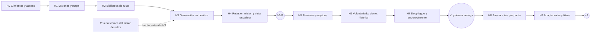

# OnWay — Documento 07: Plan de implementación por hitos

**Versión:** 0.6 · **Estado:** borrador para revisión · **Fecha:** 1 de noviembre de 2026
**Depende de:** 01 a 06
**Lo acompaña:** `CLAUDE.md` en la raíz del repositorio (resumen operativo, no copia de estos documentos)

---

## 1. Qué es este documento y qué no

Es la **hoja de ruta**: en qué orden se construye OnWay, qué incluye cada bloque, qué verás funcionando al terminarlo y cuándo se da por terminado.

No es una lista de tareas. Descomponer cada hito en tareas, asignarlas y revisarlas lo hacen tus agentes (coordinador, planner, implementer, reviewer). Aquí solo está lo que ellos necesitan como entrada y que no pueden deducir solos: el **orden**, el **límite** de cada hito, la **demostración** que lo valida y la **definición de terminado** común.

Dos reglas para no duplicar trabajo:
- El alcance de un hito se define por **identificadores** (RF, INV, operaciones del contrato, migraciones, bocetos), no por redacción. El planner los abre en los documentos 01 a 06.
- Si un hito exige cambiar una decisión de los documentos, se cambia el documento en la misma entrega y se anota en su registro de cambios.

---

## 2. Cómo se reparte el trabajo

**Principio:** cada hito es una **rebanada vertical** (base de datos, API, interfaz y datos de demostración) que termina en algo que tú puedes abrir y probar. Ningún hito entrega solo "infraestructura" sin una pantalla que enseñar, salvo el último de v1, que es el despliegue.

| Versión | Hitos | Qué es | Qué verás al final |
|---|---|---|---|
| **v1 · MVP** | H0–H4 | La historia central: un coordinador prepara una misión y una ruta validada, y un rescatista la consulta | Un recorrido completo de punta a punta, con cuentas de demostración |
| **v1 · completa** (primera entrega) | H5–H7 | Las personas: registro, perfiles, equipos, voluntariado, cierre con asistencia, historial, privacidad; y el despliegue | La app real, publicada |
| **v1 · segunda entrega** (D-21) | H8–H9 | Búsqueda de rutas por punto, adaptar rutas, filtro por habilidad | Reutilizar la biblioteca con inteligencia |
| **v2** | v2.1–v2.3 | Sin conexión, campo a través, apps móviles | Por detallar (sección 5) |
| **v3** | v3.1–v3.2 | GPS en vivo y avisos | Por detallar (sección 5) |

**Por qué este orden**
- **El riesgo grande va pronto y aislado.** El motor de rutas (R-01) es lo más incierto. La biblioteca de rutas (H2) funciona sin motor, importando y dibujando; así, si el motor da problemas, el MVP no se bloquea y siempre habrá algo que enseñar. La prueba técnica del motor se hace *en paralelo* a H1 y H2 para llegar a H3 con la decisión tomada.
- **Las personas llegan después del MVP**, aunque sean la base de la seguridad. Hasta H5 las cuentas son de demostración (administrador, coordinadores y rescatistas ficticios), pero el aislamiento por organización y los permisos por rol están activos desde H0, porque el modelo de datos ya los trae (documento 05).
- **El despliegue va al final de la primera entrega** (documento 04, AD-04): no se paga servidor durante la construcción. Cada hito se enseña en local con `docker compose up`.
- **Cada hito deja la rama principal en verde.** Se puede parar tras cualquiera y lo hecho sigue funcionando.

**Tamaño relativo** (no son fechas): S = pocos días, M = una o dos semanas, L = más de dos semanas o con incertidumbre alta.

---

## 3. Hitos de v1

Las operaciones de cada hito son las que llevan `x-milestone` con ese valor en el OpenAPI (generado desde `packages/contracts/src/milestones.ts`). La fila "Operaciones" indica cuántas son.

### H0 · Cimientos y acceso · S–M

**Objetivo:** que el proyecto arranque con un solo comando y que el carril completo (navegador, API, base de datos, permisos) funcione con una pantalla de acceso.

| | |
|---|---|
| **Demostración** | Clonar, `docker compose up`, iniciar sesión como administrador, coordinador y rescatista de demostración y ver tres menús distintos. Probar a abrir la dirección de otro rol: se rechaza (el rescatista que abre `/admin` ve «Sin acceso»). La cuenta pendiente solo ve la pantalla de espera. **Aislamiento:** la demostración lleva una sola organización; una segunda, creada por las pruebas (no forma parte de los datos de demostración), muestra que su administrador solo ve su organización y nada de la primera |
| **Alcance** | RF-101, RF-102, RF-103. Migraciones 0001–0009 aplicadas. Boceto 1 (solo inicio de sesión) y barra de navegación por rol (RF-702). Datos de demostración ficticios (R-10): **una** organización, un administrador, dos coordinadores, seis rescatistas con perfil incompleto (el perfil llega en H5), cuatro equipos y una cuenta pendiente de aprobación. La organización B del aislamiento la crean las pruebas |
| **Operaciones (5)** | `getHealth`, `login`, `logout`, `getMe`, `getOrganization` |
| **Qué se monta** | Monorepo, integración continua, contexto de transacción de la base de datos (`app.org_id`, `app.user_id`, `app.role`), sesión con cookie y CSRF, filtro de errores desde `ERROR_HTTP`, cliente generado desde el OpenAPI, esqueleto web con i18n (es, fr) y estados de carga, vacío y error |
| **Salida** | Las 118 pruebas de base de datos pasan **sobre PostGIS real** (hoy lo espacial está sustituido). Las 74 de contrato pasan con las dependencias reales. INV-01 e INV-25 comprobadas a través del API. CI en verde |
| **Fuera** | Registro, recuperar contraseña, perfiles |
| **Riesgos** | ~~PostGIS sin verificar~~ (resuelto: 118/118 sobre `postgis/postgis:16-3.4`). ~~Drizzle con seguridad por filas~~ (resuelto: el migrador aplica el SQL a mano y cada petición fija su contexto con `withContext`). ~~Instalar las dependencias reales~~ (resuelto) |

### H1 · Misiones y mapa · M

**Objetivo:** crear y activar una misión sobre un mapa, y que un rescatista la vea.

| | |
|---|---|
| **Demostración** | Como coordinador: crear una misión pinchando el objetivo en el mapa; añadir orígenes por coordenadas y por dirección, un punto intermedio y uno de reunión; cambiar de mapa satélite a topográfico y carreteras; ver en el inicio el tiempo, la luz y la luna del objetivo; activarla. Como rescatista: verla en su lista, sin rutas todavía. Cerrar y reabrir |
| **Alcance** | RF-201, 202, 203, 204, 205 (sin rutas ni voluntarios), 207, 208 (sin asistencia, aún no hay participantes), 301, 302, 304, 401–404, 601, 602 (sin rutas), 701, 702, 703, 704, 705, 708. Bocetos 3, 4, 5, 6, 8 (parcial) y 14 (parcial) |
| **Operaciones (18)** | `listCoordinators`, `geocode`, `getElevation`, `getEnvironment`, `listMissions`, `createMission`, `getMission`, `updateMission`, `duplicateMission`, `activateMission`, `closeMission`, `reopenMission`, `listMissionHistory`, `createMissionPoint`, `updateMissionPoint`, `deleteMissionPoint`, `listMyMissions`, `getMyMission` |
| **Salida** | INV-02, 08, 11, 16, 30. RN-07, 09, 16. El geocodificador solo consulta al pulsar buscar. Si cae el tiempo o la dirección, la pantalla se degrada sin romperse. Atribuciones de mapa visibles (documento 04, §8.5). Todo cambio escribe auditoría (INV-16) aunque la consulta llegue en H6 |
| **Fuera** | Rutas, voluntariado, importar puntos (H2), curvas de nivel (H9) |
| **Dependencias** | Q-26 (capas de IGN): si no se resuelve, se arranca con el mapa base abierto y se añade IGN después. Valores por defecto: Q-14 no (el administrador no escribe misiones), Q-31 el rescatista ve todas las activas de su organización, Q-32 sin punto base |
| **Riesgos** | R-06 (tiempo a la altitud del punto), servir el modelo de elevación de forma barata, R-04 (licencias) |
| **Tal como se construyó** | Las 18 operaciones montadas y probadas (`test:api`); mapa propio en `apps/web/src/map/` con tres capas (carreteras: PMTiles de los Pirineos servido por Caddy; satélite: PNOA e IGN Francia compuestos por tesela en el navegador porque IGN Francia responde teselas blancas fuera de su país; topográfico: mapas de IGN España y Plan IGN apilados), atribuciones siempre a la vista y el hueco de Andorra documentado (doc 04 §8). Altitud: GLO-30 de Copernicus local (servicio `geodata`, ~843 MB, caja lon −2…4 / lat 42…44) y Open-Meteo fuera de ella. Tiempo, luz y luna con Open-Meteo, SunCalc y caché por celda; la ubicación del dispositivo se redondea en el cliente y no se guarda. La demostración lleva 3 misiones ficticias (una por estado). Dependencias aprobadas: ESLint, typescript-eslint, maplibre-gl, react-map-gl, pmtiles, @protomaps/basemaps, geotiff y suncalc. Demostración como prueba E2E: `apps/web/e2e/h1-demo.spec.ts`, en escritorio y a 375 px, con la superposición `infra/compose.e2e.yml` (sin salir a Internet) |

### H2 · Biblioteca de rutas, sin motor · M

**Objetivo:** que la ruta sea un objeto completo: se importa o se dibuja, se mide, se versiona, se valida y se exporta.

| | |
|---|---|
| **Demostración** | Importar un GPX de ejemplo ficticio (inventado: nunca el recorrido de una persona ni de un servicio) de los Pirineos, ver la vista previa con métricas recalculadas por el servidor, guardarlo en Borrador. Editarlo a mano: se crea la versión 2. Compararlas. Validarla. Derivar una copia. Exportar. Explorar la lista y el mapa a la vez, filtrando por el área visible |
| **Alcance** | RF-405, 502, 504, 505, 506, 510, 511, 512, 516, 517, 519. Bocetos 9 y 10. Migración 0005 en uso. Almacenamiento de archivos tras el puerto `FileStorage` |
| **Operaciones (13)** | `uploadFile`, `importMissionPoints`, `listRoutes`, `createRoute`, `previewRouteImport`, `getRoute`, `archiveRoute`, `getRouteVersion`, `createRouteVersion`, `deriveRoute`, `validateRouteVersion`, `exportRoute`, `exportRoutes` (varias rutas en un solo archivo, RF-511) |
| **Salida** | INV-04 (inmutabilidad), 07, 15. Las métricas salen siempre del modelo propio de elevación (R-07), con pruebas contra GPX de referencia en `packages/geo`. Exportar e importar de nuevo da la misma geometría. Subida de archivos con validación de contenido y tamaño |
| **Fuera** | Generar y unir con caminos (H3), añadir a misión (H4), búsqueda por punto (H8) |
| **Riesgos** | R-07 (GPX ruidosos), precisión del modelo de superficie bajo arbolado (documento 04, §7.4) |
| **Tal como se construyó** | Las 13 operaciones montadas y probadas (`test:api`; 36 con las de H0 y H1). `packages/geo`: lectura de GPX y KML sin DTD ni entidades (con tope de tamaño, anidamiento y elementos), escritura sin autor, `prepareLine` (redondeo a 1 cm, depurado a 5 m, densificado a 30 m) y `computeMetrics` (mediana de 3, umbral de 3 m, ventana de pendiente de 60 m); exportar e importar da exactamente los mismos vértices. El servidor mide todo trazado (altitud en un solo lote por el `ElevationProvider`, un tramo «sin clasificar» hasta H3) y nunca usa la altitud ni las métricas de un archivo o del cliente. Archivos: `FileStorage` en disco (volumen `files`, clave aleatoria), tipo por contenido y tope de 10 MB. Biblioteca: `listRoutes` por área visible con el GiST (10 000 rutas, plan con `route_versions_geom_gix`), versiones inmutables con candado de fila, derivación, validación con aviso, archivo con INV-07. Semilla: 6 rutas ficticias de 10 GPX inventados. Web: biblioteca con lista y mapa, detalle con perfil SVG accesible y comparación, importar, dibujar y editar (solo vértices) e importar puntos en la misión. Dependencias aprobadas: `fast-xml-parser` y `@types/multer`. Demostración como prueba E2E: `apps/web/e2e/h2-demo.spec.ts` (escritorio y 375 px) |

### H3 · Generación automática de rutas · L

**Objetivo:** el corazón de la app. Dado un destino y uno o varios orígenes, el sistema propone varias rutas viables por la red existente.

| | |
|---|---|
| **Demostración** | Una misión con dos orígenes, uno a cada lado de la frontera, y un objetivo en montaña. Pulsar *Generar*, ver el progreso, recibir varias alternativas por origen con distancia, desnivel y composición (carretera, pista, sendero). Compararlas, guardar una. Dibujar una zona a evitar y regenerar: la ruta la esquiva. Dibujar una ruta a mano y que se pegue a los caminos |
| **Alcance** | RF-304 (rutas a través de la frontera), 501, 503, 507. Trabajos de cálculo con progreso (cola pg-boss, proceso *worker*). Puerto `RoutingProvider` con el motor elegido |
| **Operaciones (6)** | `generateRoutes`, `snapRoute`, `getJob`, `listAvoidZones`, `createAvoidZone`, `deleteAvoidZone` |
| **Antes de empezar** | **Prueba técnica cerrada el 2026-11-01** (documento 04, §7.6): motor **GraphHopper 11.1**, pesos del perfil en `poc/motor-rutas/graphhopper/mountain.json` y casos guardados en `poc/motor-rutas/cases/`. **Primera tarea de H3: alimentar el motor con el DEM de OnWay (GLO-30)**. Quedan para H3 la estrategia de alternativas (bloqueo), la revisión de los pesos por una persona que conozca las rutas y repetir el criterio de pendiente |
| **Salida** | INV-14. Los casos de la prueba técnica pasan como regresión. Un trabajo sobrevive a un reinicio del *worker*. `MISSION_HAS_NO_ORIGIN`, `NO_ROUTE_POSSIBLE`, `OUTSIDE_COVERAGE` y `ROUTING_UNAVAILABLE` se muestran con un mensaje útil. Con el motor caído, el resto de la app sigue (documento 04, §11.4). Memoria dentro del presupuesto de 8 GB |
| **Fuera** | Campo a través (v2.2), adaptar el tramo final (H9) |
| **Riesgos** | R-01 (calidad del motor), R-12 (memoria), perfil de montaña. Si el motor no alcanza la calidad: el MVP se entrega igualmente con H2 y se documenta la limitación |
| **Tal como se construyó** | Las 6 operaciones montadas y probadas (42 con las de H0 a H2). **Motor:** servicio `routing` (GraphHopper 11.1 con el perfil de `infra/routing/mountain.json`) y servicio de un solo uso `routing-data` (descarga la red de Geofabrik, la recorta con osmium y convierte el DEM de OnWay al formato del motor con `build-hgt`, de modo que el motor ve la misma altitud que mide OnWay); detrás del puerto `RoutingProvider` (documento 04, §5.2), con la estrategia de alternativas en el servidor. Sin red de caminos el motor queda en reposo y la API responde `ROUTING_UNAVAILABLE`. **Trabajos:** pg-boss 12 en el esquema `pgboss` (instalado por el migrador, sin migración SQL), envío transaccional, servicio `worker` (mismo código, otro punto de entrada, sin puertos), supervivencia a la muerte del *worker* probada con pg-boss real. **Zonas a evitar** de la organización con misión opcional (Q-05, resuelta). **Web:** vista `/routes/generate` (zonas, progreso, comparación con la composición), sección «Generar rutas» en la misión, y dibujar a mano uniendo los puntos a los caminos. **Pruebas:** `test:routing` (10, contra el motor real sobre la red inventada `data/seed/network.osm`, en el CI), `test:api` con INV-14 y los trabajos, y la demostración `h3-demo.spec.ts` (6 pruebas por proyecto, escritorio y 375 px) más `h3-engine-down.spec.ts` (con el motor parado). **Regresión con datos reales** (a mano o con el workflow `routing-regression`): los tres pares y el francés cumplen los 8 criterios (documento 04, §7.6). Desviaciones respecto al plan: *ajustar a los caminos* une los puntos con una ruta del motor y no usa `/match`; `createRoute` ganó `snapToPaths`; el límite de pendiente no se expone (el motor satura en 31 %); la misión de dos orígenes la crea el E2E por API y no está en la semilla; una alternativa no puede ser más de un 50 % más larga que la principal (tope fijado por el usuario al medir la regresión real). **Memoria de la pila completa con datos reales** (clon limpio, `docker stats` tras generar 3 rutas del Pirineo en 2 s): motor 1,83 GiB, API 79 MiB, *worker* 78 MiB, PostgreSQL 79 MiB, Caddy 24 MiB, unos 2,1 GiB en total; los topes de `compose.yml` suman 4,9 GiB, dentro de los 8 GB (R-12). La primera puesta en marcha tarda unos 35 minutos en esta conexión (relieve ~11 min, descarga de Geofabrik ~22 min, el recorte y el grafo, unos minutos); las siguientes, segundos. **Pendiente de una persona:** revisión de los pesos del perfil (`specs/H3-generacion-rutas/revision-pesos.md`) |

### H4 · Rutas en la misión y vista del rescatista · M — *cierra el MVP*

**Objetivo:** unir todo. El coordinador pone rutas validadas en la misión y el rescatista las consulta y las descarga.

| | |
|---|---|
| **Demostración (la historia completa)** | Coordinador: crea la misión, genera rutas, valida, las añade fijando la versión, compara, marca una como no disponible, activa (el sistema avisa si no hay ninguna validada). Rescatista, desde el móvil: abre la misión, ve las rutas validadas, descarga el GPX. El coordinador publica una versión nueva de una ruta: la misión sigue con la fijada y aparece el aviso de versión nueva |
| **Alcance** | RF-508, 513, 518, 601–603 completos, 604, 805 (parcial hasta H5). Bocetos 6, 11 y 14 completos |
| **Operaciones (9)** | `listMissionRoutes`, `addMissionRoutes`, `updateMissionRoute`, `removeMissionRoute`, `getMissionRouteGeometry`, `exportMissionRoutes`, `listMyMissionRoutes`, `getMyMissionRouteGeometry`, `exportMyMissionRoutes` |
| **Salida del MVP** | Prueba de extremo a extremo (Playwright) con la historia anterior. INV-03, 05, 06, 07, 13 y RN-13, RN-14. Un rescatista nunca recibe una versión sin validar ni una no fijada. Interfaz del rescatista usable en pantalla de móvil |
| **Fuera** | Alta de usuarios, perfiles, voluntariado, equipos (existen en los datos de demostración pero aún no se gestionan) |

> **Punto de control del MVP.** Tras H4 decides: seguir con H5, o corregir rumbo con lo que hayas visto. Es el momento más barato para cambiar de idea.

### H5 · Personas y equipos · M–L

**Objetivo:** que las cuentas dejen de ser de demostración: alta, aprobación, perfil protegido, habilidades y equipos.

| | |
|---|---|
| **Demostración** | Una persona nueva se registra con el código de invitación. El administrador la ve en solicitudes y la aprueba como rescatista. Ella completa su perfil (nombre, teléfono, documento y dirección) y añade un curso con certificado. Un coordinador ve su nombre y habilidades, pero ni documento ni dirección. El administrador crea un equipo y mete gente. Recuperar contraseña con el correo (Mailpit en local) |
| **Alcance** | RF-104, 105 (por consola), 106, 801, 806, 807, 808, 813, 805 (completo). Bocetos 1 (registro), 2, 12, 13 y 15 |
| **Operaciones (26)** | Registro y contraseñas (`register`, `forgotPassword`, `resetPassword`, `changePassword`, `updateMe`), administración (`listSignupRequests`, `decideSignupRequests`, `listUsers`, `getUser`, `updateUser`, `getInviteCode`, `rotateInviteCode`), perfil y habilidades (`getMyProfile`, `updateMyProfile`, `getMySensitive`, `listMySkills`, `createMySkill`, `updateMySkill`, `deleteMySkill`, `getCertificateLink`), equipos (`listTeams`, `createTeam`, `getTeam`, `updateTeam`, `addTeamMembers`, `removeTeamMember`) |
| **Salida** | INV-18, 23, 24, 25, 29, 31, 32. Cifrado AES-256-GCM con índice ciego del documento. Ningún listado devuelve datos personales (las pruebas de contrato lo impiden). Bloqueo por intentos y límite de peticiones. El correo sale por el puerto `Mailer` |
| **Fuera** | Enviar correo real a terceros (necesita dominio, Q-28; en H7) |
| **Riesgos** | Gestión de la clave de cifrado (documento 04, §10), RGPD aunque sea didáctico (R-10) |

### H6 · Voluntariado, cierre con asistencia, historial y privacidad · M

**Objetivo:** el ciclo completo de una misión con personas.

| | |
|---|---|
| **Demostración** | Un rescatista se ofrece a una misión activa. El coordinador acepta varios a la vez, añade un equipo entero y un rescatista suelto. Cierra la misión marcando quién participó. El historial del rescatista muestra solo los confirmados. El administrador lee un dato sensible y la lectura queda registrada. El rescatista ve quién consultó sus datos y borra los suyos: el historial se anonimiza |
| **Alcance** | RF-208 (completo), 605, 802, 803, 804, 809, 810, 812. Bocetos 7 y 8 completos |
| **Operaciones (17)** | `listRescuers`, `addMissionTeams`, `removeMissionTeam`, `listParticipations`, `getParticipationCard`, `addParticipants`, `bulkParticipations`, `listAttendanceCandidates`, `offerToMission`, `withdrawOffer`, `listMyHistory`, `listMyAccessLog`, `deleteMyData`, `exportMyData`, `readUserSensitive`, `listUserHistory`, `listAuditLog` |
| **Salida** | INV-09, 10, 12, 19, 20, 21, 22, 26, 27, 28. RN-21: la lista de voluntarios solo lleva nombre, equipo y localidad. "Quitar" exige confirmar con el número de afectados. Una acción en bloque sobre una selección grande es atómica |
| **Riesgos** | Reglas de visibilidad con muchos matices (INV-28): cada una con su prueba |

### H7 · Cierre de la primera entrega: despliegue y endurecimiento · M

**Objetivo:** pasar de "funciona en mi máquina" a "está publicada y se puede confiar en ella".

| | |
|---|---|
| **Demostración** | Una dirección pública con HTTPS donde entrar con las cuentas de demostración. Se instala en el móvil como aplicación web. Se restaura una copia de seguridad en una base vacía y la app arranca |
| **Alcance** | Contratar el servidor (Q-27, Hetzner 8 GB) y el dominio (Q-28). Caddy, copias cifradas externas y restauración ensayada, observabilidad mínima, correo real con dominio verificado, cabeceras y límites de seguridad, revisión con la lista de comprobación de seguridad, accesibilidad básica, textos en francés completos, aviso de que no sirve para rescates reales (R-03), README con aviso de datos ficticios (R-10) |
| **Operaciones (0)** | Ninguna nueva |
| **Salida** | Todas las pruebas de invariantes y la de extremo a extremo en la integración continua. Copia restaurada con éxito. Coste real dentro de 20 €/mes. Aplicación web instalable (documento 04, §13) |

### H8 · Buscar rutas por punto · S — *segunda entrega*

**Demostración:** al fijar el objetivo, la app muestra primero las rutas ya validadas que pasan cerca, con distancia al punto. **Alcance:** RF-514. **Operaciones (1):** `listNearRoutes`. **Salida:** respuesta en menos de 2 s con 10.000 rutas sintéticas (documento 05, §12). **Ya preparado:** el índice espacial existe desde la primera migración.

### H9 · Adaptar rutas y lo que quede · M — *segunda entrega*

**Demostración:** tomar una ruta de la biblioteca, cortarla en un punto y recalcular solo el tramo final hasta el objetivo de la misión actual; guardarla como derivada. Filtrar voluntarios por habilidad. **Alcance:** RF-515, RF-811 (es un parámetro de `listParticipations`, no una operación nueva) y lo que quede de Should y Could: RF-206 (ficha exportable), 303 (curvas de nivel), 706, 707. **Operaciones (1):** `adaptRoute`.

---

## 4. Definición de terminado (común a todos los hitos)

Es la lista que usa el *reviewer*. Un hito no se cierra si falla un punto.

| # | Criterio |
|---|---|
| 1 | **La demostración del hito se puede ejecutar** con `docker compose up` y los datos de demostración, y está escrita como prueba de extremo a extremo |
| 2 | **Contrato primero.** Cualquier cambio de esquema pasa por `packages/contracts`, y en el mismo cambio se regeneran el OpenAPI y las tablas del documento 06. Solo se monta lo asignado al hito |
| 3 | **Una prueba por cada invariante** (INV-xx) del alcance, contra base real. Nada se da por cumplido por revisión de código |
| 4 | **Aislamiento y permisos.** Cada petición abre su transacción con el contexto de organización, usuario y rol. Un recurso de otra organización responde 404. Ninguna consulta se salta la seguridad por filas |
| 5 | **Datos personales.** Ningún listado devuelve datos personales; documento y dirección solo salen por la función auditada. Las pruebas de contrato siguen verdes |
| 6 | **Lo externo detrás de un puerto.** Mapas, tiempo, geocodificación, elevación, rutas, correo, archivos y reloj no se llaman directamente desde el dominio |
| 7 | **Geometría fuera de la interfaz.** La lógica de rutas y geometría vive en `packages/geo` o en el servidor, nunca en componentes de React (portabilidad a móvil) |
| 8 | **Interfaz completa.** Cada vista tiene estados de carga, vacío y error, textos por `packages/i18n` (es y fr), funciona en pantalla de móvil y se maneja con teclado |
| 9 | **Errores.** Solo los códigos de `ERROR_HTTP`, con el formato único. Un código nuevo se añade al contrato, a las pruebas y al documento 06 |
| 10 | **Datos de demostración ficticios** y actualizados para que la demostración del hito funcione. Ningún secreto en el repositorio |
| 11 | **Documentos al día.** Si el hito cambió una decisión, se cambió el documento y su registro de cambios. Las preguntas resueltas se tachan |
| 12 | **Marcha atrás posible.** La rama principal compila, pasa las pruebas y arranca tras el hito |

---

## 5. Después de v1 (bosquejo, sin compromiso)

Cada bloque tendrá su propio documento de diseño cuando llegue su turno. Aquí solo el orden previsto y lo que hay que resolver antes.

| Bloque | Contenido | Antes de empezar | Notas |
|---|---|---|---|
| **v2.1 · Sin conexión** | Descargar mapas y misiones; trabajar sin red; sincronizar al volver | Q-26: qué permiten las licencias de IGN para teselas sin conexión. Elegir formato de mapa descargable | Es la razón de ser de la app móvil, por eso va primero |
| **v2.2 · Campo a través** | Tramos sin camino por superficie de coste sobre el modelo de elevación, pendiente, cobertura del suelo y obstáculos | Prueba técnica aparte (R-01, R-12). Decidir si se añade un servicio en Python tras `RoutingProvider` | Independiente de v2.1; se puede intercambiar el orden |
| **v2.3 · iOS y Android** | Envolver la web (Capacitor) o app nativa (Expo) | Decisión con v2.1 delante (documento 04, §13). Autenticación por token | Los contratos y `packages/*` ya están preparados |
| **v3.1 · GPS en vivo** | Posición de los equipos en el mapa | Revisar INV-30 y RN-26: hoy la ubicación no se guarda. Consentimiento | Cambia el modelo de privacidad |
| **v3.2 · Avisos y cambios en vivo** | Notificaciones push o por correo; ruta cambiada en vivo | Canal de tiempo real | Hoy fuera de alcance (documento 01) |

---

## 6. Qué decisiones y verificaciones pendientes bloquean qué

| Pendiente | Bloquea | Mientras tanto |
|---|---|---|
| ~~PostGIS real~~ | ~~H0 (primera tarea)~~ | **Resuelto en H0**: 118/118 sobre `postgis/postgis:16-3.4` |
| ~~Prueba técnica del motor~~ | ~~H3~~ | **Resuelta (2026-11-01):** GraphHopper 11.1, con Valhalla como plan B (documento 04, §7.6). Quedan sus condiciones para H3 |
| ~~Q-26 capas de IGN y licencias~~ | ~~mejora de H1~~ | **Resuelto en H1 (2026-10-31):** capas, formatos y licencias verificados (doc 04 §8.2). Abierta solo la parte de teselas sin conexión (v2.1) |
| ~~Q-14 el administrador escribe misiones~~ | ~~H1~~ | **Resuelto (2026-10-31): no.** Lo decide el servidor (`MISSION_WRITERS`) y, en profundidad, la base de datos (migración 0011) |
| Q-31 qué misiones ve el rescatista | H1 | Todas las activas de su organización |
| Q-32 punto base para el tiempo | H1 | Sin punto base: si deniega la ubicación, se pide elegir un punto |
| Q-28 dominio | H7 | Desarrollo con Mailpit y sin HTTPS público |
| ~~Q-05~~ | ~~H3~~ | **Resuelta (2026-11-01):** las zonas a evitar son de la organización, con misión opcional; las ve el personal (documento 01) |
| Q-04, Q-06, Q-21 | Detalles de H1–H4 | Valores por defecto del documento 02: puntos de reunión con nombre, ubicación y notas; sin etiquetas |
| Revisión de los pesos del perfil de montaña (P6) | Dar H3 por buena para uso real; no bloquea el desarrollo de H4 | Los pesos de la prueba técnica; hoja de revisión en `specs/H3-generacion-rutas/` |

---

## 7. Cómo usar este documento con tus agentes

Una entrada tipo para el coordinador:

> Implementa el hito **H2** del documento 07. Su alcance son los identificadores de la sección 3 y las operaciones con `x-milestone: H2` en el OpenAPI. Cumple la definición de terminado de la sección 4. No montes operaciones de otros hitos. Si algo contradice los documentos 01 a 06, para y pregunta.

- El **planner** descompone el hito en tareas leyendo los documentos que cita.
- El **implementer** trabaja contra el contrato y las pruebas ya escritas.
- El **reviewer** usa la sección 4 como lista y comprueba la demostración.
- Un hito por vez. Si un hito resulta demasiado grande para un ciclo, se parte por demostración (por ejemplo, H5 en "registro y aprobación" y "perfil y equipos"), no por capa técnica.

---

## 8. Registro de cambios

| Versión | Fecha | Cambio |
|---|---|---|
| 0.6 | 2026-11-01 | H3 (sección 3) al día tras construirlo (T10): fila «Tal como se construyó» con el motor, los trabajos, las desviaciones y la regresión real; Q-05 resuelta y la revisión de los pesos (P6) anotada como pendiente en la sección 6 |
| 0.5 | 2026-11-01 | Prueba técnica del motor cerrada (documento 04, §7.6): H3 «Antes de empezar» con el motor elegido (GraphHopper 11.1) y su primera tarea (alimentar el motor con el DEM de OnWay) y la fila de la sección 6 resuelta |
| 0.4 | 2026-10-31 | H2 (sección 3) al día tras construirlo (T10): «GPX de ejemplo ficticio» en lugar de «GPX real» (decisión P2: ningún track procede de un servicio público ni de una persona), 13 operaciones con `exportRoutes` (P3) y la fila «Tal como se construyó» |
| 0.3 | 2026-10-31 | Q-14 resuelta (no): el administrador no escribe misiones (H1-T6; documentos 01 y 02 actualizados). H1 (sección 3) al día tras construirlo (T10): fila «Tal como se construyó» con las capas de IGN, `geodata`, las tres misiones de demostración, las dependencias aprobadas y la demostración como prueba E2E; Q-26 (sección 6) resuelta en lo de H1 |
| 0.2 | 2026-10-30 | H0 (sección 3) al día tras construirlo: la demostración lleva una sola organización (decisión D-H0-18), con una cuenta pendiente y rescatistas con perfil incompleto hasta H5; el aislamiento entre organizaciones se demuestra con una organización creada por las pruebas. Riesgos de H0 y «PostGIS real» (sección 6) marcados como resueltos |
| 0.1 | 2026-10-30 | Primera versión: diez hitos de v1 (H0–H9) con MVP en H0–H4, bosquejo de v2 y v3, definición de terminado común. Cada operación del contrato tiene hito (`milestones.ts`, 74 pruebas) |
